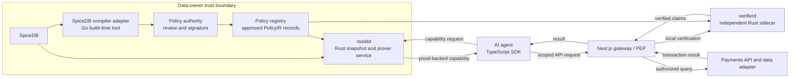
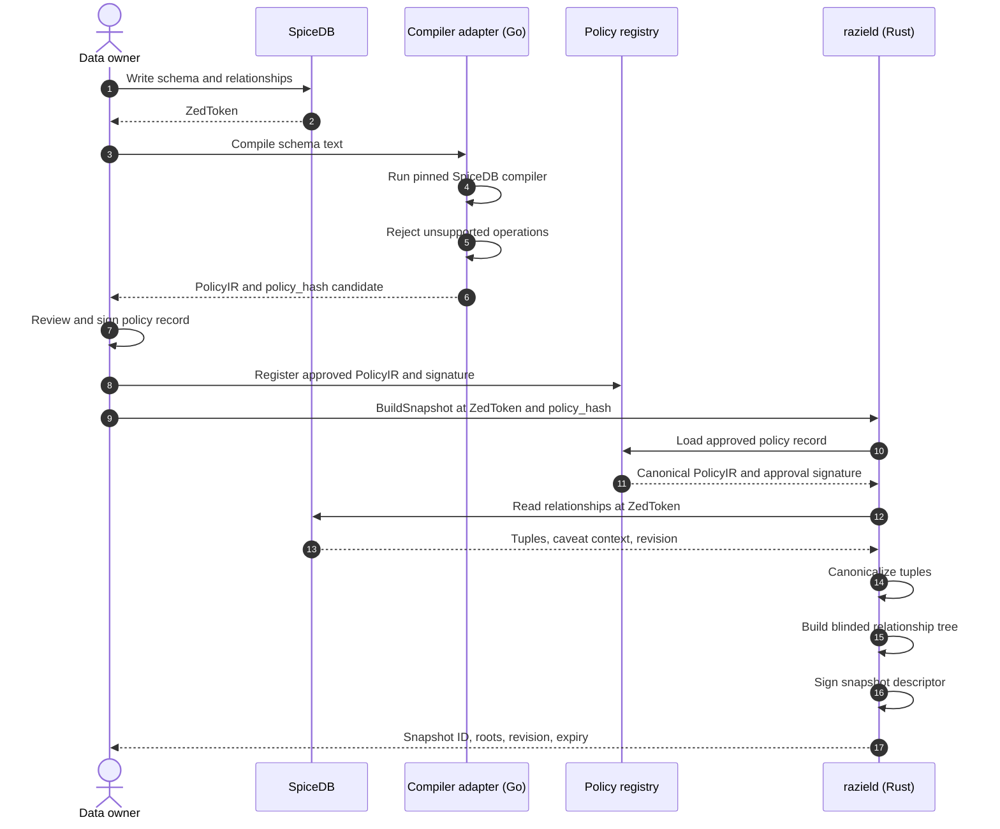
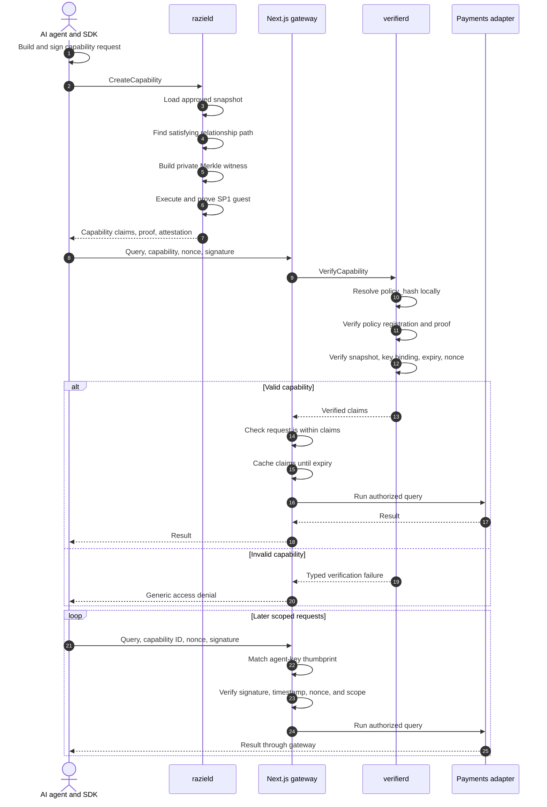

# Raziel PoC Architecture

Status: proposed baseline for implementation

Last updated: 2026-07-16

## Human-readable overview

### What we are building

Raziel is a proof-carrying authorization layer around SpiceDB for AI-agent data access.

SpiceDB remains the source of relationship state and permission-schema semantics. A
data-owner policy authority approves the canonical PolicyIR used by the verifier.
Raziel converts an `ALLOW` decision into cryptographic evidence that an independent
enforcement point can verify. The enforcement point does not need to trust an `ALLOW`
response from `razield`.

The first working scenario is payment reconciliation:

- A human principal receives access through a SpiceDB relationship path.
- The principal delegates a narrow task to an AI agent.
- SpiceDB stores a caveated, task-scoped agent grant.
- Raziel commits the approved policy and relationship snapshot.
- Raziel proves that the committed policy and snapshot authorize a capability scope.
- A separate verifier checks the proof without calling the prover.
- A gateway reuses the verified capability for rapid, bounded transaction queries.

The end-to-end demo must process a real, provenance-recorded transaction dataset.
Hand-written or generated transaction rows do not satisfy the demo acceptance gate.
Small fixtures remain valid for unit, adversarial, and equivalence tests.

### The key distinction from a signed token

A signed JWT says:

> A trusted issuer claims that this agent has permission.

A Raziel capability says:

> This approved policy and committed relationship snapshot evaluate to `ALLOW` for
> this capability scope, and this proof verifies that computation.

The policy authority signs the approved policy record. The snapshot authority signs
the relationship descriptor. Those signatures establish provenance. The ZK proof
establishes correct computation. The PoC can use one administrative owner with separate
key identifiers, but the protocol keeps the roles distinct.

### Baseline privacy model

| Boundary | Visible information |
| --- | --- |
| Public | Interpreter semantics, supported SpiceDB subset, capability format, proof system |
| Independent verifier and auditor | Exact approved PolicyIR, policy version, `policy_hash` |
| AI agent | `policy_hash`, public scoped claims, relationship snapshot root, expiry, proof |
| Raziel only | Relationship tuples, selected path, stored caveat context, Merkle openings |

The capability never carries the PolicyIR. The verifier resolves `policy_hash` in a
trusted local policy registry. The agent has no policy-registry or relationship-read
access.

Fully private PolicyIR is a later experiment. It is not part of the baseline PoC.

### Goals

1. Prove an `ALLOW` authorization against committed policy and relationship state.
2. Let an independent verifier validate that proof without calling `razield`.
3. Keep the relationship graph, satisfying path, caveat values, and Merkle openings private.
4. Bind the result to an agent key, task, purpose, action, resource scope, and expiry.
5. Reuse one verified capability for bounded rapid I/O until expiry.
6. Match SpiceDB for every operation in the supported PolicyIR subset.
7. Run the complete stack in Linux containers on an Apple Silicon development machine.
8. Complete the payment-reconciliation flow against a real transaction dataset.
9. Make new scenarios repeatable without changing proof-system code.

### Non-goals for the first PoC

- Full SpiceDB language compatibility.
- Proofs of `DENY`.
- Exclusion or authenticated non-membership.
- Recursive permissions or unbounded graph traversal.
- Wildcards, maps, lists, IP helpers, regex, or arbitrary CEL functions.
- Live SpiceDB Watch synchronization.
- Private dataset discovery or relevance proofs.
- Cumulative query privacy budgets.
- Production key management, availability, or security claims.
- External prover networks that receive private witnesses.
- A proof of the historical correctness of delegation issuance.

## System context



The `verifierd` process must never call `razield`. That invariant keeps proof
verification separate from issuer trust.

## Main components

| Component | Language | Responsibility | Must not do |
| --- | --- | --- | --- |
| `apps/demo-console` | Next.js and TypeScript | Human workflow, task creation, snapshot status, proof inspection, audit view | Evaluate authorization or hold graph secrets |
| `apps/demo-gateway` | Next.js route handlers and TypeScript | PEP, agent request authentication, scope checks, capability cache, payments API facade | Trust an unsigned `ALLOW` response |
| `packages/sdk-ts` | TypeScript | Agent key handling, capability request, proof-capability transport, request signing | Receive PolicyIR or graph data |
| `services/razield` | Rust | Snapshot orchestration, witness construction, SP1 proving, capability issuance | Act as the independent verifier |
| `services/verifierd` | Rust | Policy-registry lookup, proof verification, snapshot checks, claim validation | Call `razield` or read private graph data |
| `programs/authorization-guest` | Rust and SP1 | Check commitments, Merkle membership, PolicyIR evaluation, caveats, capability claims | Perform network or filesystem I/O |
| `crates/proto` | Rust | Compile generated Protobuf message contracts for Rust components | Define canonical commitment bytes |
| `crates/policy-ir` | Rust | PolicyIR types, validation, bounded evaluator | Parse arbitrary SpiceDB text |
| `crates/canonical` | Rust | Domain-separated canonical encodings and commitments | Hash raw Protobuf serialization |
| `crates/snapshot` | Rust | Tuple leaves, blinded Merkle tree, descriptor signing | Decide authorization |
| `crates/witness` | Rust | Find positive paths and build Merkle openings | Produce `DENY` proofs |
| `tools/spicedb-ir-compiler` | Go | Run SpiceDB's compiler and translate its protos into PolicyIR | Make runtime decisions or perform cryptography |
| `proto/raziel/v1` | Protobuf | Stable RPC and artifact contracts | Define canonical cryptographic bytes |
| `examples/reconciliation` | Schema and adapters | Payment scenario policy, source manifest, field mapping, demo configuration | Contain generated acceptance data |

## Why this stack

### One polyglot monorepo

The PolicyIR schema, SP1 guest, public values, verifier, Protobuf contracts,
TypeScript SDK, and test vectors form one compatibility unit. One repository lets a
single change update and test that unit atomically.

Repository separation comes later, after the proof format and API reach a stable,
versioned boundary.

### TypeScript and Next.js

TypeScript is the primary product and integration language. Next.js with the App
Router supplies the human demo console and protected gateway routes. The browser
does not call the Rust prover directly. Server-side TypeScript uses generated RPC
clients.

### Rust and SP1

Proof-critical semantics live in Rust. The host evaluator and SP1 guest share the
same PolicyIR types and pure evaluation code where the target permits it. This
reduces host-versus-guest semantic drift.

### A small Go compiler adapter

SpiceDB's maintained schema compiler is written in Go and returns compiled
namespace and caveat Protobuf definitions. A small pinned adapter converts those
definitions into Raziel's bounded PolicyIR. Reimplementing the SpiceDB parser in
Rust would place avoidable risk at the policy boundary.

The adapter is a build-time or snapshot-publication tool. It is not a long-running
runtime service.

### Protobuf and Buf

Protobuf defines RPC and artifact shapes. Buf generates Rust and TypeScript code,
lints the schema, and detects breaking API changes.

Protobuf bytes are not canonical cryptographic bytes. `crates/canonical` defines
every commitment encoding explicitly and publishes cross-language test vectors.

### Independent verifier sidecar

The first verifier is a Rust sidecar. This avoids making Node native-module or WASM
packaging a blocker. A later packaging spike can expose the Rust verifier through
N-API or WASM after proof format and platform compatibility are measured.

## Administrative snapshot sequence



`razield` cannot mark a policy as approved. It can submit or consume a candidate, but
`verifierd` accepts only a policy record signed by the configured policy authority.

## Capability and request sequence



## Core data commitments

### Policy commitment

The approved baseline keeps PolicyIR visible to the verifier and auditor. The agent
sees only its hash.

```text
policy_hash = H(
  "raziel/policy/v1",
  canonical_policy_ir
)
```

The policy registry stores the canonical PolicyIR, version, status, validity window,
approver identity, and authority signature. `verifierd` recalculates `policy_hash`
before accepting the record.

### Relationship leaf

```text
relationship_leaf = H(
  "raziel/relationship-leaf/v1",
  snapshot_secret_salt,
  resource_type,
  resource_id,
  relation,
  subject_type,
  subject_id,
  subject_relation,
  caveat_name,
  canonical_stored_caveat_context
)
```

The private snapshot salt reduces dictionary attacks against small, guessable
relationship sets. The root and signed descriptor remain public.

### Relationship snapshot descriptor

```text
RelationshipSnapshotDescriptor {
  snapshot_id
  relationship_snapshot_root
  policy_hash
  spicedb_revision
  epoch
  issued_at
  expires_at
  canonicalization_version
  signing_key_id
  authority_signature
}
```

The root commits one relationship snapshot. It does not track requests, prove
freshness by itself, or establish that SpiceDB contained the tuples. The snapshot
authority signature attests that provenance. Expiry and the verifier's accepted-root
registry control freshness and revocation.

### Capability request commitment

```text
capability_request_commitment = H(
  "raziel/capability-request/v1",
  agent_key_thumbprint,
  task_id,
  purpose,
  action,
  resource_type,
  resource_scope,
  requested_expiry,
  issuance_nonce
)
```

The proof binds an authorization envelope, not each transaction query. The gateway
checks that every API request remains inside the proven envelope.

## PolicyIR baseline

The first PolicyIR supports:

- direct relationship references
- subject-set relationships
- union
- intersection
- one bounded arrow
- named caveats
- string, integer, and Boolean values
- equality and ordered integer comparisons
- Boolean `and`, `or`, and `not`
- explicit evaluator limits

The first PolicyIR rejects:

- exclusion
- recursion
- wildcards
- unbounded traversal
- floating-point values
- maps and lists
- IP and regex helpers
- arbitrary CEL functions
- unknown or extension fields

The compiler must fail closed. It must never approximate an unsupported SpiceDB
operation.

## Capability token model

The capability is a Protobuf artifact transported as binary gRPC data or a base64url
HTTP value. It is not a JWT in the baseline.

```text
ProofCapability {
  format_version
  capability_id
  agent_key_thumbprint
  task_id
  purpose
  action
  resource_type
  resource_scope
  policy_hash
  relationship_snapshot_root
  snapshot_id
  capability_request_commitment
  issuance_nullifier
  issued_at
  expires_at
  proof_system
  verification_key_id
  zk_proof
  snapshot_attestation
}
```

The agent signs a versioned, length-prefixed protected-request envelope:

```text
ProtectedRequestSignatureInput {
  format_version = 1
  capability_id
  request_method
  canonical_request_target
  request_body_hash
  request_nonce
  request_timestamp
}
```

The canonical target binds the normalized path and query parameters. Every protected
request carries the agent public key. The gateway recomputes its thumbprint and matches
the capability claim before signature verification. Cold requests pass the same
envelope to `verifierd`. Cache hits verify the envelope in the gateway and skip only
proof verification. [ADR-0002](docs/decisions/0002-protected-request-signature-envelope.md)
defines the proposed canonical rules.

The issuance nullifier controls duplicate or conflicting capability issuance. It is
not consumed on first use. The request nonce prevents replay of individual calls.

## Repository layout target

```text
apps/
  demo-console/               Next.js human console
  demo-gateway/               Next.js PEP and payments routes
packages/
  sdk-ts/                     agent SDK
  proto-ts/                   generated TypeScript contracts
services/
  razield/                    Rust prover service
  verifierd/                  Rust verifier sidecar
crates/
  canonical/
  policy-ir/
  snapshot/
  witness/
  prover/
  verifier/
programs/
  authorization-guest/       SP1 program
tools/
  spicedb-ir-compiler/        Go CLI
proto/
  raziel/v1/
examples/
  reconciliation/
tests/
  vectors/
  e2e/
docs/
  agent/
  decisions/
  spec/
```

## Architecture invariants

The canonical list is [the 16-item repository invariant
set](AGENTS.md#architecture-invariants). It is part of this architecture by reference.
No shortened list replaces it. A proposed change needs a decision record and explicit
maintainer approval.

## Security and trust limits

The baseline proves correct evaluation against committed inputs. It does not prove:

- that the source application wrote correct relationships to SpiceDB
- that the snapshot authority read SpiceDB correctly
- that human delegation policy was lawful or well-governed
- that an allowed query is free from inference risk across many calls
- that a compromised gateway will enforce capability scope
- that a stolen snapshot signing key has not issued a malicious root

These limits belong in demo and research reporting. They must not be hidden behind a
general claim of trustlessness.

## Agent-oriented implementation dump

### Source-of-truth order

1. `AGENTS.md` for repository operating rules.
2. `docs/agent/CURRENT-BATON.md` for active work state.
3. `ARCHITECTURE.md` for boundaries and invariants.
4. `docs/spec/POC-TECHNICAL-SPEC.md` for implementation requirements.
5. Protobuf files for wire contracts.
6. Rust canonical and PolicyIR crates for cryptographic semantics.
7. Scenario documents for domain mapping.

If prose conflicts with executable tests, stop and record the mismatch. Do not silently
change cryptographic semantics to satisfy one test.

### Trust-zone ownership

| Zone | Reads secrets | Produces trusted artifact |
| --- | --- | --- |
| SpiceDB and snapshot builder | Schema, relationships, stored caveat context | Signed snapshot descriptor |
| `razield` | Snapshot data, private path, openings | ZK proof and capability |
| Policy authority and registry | Candidate schema, approved canonical PolicyIR | Signed policy record |
| `verifierd` | Approved PolicyIR, public proof values | Verified claims or typed failure |
| Gateway | Public claims, request body, cache | Enforced API decision and audit receipt |
| Agent | Public capability and its own private key | Signed capability and API requests |

### Required public values from the SP1 guest

```text
AuthorizationPublicValues {
  format_version
  policy_hash
  relationship_snapshot_root
  capability_request_commitment
  decision = ALLOW
  capability_scope_hash
  issued_at
  expires_at
  issuance_nullifier
}
```

No private tuple, path identifier, caveat value, or Merkle sibling may enter public
values or logs.

### Host and guest split

Host responsibilities:

- resolve the requested policy and snapshot
- search for one satisfying positive path
- collect every relationship leaf and Merkle opening
- collect stored and request-time caveat inputs
- enforce size and depth limits before proving
- supply private and public inputs to SP1
- package proof output without reinterpreting `ALLOW`

Guest responsibilities:

- validate version and limit fields
- recompute `policy_hash`
- verify every Merkle membership path
- evaluate the bounded PolicyIR
- evaluate the bounded caveat IR
- bind agent, task, purpose, action, resource scope, nonce, and expiry
- commit `ALLOW` and the exact public values
- fail on malformed, unused, ambiguous, or excess witness data

Verifier responsibilities:

- resolve `policy_hash` in the local registry
- validate policy status, signature, and validity window
- validate snapshot authority, root status, and expiry
- verify the SP1 proof against the selected verification key
- compare public values with capability claims
- validate agent key binding and request anti-replay data
- return claims, never an unexplained Boolean

### Positive-proof constraint

The first guest proves only `ALLOW`. It receives the positive relationships needed by
the supported expression. Intersection requires positive evidence for both branches.
Union requires one valid branch. The compiler does not emit exclusion nodes.

`DENY` responses come from failed proof creation or verification and carry no ZK proof.
User-facing denials remain generic. Internal logs use typed reason codes without graph
paths or policy explanations.

### Real-data acceptance boundary

The reconciliation acceptance run must have:

- a named external or user-provided source
- source URL or custody record
- license or usage basis
- retrieval date
- file checksum
- immutable raw-data location outside generated build output
- documented column mapping
- redaction and secret-scanning check
- deterministic import command
- recorded row count and schema fingerprint

Tests can use minimal fixtures under `tests/fixtures`. Product screenshots, performance
claims, and acceptance reports must state which data source they used.

### Scenario extension rule

A new scenario adds domain configuration and adapters. It must not fork the proof guest.
See `docs/spec/SCENARIO-AUTHORING.md` and the `raziel-scenario` repo skill.

### Completion gates

Architecture work is complete only after:

- all Mermaid blocks parse
- every referenced file exists
- public and private fields agree across architecture, spec, and Protobuf
- the baton records exact next work

Implementation work is complete only after:

- unit and integration tests pass
- SpiceDB-versus-PolicyIR equivalence tests pass
- a valid proof verifies in `verifierd`
- altered policy hash, root, scope, proof, expiry, and signature each fail
- `verifierd` completes with `razield` stopped
- cached capability requests remain inside scope
- the real-data reconciliation journey completes end to end
- benchmark output records execution, proving, verification, proof size, and cache latency
