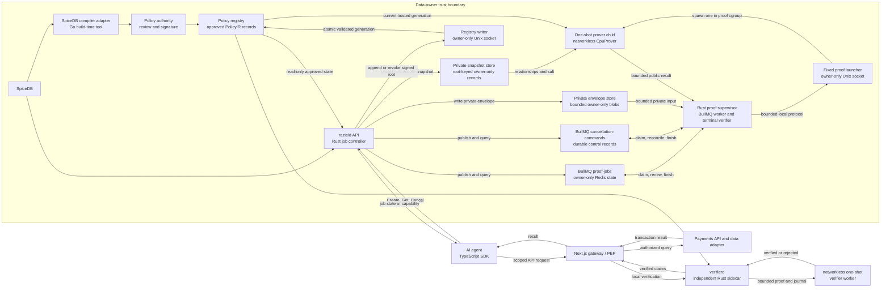
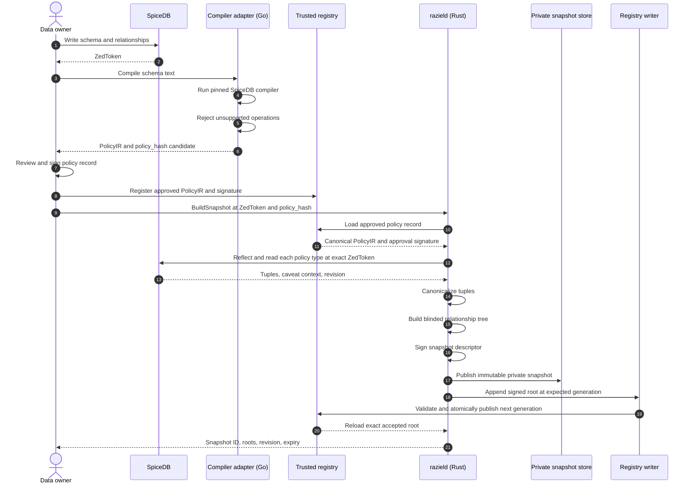
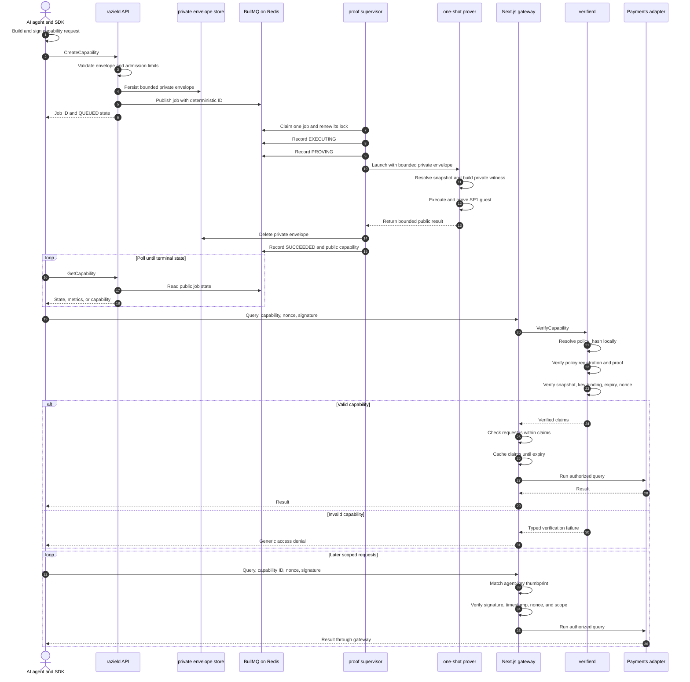

# Raziel PoC Architecture

Status: M0 through M5 validated; M6 services and M7 agent features implemented locally

Last updated: 2026-10-08

## Human-readable overview

### What we are building

Raziel is a proof-carrying authorization layer around SpiceDB for AI-agent data access.

SpiceDB remains the source of relationship state and permission-schema semantics. A
data-owner policy authority approves the canonical PolicyIR used by the verifier.
Raziel converts an `ALLOW` decision into cryptographic evidence that an independent
enforcement point can verify. The enforcement point does not need to trust an `ALLOW`
response from `razield`.

The first working scenario is payment reconciliation:

- A human principal receives access through a SpiceDB relationship path.
- The principal delegates a narrow task to an AI agent.
- SpiceDB stores a caveated, task-scoped agent grant.
- Raziel commits the approved policy and relationship snapshot.
- Raziel proves that the committed policy and snapshot authorize a capability scope.
- A separate verifier checks the proof without calling the prover.
- A gateway reuses the verified capability for rapid, bounded transaction queries.

The revised demo uses seeded and portal-created synthetic processor and bank ledgers.
Each external agent requests access through the public SDK, receives its own real
Plonk capability, and queries its permitted dataset. The operator reviews requests in
a third dashboard. Real-data acceptance is deferred under
[ADR-0019](docs/decisions/0019-public-sdk-and-two-agent-reconciliation.md), not completed.

### Current implementation status

| Milestone | Current state | Durable evidence |
| --- | --- | --- |
| M0 | Complete | Repository, pinned toolchain, contracts, and process shells |
| M1 | Complete | Strict SpiceDB compiler adapter, PolicyIR evaluator, and live equivalence |
| M2 | Complete | Canonical commitments, blinded snapshots, authority signatures, and local registries |
| M3 | Complete | Real local Plonk proof, independent verification, mutation checks, and public benchmark |
| M4 | Complete | Signed API request, BullMQ job, private witness assembly, local Plonk proof, terminal capability, independent verification, mutation rejection, and public service-flow report |
| M5 | Complete | Live synthetic desktop flow from dataset and visual policy authoring through Plonk capability issuance, verifier and cache queries, denial controls, and receipt export |
| M6 | In progress | Registration, inbox, policy publication, snapshot preparation, serial dispatch, signature acceptance, and terminal retention pass local checks. Packaged SDK signing, polling, and cold/cache query delivery pass. SDK 0.1.0 is publicly published with verified registry metadata, latest tag, and archive integrity. Live VM proof validation remains pending |
| M7 | In progress | Two agent dashboards, persistent identities, SDK task flows, bounded messages, LLM tools, and synthetic ledger seeding are implemented. The connected two-proof VM demonstration remains pending |

The previous M6 real-data and M7 scenario-extension objectives are deferred. Dated
evidence keeps its original milestone labels. The
[M6-M7 plan](docs/spec/M6-M7-AGENT-DEMO-PLAN.md) defines the new feature order.
The concrete [agent API contract](docs/spec/AGENT-API-V1.md) and
[ADR-0020](docs/decisions/0020-agent-api-and-request-provisioning.md) are approved.
B-0064 implements signed caller authentication and the SDK foundation. B-0065 now
supports request creation, exact retries, own-request reads, rejection, and cancellation.
Operator approval passes the connected browser and packaged-SDK HTTP check.
Private request preparation passed against real SpiceDB and the snapshot authority.
It pins the approved package and exact revision, and retries reuse the same signed
snapshot. B-0066 now provides a separate `razield-access-dispatch` executable with
the existing BullMQ worker at concurrency one. It reserves a durable request before
preparation and exposes a 120-second issuance-signature proposal. An offline signer
releases capacity into `WAITING_FOR_AGENT` and must explicitly resume. This worker
is not yet composed into the preview. The issuance endpoint accepts the registered
agent's exact proposal signature through the existing Rust admission boundary.
It persists the nonce/signature comparator and deterministic job ID in owner-only
storage before publishing `SUBMITTING`. Recovery checks that write before applying
the signature deadline. Private context is reused from the immutable intent, never
copied into Redis or echoed. The dispatcher now records submission start before its
CapabilityService RPC, reads the deterministic job before any exact resend, and
blocks resends during cancellation. Unknown publication remains unresolved.
Validated terminal public results commit with workflow capacity release in Redis.
Detail reads retain the capability independently of proof-queue retention. Lists
omit capability bytes. This path has controlled proof-service tests, not a new real
proof run. The sibling SDK now resumes requests, signs exact proposals through a
caller-owned signer, and submits retained attempts. Bounded polling returns actionable
and terminal states. Protected queries retain the capability and refresh both request
signatures. The packaged SDK passes a cold/cache gateway check with a controlled
proof-verifier response. It does not claim a new real proof. The existing preview
has not been restarted or upgraded.
The owner API allocates durable family/version identities and compiles namespaced
candidates. A separate composed publication role now approves, retains, and installs
coexisting versions. Its local gate passed against the pinned SpiceDB image with two
versions and an exact retry. The opt-in `docker-compose.m6.yml` runtime connects the
visual builder to that exclusive writer. Browser publication of two versions passed
locally. It uses a separate project and private state, not an implicit M5 migration.
Its operator catalogue now lists installed, currently approved versions through the
owner socket. It contains no PolicyIR or schema. The M6 gateway checks exact immutable
policy/type/scope dataset bindings on cold and cached requests, including revision and
checksum in the data read. Approval persists its private command, exact public policy
binding, and immutable dataset mapping. It does not start a proof.
M5 remains the default. Mode guards prevent legacy writes in the M6 runtime. Snapshot
registry mutations now retry stale generations without rebuilding the private tree,
then confirm the exact root and current policy in a validated newer generation.

The separate `docker-compose.m6-live.yml` overlay connects the dispatcher to the
existing capability API, proof supervisor, and isolated prover. The independent
verifier supplies the gateway. [ADR-0021](docs/decisions/0021-durable-m6-spicedb-deployment.md)
adds dedicated PostgreSQL-backed SpiceDB for restart persistence. Private snapshots
remain owner-only files, not database rows. The live project imports no preview or
M5 state. The [VM runbook](docs/runbooks/M6-LIVE-VM.md) gives preparation, startup,
SDK flows, and the remaining real-proof gate.

The M6 proof and verifier sandboxes carry the per-container systemd annotation
`org.systemd.property.MemorySwapMax: "uint64 0"`. It keeps the explicit no-swap
property in each systemd scope across reloads and container recreation. Their
health checks verify the actual cgroup RAM and swap limits plus launcher socket
ownership. Docker's recorded limits alone do not establish runtime enforcement.
The cgroupfs runtime still uses the existing equal memory/memory-swap limits.
No host-wide swap policy, extra container privilege, or child-profile bypass is added.

[ADR-0022](docs/decisions/0022-fixed-domain-ngrok-demo-ingress.md) adds opt-in,
Docker-managed ngrok ingress on the active backend host. Its fixed HTTPS domain
serves the signed agent API and protected-query routes, not operator pages.
An explicitly approved GET `/api/health` exception returns only non-cacheable
status=ok for public routing and console liveness, not proof-stack readiness.
Browser dashboards stay on SSH forwarding. The ingress joins no owner networks
and mounts no private state. Pooling and local inspection are disabled. Only one
backend uses the domain at a time. Ngrok's cloud terminates HTTPS and can see
permitted API traffic. This is a synthetic-demo deployment, not a production
confidentiality claim. The SDK, signatures, proof contracts, and registries are unchanged.

B-0067 adds the separate `raziel-demo-agents` runtime. Two non-root containers retain
separate Ed25519 keys, tokens, exact intent/signing attempts, and task state. Their
desktop dashboards use the packaged SDK for requests and protected queries. Follow-up
queries can change the UTC window without changing the capability or dataset binding.
An authenticated internal message service carries bounded synthetic lookup/results.
The OpenAI-compatible adapter validates tool calls and keeps credentials server-side.
The supplied SoC service passed a bounded completion-connectivity check. It has not
yet run the proof-backed reconciliation task. Local agent checks and Docker/browser
startup pass. The operator seed creates two editable drafts with exact, missing, and
ambiguous settlement cases. Its create-only store operation preserves operator writes.
The [agent demo runbook](docs/runbooks/M7-AGENT-DEMO.md) distinguishes this checkpoint
from the pending real VM proof and three-dashboard recording gates.

The approved eight-CPU M3 profile uses the synthetic direct fixture. It produced a
2,537-byte Plonk artifact in 929,660 milliseconds, used 45,592,842,240 bytes at peak,
and verified in 438 milliseconds. This closes the cryptographic M3 gate. It does not
claim real-data acceptance.

M5 produced the first connected visual checkpoint on the NUS VM. The portal created
and reviewed synthetic transaction records in the existing reconciliation scenario.
It labeled the dataset `SYNTHETIC`, recorded the local source, checksum, schema
fingerprint, and row count, then sent protected queries through the gateway. One live
Plonk capability supported an independent-verifier query and a cache-backed query.
Scope, replay, expiry, alteration, and missing-signature controls returned no rows.
The [M5 portal runbook](docs/runbooks/M5-LOCAL-PORTAL.md) records the public evidence
and screenshots. This development demonstration does not establish real-data
acceptance or a second scenario. The external-agent approval-to-data flow remains incomplete.

### The key distinction from a signed token

A signed JWT says:

> A trusted issuer claims that this agent has permission.

A Raziel capability says:

> This approved policy and committed relationship snapshot evaluate to `ALLOW` for
> this capability scope, and this proof verifies that computation.

The policy authority signs the approved policy record. The snapshot authority signs
the relationship descriptor. Those signatures establish provenance. The ZK proof
establishes correct computation. The PoC can use one administrative owner with separate
key identifiers, but the protocol keeps the roles distinct.

### Baseline privacy model

| Boundary | Visible information |
| --- | --- |
| Public | Interpreter semantics, supported SpiceDB subset, capability format, proof system |
| Independent verifier and auditor | Exact approved PolicyIR, policy version, `policy_hash` |
| AI agent | `policy_hash`, public scoped claims, relationship snapshot root, expiry, proof |
| Raziel only | Relationship tuples, selected path, stored caveat context, Merkle openings |

The capability never carries the PolicyIR. The verifier resolves `policy_hash` in a
trusted local policy registry. The agent has no policy-registry or relationship-read
access.

Fully private PolicyIR is a later experiment. It is not part of the baseline PoC.

### Goals

1. Prove an `ALLOW` authorization against committed policy and relationship state.
2. Let an independent verifier validate that proof without calling `razield`.
3. Keep the relationship graph, satisfying path, caveat values, and Merkle openings private.
4. Bind the result to an agent key, task, purpose, action, resource scope, and expiry.
5. Reuse one verified capability for bounded rapid I/O until expiry.
6. Match SpiceDB for every operation in the supported PolicyIR subset.
7. Run the complete stack in Linux containers on an Apple Silicon development machine.
8. Complete the two-agent payment-reconciliation flow with labeled synthetic data.
9. Make new scenarios repeatable without changing proof-system code.

### Non-goals for the first PoC

- Full SpiceDB language compatibility.
- Proofs of `DENY`.
- Exclusion or authenticated non-membership.
- Recursive permissions or unbounded graph traversal.
- Wildcards, maps, lists, IP helpers, regex, or arbitrary CEL functions.
- Live SpiceDB Watch synchronization.
- Private dataset discovery or relevance proofs.
- Cumulative query privacy budgets.
- Production key management, availability, or security claims.
- External prover networks that receive private witnesses.
- A proof of the historical correctness of delegation issuance.

## System context



The `verifierd` process must never call `razield`. That invariant keeps proof
verification separate from issuer trust.

The API, BullMQ queues, private envelope store, supervisor, and one-shot prover are the
accepted M4 target in
[ADR-0013](docs/decisions/0013-m4-service-and-verifier-execution.md). Implementation
started with a passing queue conformance gate. The gate covers request-ID
deduplication, one-job concurrency, lock renewal, zero proof retries, cancellation,
progress, bounded retention, and authenticated Redis restart recovery. The split keeps
a 43 GiB proof operation away from the responsive API and queue supervisor. All roles
remain inside the data-owner trust boundary. The one-shot prover has no hosted-prover
or SP1-network path. The verification-only `raziel-prover` feature uses direct
`sp1-verifier` Plonk verification against a trusted paired program-key record. Its
checked dependency graph excludes the SDK, prover, core executor, native Gnark, JIT,
and outbound SP1 clients. B-0030 now runs that verifier behind a fixed owner-only
launcher. The one-shot child has a 2 GiB hard limit, zero swap, no network, a
read-only root, bounded tmpfs, and a 60-second deadline. B-0031 retained one public
Plonk proof and passed it through this worker with every `razield` role stopped. The
proof took 932,309 milliseconds and peaked at 46,271,315,968 bytes. Verification took
447 milliseconds and peaked at 8,146,944 bytes. It used no swap and rejected proof,
journal, key, policy, root, scope, expiry, and request-signature mutations. The
[proof](docs/benchmarks/sp1-plonk/cluster-20260825T182353Z-18591.md) and
[verifier](docs/benchmarks/sp1-verifier/verifier-20260825T192214Z-34749.md) reports
record the public evidence. B-0032 completed the full service path. Its signed API
request reached BullMQ, private proving, terminal capability publication, and
independent verification with the issuer and prover stopped. The proof took 955,516
milliseconds, peaked at 47,003,119,616 bytes, used no swap, and recorded no OOM
event. The verifier rejected an altered capability and a stolen key binding. The
[service-flow report](docs/benchmarks/m4-service-flow/m4-service-20260826T090300Z-199729.md)
records the final M4 gate.

The local prover-runtime build keeps networking disabled. Explicit preparation
prefetches SP1 6.3.1's two published native-runner lockfiles with checksum validation.
The runtime build checks their metadata offline before compilation. This changes
no proof feature or workspace dependency pin. A separate build-only
container downloads the Go modules pinned by SP1's checked-in Gnark bridge before
Raziel creates private run state. That fetch container can read only the public Cargo
registry and its dedicated Go module cache. It finalizes a cached manifest and
checksum pair without modifying the immutable Cargo source. The networkless runtime
build mounts the verified cache read-only and disables Go proxy access.
An explicit M6 recovery can copy an existing public Go cache into the separate M6
cache after exact pinned-manifest, checksum, completeness, and offline integrity
checks. The source is read-only. No private volume or Docker socket is mounted.
This recovery does not substitute dependency versions or change proof semantics.

Generated Snapshot, Capability, and Verification clients and servers compile through
the opt-in `raziel-proto` `services` feature. Both Rust service crates select that
feature. The default message-only crate and authorization guest dependency graphs
exclude Tonic, Tokio, HTTP, Hyper, Tower, and the Prost service codec. This compiles
wire contracts only. It does not add handlers, listeners, transport policy, or service
behavior.

The independent `verifierd` admission boundary applies a strict 2 MiB raw-Protobuf
decoder against a frozen descriptor. It validates the public capability, raw Ed25519
agent key, ADR-0002 protected-request signature, trusted whole-second time, and exact
verifier-local registry state. It reconstructs the full ADR-0011 public journal and
passes only the bounded proof artifact, expected public values, and trusted program
key to the worker boundary. A crate-owned Tonic codec applies the strict decoder at
live ingress. The worker calls direct SP1 Plonk verification and only a matching
success promotes candidate claims. Controlled process tests cover rejection, crash,
malformed output, and timeout without generating a proof.

The pure `razield` admission boundary implements
[ADR-0014](docs/decisions/0014-agent-key-thumbprint-and-issuance-identity.md). It maps
generated request values into the ADR-0011 canonical model, derives the agent identity
from validated raw Ed25519 key bytes, verifies the signature over the exact request
commitment, derives the 64-character BullMQ job ID, and checks the accepted 75-minute
window. Its API has no queue, filesystem, network, witness, or proof access. The
bounded RPC handler calls this boundary before private-envelope storage or
publication.

The service-private envelope boundary accepts only that admitted type. It writes a
versioned Rust-only Prost message with a 16 KiB ceiling into a dedicated `0700`
directory and publishes a `0600` file without replacing an existing job envelope.
Reads reject links, non-regular files, wrong modes, oversized or non-canonical bytes,
wrong versions, invalid request fields, and commitment or reference mismatches. The
store supports idempotent deletion and grace-based orphan cleanup. This boundary has
no queue, network, witness, guest, or proof API.

The B-0019 publisher joins the admitted request, private store, and BullMQ queue.
It completes private-envelope durability before queue publication. Redis receives
only a format version and opaque envelope reference under a 256-byte payload ceiling.
The exact request commitment remains the custom job ID. The publisher fetches and
validates the authoritative Redis record after add or duplicate handling. Confirmed
failure removes a newly created envelope. An unreadable queue preserves it for later
reconciliation. The queue policy fixes one attempt, global concurrency one, zero
stalled retries, and terminal retention at 24 hours or 100 records. Live tests prove
waiting-state publication, exact duplicate retention, payload privacy, confirmed
failure cleanup, stalled failure, and Redis restart recovery.

The B-0020 service ingress validates explicit owner configuration and reconciles the
private store against exact BullMQ records before binding. Its generated Tonic wrapper
caps decoded messages at 2 MiB. `CreateCapability` takes trusted whole-second server
time, calls admission, publishes the job, and returns the authoritative queued record.
Malformed and oversized requests cause no publication or private-file side effect.
Exact duplicates return their retained queued record. Authorization-bound mutations
fail before publication. The display-only `agent_id` does not change job identity.

The proof supervisor uses the official BullMQ worker for claim, lock renewal,
one-job concurrency, stalled handling, and terminal retention. It validates the exact
job name, identity, payload, and persisted queue policy before private storage access.
The claimed processor loads one commitment-bound envelope, rechecks the 75-minute
window with trusted whole-second time, publishes closed `EXECUTING` and `PROVING`
phases, and calls a narrow one-shot executor contract. A fixed one-hour deadline and 30-second exit
grace bound that handoff. Cancellation reaches active execution before envelope
deletion. Supervisor shutdown cancels active work, closes the worker, and confirms no
active jobs remain. Production startup constructs only the fixed Unix-socket executor
and strict terminal validator. A valid result becomes BullMQ success only after
private-envelope deletion and direct proof, journal, request, snapshot, policy, root,
time, nullifier, and trusted program-key checks.

The B-0022 host builder takes one caller-selected snapshot's ordered relationship
records, secret salt, committed root, and fixed snapshot limits. It checks the count
ceiling before cloning private resolver fields. It rebuilds the blinded tree and
rejects any root mismatch before evaluation. Each validated leaf index becomes the
PolicyIR `witness_id`, which matches the guest's verified-witness resolver. The traced
evaluator returns only relationships used by its first positive path. The builder
turns those sorted IDs into Merkle openings, creates `RelationshipWitnessSetV1`, and
runs the existing witness validator against the selected root before returning it.
Denied requests return no witness. Error and debug output contain no relationship,
caveat, salt, path, or opening value. The B-0023 assembler resolves the request's
exact `snapshot_id` through the trusted local registry. It reuses authorization-core's
request mapping, requires the request, approved policy, and signed snapshot to cover
the fixed 75-minute window, consumes the B-0022 private selection, and runs host
authorization over the assembled guest input. The returned type keeps the expected
public journal beside the private input for the later proof comparison.

The B-0024 private snapshot store persists one strict Rust-only Protobuf record under
its registry-approved relationship-root digest. It checks `0700` and `0600` modes,
owner identity, regular files, link counts, immutable publication, transport limits,
typed caveat values, exact snapshot identity, and a rebuilt Merkle root. The
feature-gated `razield-prover` binary reads one strict 32 KiB request from a `0600`
Unix socket. Request data cannot select paths, proof mode, limits, or keys. Fixed
owner configuration selects `current.pb`, the snapshot store, guest ELF, Plonk setup,
expected key ID, and trust domain. Startup checks the 60,129,542,144-byte cgroup,
zero swap, eight visible CPUs, local proving environment, setup artifacts, and trusted
file shapes before private input. The child calls B-0023, executes the guest, runs
local CPU Plonk proving, compares the complete public journal and key ID, and returns
one bounded public result. The default API dependency graph excludes the SP1 SDK.

The B-0025 persistent launcher accepts one bounded request at a time and starts one
fixed `razield-prover` child. It forwards cancellation and confirms child exit before
acknowledgment. Controlled process tests cover host, witness, proof, journal,
resource, crash, malformed-output, and cancellation paths without running SP1. The
Compose proof profile applies the exact 60,129,542,144-byte memory and memory-swap
caps, eight-CPU affinity, no network, read-only root, fixed trusted mounts, owner-only
socket, and bounded tmpfs. The production supervisor runs direct verification and
retains a public `ProofCapability` plus aggregate metrics only after cleanup. Live
Redis tests confirm one completed terminal result, no private context in Redis, zero
proof retry, and restart recovery.

The B-0026 SnapshotService resolves an exact approved policy and active snapshot key
before any SpiceDB call. It reflects the requested revision, reads each PolicyIR
resource type at that same revision, rejects unsupported relationship forms, and
generates one fresh 32-byte salt. It stores the immutable private snapshot first.
The networkless registry writer then validates the signed descriptor and atomically
publishes a complete next generation through an owner-only Unix socket. `razield`
reloads its read-only registry view before returning. Build, read, revoke, and live
SpiceDB compatibility gates pass.

The B-0027 lifecycle boundary strictly decodes retained proof progress, terminal
capabilities, metrics, failure classes, and timestamps. A second BullMQ queue stores
public cancellation commands before any target mutation. The same supervisor process
removes waiting jobs or signals active work. It reports `CANCELED` only after private
cleanup. Duplicate calls return the retained outcome. Bounded reads reconcile rapid
cross-queue transitions, and persistent mismatches fail closed. Startup recovery
finishes commands retained before or after proof-job removal. The independent
retained-proof gate passes on the NUS VM. B-0032 passed the full signed request,
queue, one-shot proof, terminal capability, and independent-verifier path on the same
VM. The final verifier ran after the issuer and proof worker stopped. The private job
envelope was deleted, and the approved owner-only private snapshot remained.

## Main components

| Component | Language | Responsibility | Must not do |
| --- | --- | --- | --- |
| `apps/demo-console` | Next.js and TypeScript | Human workflow, task creation, snapshot status, proof inspection, audit view | Evaluate authorization or hold graph secrets |
| `apps/demo-gateway` | Next.js route handlers and TypeScript | PEP, agent request authentication, scope checks, capability cache, payments API facade | Trust an unsigned `ALLOW` response |
| `packages/sdk-ts` | TypeScript | Agent key handling, capability request, proof-capability transport, request signing | Receive PolicyIR or graph data |
| `services/razield` | Rust | Snapshot orchestration, asynchronous job control, private witness construction, local SP1 proving, capability issuance | Act as the independent verifier |
| `services/verifierd` | Rust | Policy-registry lookup, proof verification, snapshot checks, claim validation | Call `razield` or read private graph data |
| `programs/authorization-guest` | Rust and SP1 | Check commitments, Merkle membership, PolicyIR evaluation, caveats, capability claims | Perform network or filesystem I/O |
| `crates/proto` | Rust | Compile generated Protobuf messages by default and generated Tonic contracts behind an explicit service feature | Define canonical commitment bytes or add service behavior |
| `crates/authorization-core` | Rust | Shared guest statement, request binding, witness usage, and public journal bytes | Read files, clocks, registries, keys, or networks |
| `crates/policy-ir` | Rust | PolicyIR types, validation, bounded evaluator | Parse arbitrary SpiceDB text |
| `crates/canonical` | Rust | Domain-separated canonical encodings and commitments | Hash raw Protobuf serialization |
| `crates/snapshot` | Rust | Tuple leaves, blinded Merkle tree, descriptor claim encoding and intrinsic validation | Sign claims or decide authorization |
| `crates/authority` | Rust | Host-only Ed25519 key loading, role-safe signing, strict verification, key identifiers, and trusted snapshot epoch allocation | Enter the SP1 guest graph or generate private keys |
| `crates/witness` | Rust | Find positive paths and build Merkle openings | Produce `DENY` proofs |
| `tools/raziel-admin` | Rust | Offline policy approval, key inspection, atomic registry publication, and one-way revocation | Generate keys or expose private material |
| `tools/spicedb-ir-compiler` | Go | Run SpiceDB's compiler and translate its protos into PolicyIR | Make runtime decisions or perform cryptography |
| `proto/raziel/v1` | Protobuf | Stable RPC and artifact contracts | Define canonical cryptographic bytes |
| `examples/reconciliation` | Schema and adapters | Payment scenario policy, source manifest, field mapping, demo configuration | Mislabel generated data as real source evidence |

## Why this stack

### Backend And Public Packages

The PolicyIR schema, SP1 guest, public values, verifier, Protobuf contracts, and
canonical vectors remain one backend compatibility unit. ADR-0019 moves the SDK into
its sibling release repository and puts both agent applications in another repository.
The workspace SDK now re-exports a pinned tarball from that sibling package. It no
longer contains a second implementation. `0.1.0` was published on 2026-10-01. Its
public registry metadata, `latest` tag, and archive integrity are verified.
The demo agents now pin the public npm release and its lockfile integrity. Their
checkout no longer vendors the obsolete candidate archive. Local and VM builds
use the same dependency and lockfile. The backend compatibility shim keeps its
checked candidate pin. See the
[publication record](docs/agent/history/2026-10-01-sdk-publication-attempt.md) and
[agent migration](docs/agent/history/2026-10-01-agent-public-sdk-consumption.md).
Public releases pin their backend protocol revision and canonical vectors. They do
not import backend source files or require private workspace packages.

The M6 public facade exposes signed identity lookup at `/api/agent/v1/me` and access
request create/list/get/cancel/resume routes in `demo-console`. Operator registration, token
issuance, revocation, and request list/detail/reject/cancel are implemented.
Operator routes retain their separate authentication. The internal gateway, including
its dataset administration routes, stays unreachable from agent containers. The
agent-authenticated protected-query facade forwards the original bounded envelope
only to the existing PEP route. It checks the inner public key against the registered
API signer and preserves the exact signed target. The gateway retains proof, scope,
inner-signature, replay, dataset-binding, and cache enforcement. Response projection
supports the exact namespaced resource type. Connected SDK/VM validation is pending.
Token and signature checks do not replace capability verification. See ADR-0020 for
the approved boundary and its staged implementation.

The console's Node HTTP entry point rejects duplicate authentication headers and
preserves the original request target before Next.js normalization. Both `dev` and
`start` use that entry point. Rust owns strict key and signature validation. Redis
stores token hashes and atomically rechecks revocation before consuming a nonce.

The owner-only `razield-access` role owns request state. Redis holds safe metadata
and generation checks. A separate owner-only volume holds the normalized private
intent for exact retry comparison. Its context never enters Redis, public responses,
or logs. Requests have a 24-hour review deadline and seven-day terminal retention.
The facade resolves a finalized dataset only for new admission. Exact retained
retries do not require the dataset service. This role does not generate proofs.

### TypeScript and Next.js

TypeScript is the primary product and integration language. Next.js with the App
Router supplies the human demo console and protected gateway routes. The browser
does not call the Rust prover directly. Server-side TypeScript uses generated RPC
clients.

### Rust and SP1

Proof-critical semantics live in Rust. The host evaluator and SP1 guest share the
same PolicyIR types and pure evaluation code where the target permits it. This
reduces host-versus-guest semantic drift.

Plonk is the only approved proof mode for an agent-facing capability. The validated
profile provides computational zero knowledge, a small public artifact, and fast
independent verification. Its measured cost is about 15 minutes 30 seconds and 42.46
GiB for the direct fixture on the eight-CPU VM profile. The validated run took
929,660 ms to prove, 438 ms to verify, and peaked at 45,592,842,240 bytes without
swap or OOM.

Core remains useful for execute-mode checks and non-sensitive internal measurements.
The pinned SP1 6.3.1 Core artifact carries witness-derived trace openings and has no
approved witness-hiding claim. It cannot enter `ProofCapability.zk_proof`, reach an
agent, or replace Plonk in a product demonstration.

This cost profile makes capability creation an asynchronous control-plane operation.
It does not run inside an HTTP request or a protected data query. One completed
capability supports many fast requests through independent verification and the M5
gateway cache.

### A small Go compiler adapter

SpiceDB's maintained schema compiler is written in Go and returns compiled
namespace and caveat Protobuf definitions. A small pinned adapter converts those
definitions into Raziel's bounded PolicyIR. Reimplementing the SpiceDB parser in
Rust would place avoidable risk at the policy boundary.

The adapter is a build-time or snapshot-publication tool. It is not a long-running
runtime service.

### Protobuf and Buf

Protobuf defines RPC and artifact shapes. Buf generates Rust and TypeScript code,
lints the schema, and detects breaking API changes.

Protobuf bytes are not canonical cryptographic bytes. `crates/canonical` defines
every commitment encoding explicitly and publishes cross-language test vectors.

### Independent verifier sidecar

The first verifier is a Rust sidecar. This avoids making Node native-module or WASM
packaging a blocker. A later packaging spike can expose the Rust verifier through
N-API or WASM after proof format and platform compatibility are measured.

## Administrative snapshot sequence



`razield` cannot mark a policy as approved. It can submit or consume a candidate, but
`verifierd` accepts only a policy record signed by the configured policy authority.

## Capability and request sequence



`CreateCapability` returns after admission and durable queueing. It does not wait for
proof generation. BullMQ enforces one active proof job. A separate networkless child
runs the validated M3 profile. The exact queue format, cancellation rules, process
caps, and capability time window are accepted in
[ADR-0013](docs/decisions/0013-m4-service-and-verifier-execution.md).

## Core data commitments

### Policy commitment

The approved baseline keeps PolicyIR visible to the verifier and auditor. The agent
sees only its hash.

```text
policy_hash = H(
  "raziel/policy/v1",
  canonical_policy_ir
)
```

The policy registry stores canonical PolicyIR, version, signed approval claims,
mutable status, and registry generation. `verifierd` recalculates `policy_hash`,
strictly verifies the authority signature, and checks the current local trust state
before accepting the record.

### Relationship snapshot commitment

```text
canonical_relationship_v1 =
  u32be(1) ||
  resource_type,
  resource_id,
  relation,
  subject_type,
  subject_id,
  subject_relation,
  caveat_name,
  canonical_stored_caveat_context

relationship_leaf = H(
  "raziel/relationship-leaf/v1",
  u32be(1) ||
  u32be(leaf_index) ||
  bytes(snapshot_secret_salt) ||
  bytes(canonical_relationship_v1)
)

relationship_node = H(
  "raziel/relationship-node/v1",
  u32be(1) ||
  bytes(left_digest) ||
  bytes(right_digest)
)

relationship_snapshot_root = H(
  "raziel/relationship-root/v1",
  u32be(1) ||
  u32be(private_leaf_count) ||
  bytes(snapshot_secret_salt) ||
  bytes(left_balanced_tree_digest)
)
```

The private snapshot salt reduces dictionary attacks against small, guessable
relationship sets. Records use strict structural identity order before hashing.
Duplicate identities fail. The tree is left-balanced with no padding or duplicated
leaf. The private count fixes the unique opening path and prevents phantom odd-leaf
indices. Only the root and signed descriptor become public. ADR-0009 defines the
complete encoding, empty-tree digest, limits, and opening rules.

### Relationship snapshot descriptor

```text
RelationshipSnapshotDescriptor {
  format_version
  trust_domain_id
  snapshot_id
  relationship_snapshot_root
  policy_record_id
  policy_hash
  spicedb_revision
  epoch
  issued_at
  expires_at
  canonicalization_version
  signing_key_id
  authority_signature
}
```

The root commits one relationship snapshot. It does not track requests, prove
freshness by itself, or establish that SpiceDB contained the tuples. The snapshot
authority signature attests that provenance. Expiry and the verifier's accepted-root
registry control freshness and revocation. The descriptor binds one exact approved
policy record inside one deployment trust domain.

### Capability request commitment

```text
capability_request_commitment = H(
  "raziel/capability-request/v1",
  agent_key_thumbprint,
  task_id,
  purpose,
  action,
  resource_type,
  resource_scope,
  requested_expiry,
  issuance_nonce,
  snapshot_id,
  request_context
)
```

The proof binds an authorization envelope, not each transaction query. The gateway
checks that every API request remains inside the proven envelope. Request context is
private, typed, strictly ordered, and covered by the commitment. ADR-0011 defines the
exact framing, scope hash, and issuance nullifier.

The proof subject is `agent:<lowercase hexadecimal key thumbprint>`. A friendly
`agent_id` is service metadata and cannot select a PolicyIR subject. The action is the
PolicyIR permission name. `resource_type` and `resource_scope` form one exact PolicyIR
object reference.

## PolicyIR baseline

The first PolicyIR supports:

- direct relationship references
- subject-set relationships
- union
- intersection
- one bounded arrow
- named caveats
- string, integer, and Boolean values
- equality and ordered integer comparisons
- Boolean `and`, `or`, and `not`
- explicit evaluator limits

The first PolicyIR rejects:

- exclusion
- recursion
- wildcards
- unbounded traversal
- floating-point values
- maps and lists
- IP and regex helpers
- arbitrary CEL functions
- unknown or extension fields

The compiler must fail closed. It must never approximate an unsupported SpiceDB
operation.

## Capability token model

The capability is a Protobuf artifact on internal RPC boundaries. M5 transports it
as `capability_proto_hex` in the protected-query JSON envelope. The proposed M6 API
returns Protobuf `bytes` through ProtoJSON and lets the SDK build that existing gateway
envelope. ADR-0020 governs the new API representation. The capability is not a JWT.

```text
ProofCapability {
  format_version
  capability_id
  agent_key_thumbprint
  task_id
  purpose
  action
  resource_type
  resource_scope
  policy_hash
  relationship_snapshot_root
  snapshot_id
  capability_request_commitment
  issuance_nullifier
  issued_at
  expires_at
  proof_system
  verification_key_id
  zk_proof
  snapshot_attestation
}
```

The agent signs a versioned, length-prefixed protected-request envelope:

```text
ProtectedRequestSignatureInput {
  format_version = 1
  capability_id
  request_method
  canonical_request_target
  request_body_hash
  request_nonce
  request_timestamp
}
```

The canonical target binds the normalized path and query parameters. Every protected
request carries the agent public key. The gateway recomputes its thumbprint and matches
the capability claim before signature verification. Cold requests pass the same
envelope to `verifierd`. Cache hits verify the envelope in the gateway and skip only
proof verification. [ADR-0002](docs/decisions/0002-protected-request-signature-envelope.md)
defines the accepted canonical rules.

The exact request commitment identifies duplicate BullMQ jobs. The issuance nullifier
remains a proof-bound conflicting-issuance identifier and is not consumed on first
use. The request nonce prevents replay of individual calls.

## Repository layout target

```text
apps/
  demo-console/               Next.js human console
  demo-gateway/               Next.js PEP and payments routes
packages/
  sdk-ts/                     agent SDK
  proto-ts/                   generated TypeScript contracts
services/
  razield/                    Rust prover service
  verifierd/                  Rust verifier sidecar
crates/
  authorization-core/
  canonical/
  policy-ir/
  snapshot/
  witness/
  prover/
  verifier/
programs/
  authorization-guest/       SP1 program
tools/
  spicedb-ir-compiler/        Go CLI
proto/
  raziel/v1/
examples/
  reconciliation/
tests/
  vectors/
  e2e/
docs/
  agent/
  decisions/
  spec/
```

## Architecture invariants

The canonical list is [the 16-item repository invariant
set](AGENTS.md#architecture-invariants). It is part of this architecture by reference.
No shortened list replaces it. A proposed change needs a decision record and explicit
maintainer approval.

## Security and trust limits

The baseline proves correct evaluation against committed inputs. It does not prove:

- that the source application wrote correct relationships to SpiceDB
- that the snapshot authority read SpiceDB correctly
- that human delegation policy was lawful or well-governed
- that an allowed query is free from inference risk across many calls
- that a compromised gateway will enforce capability scope
- that a stolen snapshot signing key has not issued a malicious root

These limits belong in demo and research reporting. They must not be hidden behind a
general claim of trustlessness.

## Agent-oriented implementation dump

### Source-of-truth order

1. `AGENTS.md` for repository operating rules.
2. `docs/agent/CURRENT-BATON.md` for active work state.
3. `ARCHITECTURE.md` for boundaries and invariants.
4. `docs/spec/POC-TECHNICAL-SPEC.md` for implementation requirements.
5. Protobuf files for wire contracts.
6. Rust canonical and PolicyIR crates for cryptographic semantics.
7. Scenario documents for domain mapping.

If prose conflicts with executable tests, stop and record the mismatch. Do not silently
change cryptographic semantics to satisfy one test.

### Trust-zone ownership

| Zone | Reads secrets | Produces trusted artifact |
| --- | --- | --- |
| SpiceDB and snapshot builder | Schema, relationships, stored caveat context | Signed snapshot descriptor |
| `razield` | Snapshot data, private path, openings | ZK proof and capability |
| Policy authority and registry | Candidate schema, approved canonical PolicyIR | Signed policy record |
| `verifierd` | Approved PolicyIR, public proof values | Verified claims or typed failure |
| Gateway | Public claims, request body, cache | Enforced API decision and audit receipt |
| Agent | Public capability and its own private key | Signed capability and API requests |

### Required public values from the SP1 guest

```text
AuthorizationPublicValues {
  format_version
  policy_hash
  relationship_snapshot_root
  capability_request_commitment
  decision = ALLOW
  capability_scope_hash
  issued_at
  expires_at
  issuance_nullifier
}
```

No private tuple, path identifier, caveat value, or Merkle sibling may enter public
values or logs. The guest commits the exact ADR-0011 byte encoding once with
`commit_slice`. Protobuf remains a service wire model and is not the SP1 journal
encoding.

### Host and guest split

Host responsibilities:

- resolve the requested policy and snapshot
- search for one satisfying positive path
- collect each relationship used by that path and its Merkle opening
- collect stored and request-time caveat inputs
- enforce size and depth limits before proving
- validate the candidate input through `authorization-core`
- supply private and public inputs to SP1
- package proof output without reinterpreting `ALLOW`

Guest responsibilities:

- validate version and limit fields
- recompute `policy_hash`
- verify every Merkle membership path
- evaluate the bounded PolicyIR
- evaluate the bounded caveat IR
- derive the subject from the agent key thumbprint
- derive capability claims from the issuance envelope
- bind task, purpose, action, resource scope, nonce, snapshot, context, and expiry
- commit `ALLOW` and the exact public values
- fail on malformed, unused, ambiguous, or excess witness data

Verifier responsibilities:

- resolve `policy_hash` in the local registry
- validate policy status, signature, and validity window
- validate snapshot authority, root status, and expiry
- verify the SP1 proof against the selected verification key
- compare public values with capability claims
- validate agent key binding and request anti-replay data
- return claims, never an unexplained Boolean

### Positive-proof constraint

The first guest proves only `ALLOW`. It receives the positive relationships needed by
the supported expression. Intersection requires positive evidence for both branches.
Union uses the first canonical successful branch after every branch has run under M1
error semantics. The evaluator returns the exact leaf IDs used by that path. The guest
rejects any supplied opening outside that set. The compiler does not emit exclusion
nodes.

`DENY` responses come from failed proof creation or verification and carry no ZK proof.
User-facing denials remain generic. Internal logs use typed reason codes without graph
paths or policy explanations.

### Deferred real-data acceptance boundary

The later real-data run must have:

- a named external or user-provided source
- source URL or custody record
- license or usage basis
- retrieval date
- file checksum
- immutable raw-data location outside generated build output
- documented column mapping
- redaction and secret-scanning check
- deterministic import command
- recorded row count and schema fingerprint

Tests can use minimal fixtures under `tests/fixtures`. Product screenshots, performance
claims, and acceptance reports must state which data source they used.

### Scenario extension rule

A new scenario adds domain configuration and adapters. It must not fork the proof guest.
See `docs/spec/SCENARIO-AUTHORING.md` and the `raziel-scenario` repo skill.

### Completion gates

Architecture work is complete only after:

- all Mermaid blocks parse
- every referenced file exists
- public and private fields agree across architecture, spec, and Protobuf
- the baton records exact next work

Implementation work is complete only after:

- unit and integration tests pass
- SpiceDB-versus-PolicyIR equivalence tests pass
- a valid proof verifies in `verifierd`
- altered policy hash, root, scope, proof, expiry, and signature each fail
- `verifierd` completes with `razield` stopped
- cached capability requests remain inside scope
- the revised two-agent reconciliation demo completes with labeled synthetic data
- both external agents consume the packaged SDK and real scoped capabilities
- benchmark output records execution, proving, verification, proof size, and cache latency
