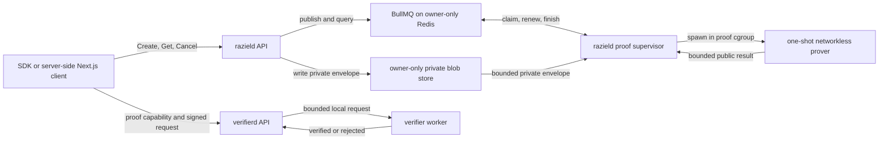

# ADR-0013: M4 Service and Verifier Execution

- Status: accepted
- Date: 2026-08-11
- Accepted: 2026-08-12
- Milestone: M4
- Related decisions: ADR-0002, ADR-0010, ADR-0011, ADR-0012
- Related open decision: O-007
- Maintainer direction on 2026-08-12: retain the Rust API-job server topology and
  defer NestJS for the PoC
- Maintainer direction on 2026-08-12: use a maintained job queue and do not implement
  queue semantics through a filesystem spool
- Maintainer amendment on 2026-08-12: use direct `sp1-verifier` Plonk verification
  instead of SDK `LightProver` in the isolated verifier build

## Context

M3 produced and independently verified a real SP1 Plonk proof. The validated direct
fixture has these service-relevant measurements:

```text
execution instructions = 422138
execution time = 424 ms
proof time = 1742106 ms
encoded proof artifact = 2537 bytes
verification time = 479 ms
proof-process peak memory = 46301016064 bytes
proof-process hard limit = 60129542144 bytes
parallel proof jobs = 1
```

The proof takes about 29 minutes and peaks near 43.12 GiB. A request-serving process
cannot perform that work inline. FR-066 already requires an asynchronous capability
job API, and the Protobuf contract already exposes Create, Get, and Cancel operations
with QUEUED, EXECUTING, PROVING, SUCCEEDED, FAILED, and CANCELED states.

The current binaries are M0 shells. The generated Rust Tonic service bindings are not
compiled into `raziel-proto`. No Rust service runtime or job-queue dependency is
approved. The existing `raziel-verifier` crate owns strict policy, root, and
authority-key registry validation. The existing `raziel-prover` crate contains both
`CpuProver` and `LightProver` paths under one Cargo feature graph.

ADR-0012 requires remote proof decoding and verification inside a hard-capped worker.
It also bars Core artifacts from agent-facing capabilities. The pinned Core proof
contains witness-derived trace openings and lacks an approved witness-hiding claim.

The measured proof time exposes a separate protocol conflict. FR-063 defaults a
capability to 15 minutes, but issued and expiry timestamps are proof-bound. A
29-minute proof can finish after that capability expires.

## Proposed Decision

### Process topology

M4 uses four long-running Rust service roles, one one-shot Rust proof executor, and
one owner-only Redis service:

| Role | Responsibility | Private material | Network |
| --- | --- | --- | --- |
| `razield` API | Authenticate requests, apply admission limits, publish BullMQ jobs, read states, and return public results | Signed request context during admission | Internal RPC, approved data-owner services, and Redis |
| `razield-proof-worker` | Run the BullMQ worker, maintain the job lock, launch one executor, bridge cancellation, and publish the result | Bounded private request envelope in memory | Redis and a local executor channel only |
| `razield-prover` | Resolve trusted state, build the witness, execute, prove, and return a bounded result | Relationships, path, caveats, openings, prepared guest input | None |
| `verifierd` API | Bound ingress, resolve verifier-owned registries, reconstruct expected public values, map failures | Exact approved PolicyIR from its own registry | Gateway RPC only |
| `verifier-worker` | Decode one artifact and run the direct SP1 Plonk verifier against a registry-pinned program key | No witness data | None; local Unix socket only |

`razield`, `razield-proof-worker`, and `razield-prover` use separate processes. The
one-shot prover runs in the 60 GiB proof cgroup. A proof OOM or abort must not
terminate the API or BullMQ supervisor. All three run inside the data-owner trust
boundary. The one-shot prover cannot construct an SP1 network, CUDA, hosted, mock, or
environment-selected prover.

`verifierd` and `verifier-worker` remain separate from every `razield` role. They
have no prover endpoint, private snapshot store, relationship store, or proving
setup archive.



### Framework ownership

The API/job-server pattern does not require NestJS. The PoC keeps D-003 and D-004:

- Next.js owns the console, gateway, generated TypeScript clients, and product
  orchestration.
- Rust owns `razield`, the BullMQ proof supervisor, the one-shot prover, `verifierd`,
  and the verifier worker.
- BullMQ owns queue publication, worker claims, locks, stalled-job handling,
  deduplication, execution state, events, and bounded terminal retention on Redis.
- Protobuf defines the process contracts.

NestJS is deferred. Adding it now would create a second TypeScript server layer in
front of the Rust service without removing the Rust worker, witness, registry, or
verification boundaries. A later product control plane can use NestJS and call the
same Protobuf APIs after the PoC contract stabilizes.

### Capability job lifecycle

`CreateCapability` returns after strict validation and atomic queue publication. It
never waits for witness construction or proof generation.

The agent authenticates issuance by signing the exact 32-byte ADR-0011
`capability_request_commitment` with Ed25519. The API derives the thumbprint from the
supplied public key, rebuilds the commitment from typed request fields, and performs
strict signature verification prior to queue publication. `agent_id` remains
presentation metadata and cannot select the PolicyIR subject.

```text
QUEUED -> EXECUTING -> PROVING -> SUCCEEDED
   |          |           |
   +----------+-----------+-> FAILED
   +----------+-----------+-> CANCELED
```

BullMQ's Redis state is authoritative for waiting, active, completed, and failed
jobs. The public Protobuf API maps waiting to QUEUED. An active job exposes a typed
EXECUTING or PROVING progress phase. A completed job maps to SUCCEEDED. A typed
cancellation result maps to CANCELED. Other terminal errors map to FAILED.

Rules:

- Worker concurrency and queue-global concurrency are both one.
- Each job sets `attempts = 1`. The worker sets `max_started_attempts = 1` and
  `max_stalled_count = 0`. A crash, lost lock, OOM, or deadline fails the job and
  never starts a second proof.
- A terminal state is immutable.
- The exact request commitment becomes a BullMQ custom job ID. Repeating the exact
  signed issuance request returns its retained job.
- The API never reports CANCELED until executor termination and private-file deletion
  are confirmed.
- Canceling a queued job removes it through BullMQ, deletes its private envelope, and
  records the typed cancellation result.
- Canceling an executing or proving job signals the supervisor through its internal
  control endpoint. The supervisor activates BullMQ's cancellation token, terminates
  the one-shot prover, waits for exit, erases private files, then records CANCELED.
- The BullMQ supervisor renews the active-job lock during the proof. Lock-renewal
  loss cancels the local prover. BullMQ then fails the stalled job under the zero
  requeue policy.
- Completed and failed BullMQ records retain only public status, safe metrics, and a
  public capability for a bounded period. The implementation sets both an age and a
  count ceiling.
- Public job metrics contain durations, instruction count, proof size, and aggregate
  resource data only.

### BullMQ queue and private blob store

The PoC uses the official `bullmq-official` Rust crate on a pinned Redis service.
BullMQ supplies the queue protocol and lifecycle. Raziel does not implement job
claiming, leases, lock renewal, retries, stalled-job recovery, ordering, or terminal
retention through file operations or raw Redis commands.

Redis runs on an internal owner-only network with no published host port. It uses an
authenticated service account, a bounded memory limit, `maxmemory-policy noeviction`,
and an owner-only persistent volume. Redis stores queue state, opaque private-blob
references, safe progress, and terminal public results. It never stores the private
request envelope, witness, prepared guest input, or proof scratch data.

The filesystem holds only the private request envelope and one-shot scratch data. It
is not a queue:

- Directories use owner-only access. Private envelope files use mode `0600`.
- The API writes the envelope to a private temporary path, syncs it, renames it, then
  publishes the opaque reference as a BullMQ job.
- The envelope is a versioned internal Protobuf message. Its wire bytes are transport
  data, never commitment input.
- The envelope has a fixed byte ceiling derived from the guest input ceilings.
- The worker reads the envelope only after BullMQ grants the active-job lock.
- Private request context, witness data, prepared guest input, proof scratch data, and
  worker traces are deleted before every terminal transition.
- A startup janitor removes staged blobs that have no BullMQ job after a bounded grace
  period. It never changes job ownership or queue state.
- `internal_error_ref` is an opaque identifier. It never embeds an error string,
  policy branch, caveat value, path, opening, or witness field.

The initial dependency review selected version `1.2.0`. A live registry check during
review found version `1.2.3`. The accepted implementation pin is `1.2.3`. It is an
official stable release and uses BullMQ's established Lua scripts and Redis data
structures. Its source pins its direct dependency versions and fixes worker job
pickup, concurrency coordination, and graceful close behavior present in `1.2.0`.

The Rust binding is new, so M4 includes queue conformance tests for the exact features
Raziel needs. Its Rust worker does not supply a sandboxed child-process API. Raziel
still owns the Linux cgroup and one-shot prover boundary.

The first implementation slice is a queue conformance gate. It must prove custom-ID
deduplication, one-job global concurrency, lock renewal, zero-retry stalled failure,
queued removal, active cancellation-token delivery, progress events, bounded result
retention, and Redis restart recovery. A missing or incompatible behavior stops the
slice. Raziel will select another maintained queue instead of filling the gap with
custom file or Redis queue logic.

An isolated `1.2.0` review probe compiled on Rust `1.97.1`, passed all 49 bundled unit
tests, and passed the nine live behaviors above against the pinned Redis `8.2.8`
image. In the lost-lock case, BullMQ recorded two internal queue claims. It invoked
the processor once. The second claim failed before processor code under
`max_started_attempts = 1`, so it cannot start a second proof. The M4 gate must rerun
these cases against the approved `1.2.3` pin inside the repository.

### Proof-worker isolation

The one-shot prover uses the validated ADR-0012 profile:

```text
proof mode = Plonk
parallel jobs = 1
proof deadline = 60 minutes
artifact maximum = 1048576 bytes
memory hard limit = 60129542144 bytes
swap = 0 bytes
visible CPUs = 4
Rust workers = 4
Go maximum processes = 4
Go soft heap target = 24 GiB
network = none
root filesystem = read-only
private scratch = bounded tmpfs
```

The one-shot prover mounts the trusted guest ELF, Plonk setup, registry generation,
and private snapshot state from approved local paths. Request data cannot select an
ELF, setup archive, verification key, proof mode, resource profile, or external
endpoint.

Core remains limited to offline tests and non-sensitive internal measurements. A
Core artifact never enters a job result, capability, verifier request, browser
response, receipt, or standard log.

### Verifier execution boundary

`verifierd` performs these steps prior to invoking the worker:

1. Apply a 2 MiB service request ceiling.
2. Decode Protobuf and reject missing, unknown, malformed, oversized, or invalid
   public fields.
3. Require `PROOF_SYSTEM_SP1` and apply the 1 MiB artifact ceiling without decoding
   the SP1 payload in the API process.
4. Resolve the exact policy, accepted snapshot root, authority keys, and configured
   program-key identity from verifier-owned local state.
5. Validate signatures, status, trust domain, expiry, agent-key thumbprint, request
   envelope, replay inputs, and the paired program-key record.
6. Reconstruct the complete expected ADR-0011 public-value bytes.
7. Send only the proof artifact, expected public values, and trusted key identity to
   the local verifier worker.

The worker runs under a provisional 2 GiB cgroup limit, zero swap, a read-only root,
a bounded tmpfs, no network, and a 60-second deadline. It strictly decodes the
artifact, compares the complete public journal, and runs `sp1-verifier`'s direct
Plonk verification against the registry-pinned SP1 BN254 program-key hash and the
SP1 release's embedded Plonk verification key.

The verifier-owned program registry stores one atomic key record. Registration
derives both the Raziel `sp1-vk-v1:` identifier and SP1 BN254 program-key hash from
the same approved `SP1VerifyingKey`. The isolated worker receives that trusted pair.
Request data cannot provide or select either representation. This replaces runtime
ELF setup in the verifier worker and does not change the guest program, proof bytes,
public values, or Raziel key identifier.

Protected-request signature canonicalization remains governed by proposed ADR-0002
and O-007. The proof-only worker contract does not depend on HTTP target
canonicalization. M4 cannot claim the stolen-capability exit gate until ADR-0002 is
accepted and its envelope checks pass.

The worker uses a Unix-domain socket on an owner-only volume. The socket protocol has
one versioned, length-prefixed request and one bounded response. A worker abort, OOM,
timeout, malformed response, or socket failure cannot crash `verifierd`. The 2 GiB
limit remains provisional until a real proof measures verification-only peak memory.

This decision refines ADR-0012's child-process requirement into a cgroup-isolated
worker process. The worker can spawn one one-shot verifier child inside the same
cgroup. The service boundary, not an in-process unwind handler, supplies the hard
memory and deadline controls.

### Capability time window

The recommended PoC rule closes O-008:

```text
proof deadline = 60 minutes
minimum usable window after proof = 15 minutes
maximum proof-bound capability lifetime = 75 minutes
issued_at = trusted proof-worker start time
expires_at <= issued_at + 75 minutes
expires_at <= requested, policy, snapshot, delegation, and key expiry
```

Job admission requires every upper-bound expiry to cover the 75-minute window. The
default requested expiry changes from 15 minutes to 75 minutes for the local Plonk
profile. A proof that reaches its 60-minute deadline yields no capability. The
measured 29-minute run leaves about 46 minutes for verification and protected use.

This is a security tradeoff. The proof binds a longer validity interval so the
expensive proof can finish. Revocation, verifier-local status, agent request
signatures, nonces, and gateway scope checks still apply. A later proof construction
can restore a 15-minute post-proof lifetime by separating the long-lived proof from a
short-lived issuance wrapper. That change would alter public proof semantics and
requires another decision and proof gate.

### Public and audit errors

| Condition | Public result | Private audit detail |
| --- | --- | --- |
| Malformed request prior to admission | `INVALID_REQUEST` | Bounded field code |
| No satisfying authorization path | `NOT_AUTHORIZED` | Typed evaluator code without path data |
| Capability or proof mismatch | `CAPABILITY_INVALID` | Exact registry, journal, key, codec, or proof code |
| Capability outside its time window | `CAPABILITY_EXPIRED` | Trusted time and record class |
| Reused protected-request nonce | `REQUEST_REPLAYED` | Nonce-store record identifier |
| Worker crash, OOM, timeout, or unavailable socket | `SERVICE_UNAVAILABLE` | Worker exit class and opaque correlation ID |

No public or standard log records a policy branch, relationship, path, caveat value,
salt, Merkle opening, prepared guest input, proof byte string, or witness trace.

## Approved Dependencies And Features

The maintainer separately approved these implementation changes on 2026-08-12:

1. `tonic = "=0.14.6"` and `tonic-prost = "=0.14.6"` for the generated Rust service
   bindings. `tokio = "=1.53.1"` uses the `fs`, `io-util`, `macros`, `net`, `process`,
   `rt-multi-thread`, `signal`, `sync`, and `time` features for RPC, Unix sockets,
   child processes, deadlines, shutdown, and private-file operations.
2. Replace the review-tested `bullmq-official = 1.2.0` pin with
   `bullmq-official = 1.2.3`, imported as `bullmq`. Use the pinned Redis runtime:
   `redis:8.2.8-bookworm@sha256:2f7462b9e93e0a7ae2edf3a0a0babc8a4d29f8bfc50849b906b7caaef925edc1`.
3. A `raziel-prover` Cargo feature split. Verification builds use
   `sp1-verifier = { version = "=6.3.1", default-features = false }` and exclude
   `sp1-sdk`, `native-gnark`, `sp1-core-executor`, `sp1-prover`, `CpuProver`, guest
   execution, and proving modules. The proof-worker build explicitly activates the
   SDK, executor, and native-Gnark paths.

No other crate or system facility is approved. A later need for Linux process-limit
support beyond the Compose cgroup boundary requires a new dependency request.

A later positive isolated-verifier gate needs separate approval for one synthetic
Plonk rerun and retention of its 2.5 KiB public zero-knowledge artifact as a test
fixture. The run must use the approved VM profile and contain no witness or debug
trace.

The feature split adds no proof mode or SP1 package version. `sp1-verifier` `6.3.1`
already exists in the locked SDK graph. The direct dependency lets Cargo build the
standalone verifier without SDK proving and execution crates. The approved proving
build remains available to `razield-proof-worker`.

## Test Requirements

M4 must cover:

- Create returns QUEUED without waiting for proof work.
- exact duplicate requests return one job
- changed request field, context entry, public key, commitment, or signature fails
  prior to queue publication
- duplicate publication returns the retained BullMQ job
- worker and global queue concurrency remain one
- queued, executing, and proving cancellation removes private blobs
- supervisor crash, executor crash, lost lock, deadline, OOM, truncated result, and
  malformed result handling
- a stalled job fails without a second proof attempt
- API liveness during a killed proof worker
- Redis authentication, no host-published port, `noeviction`, memory ceiling, and
  bounded terminal retention
- owner-only blob permissions, publication ordering, orphan cleanup, byte ceilings,
  and terminal deletion
- no witness fields in public metadata, standard logs, or audit output
- strict 2 MiB verifier ingress and 1 MiB artifact ingress
- policy, root, authority, key, proof, journal, scope, time, and request mutations
- verifier-worker restart after malformed or resource-exhausting input
- `verifierd` success with every `razield` role stopped
- standalone verifier feature-tree exclusion of native proving and network paths
- one real retained public Plonk artifact through the isolated verifier worker
- measured verification-only peak memory under the accepted worker cap
- admission rejection for less than the accepted proof-plus-use time window

## Consequences

- The API remains responsive during the 29-minute proof operation.
- A proof crash or OOM stays outside the API cgroup.
- The current VM can host the worker. A local console can reach its API through an
  approved internal route or SSH tunnel.
- The PoC uses a maintained queue for job ownership, lock renewal, deduplication,
  progress, cancellation, stalled-job handling, and bounded retention.
- Redis adds one owner-operated service and persistent volume.
- Private queued input exists in a separate owner-only blob for the job lifetime and
  needs strict deletion tests.
- The Rust binding reached stable `1.0` in July 2026. Its exact queue behavior remains
  an M4 conformance gate rather than an assumption.
- Plonk capabilities become practical for a visual demo, but creation remains slow.
- The accepted 75-minute proof-bound lifetime expands the exposure window relative to
  the earlier 15-minute default. Its subordinate expiry bounds and revocation checks
  remain mandatory.
- M5 can render true job progress and completed capabilities. It must not fake a
  successful proof or substitute a Core artifact.

## Options Rejected Or Deferred

### Prove inside CreateCapability

The measured proof exceeds normal RPC and HTTP deadlines and can consume over 43 GiB.
Inline proving makes the API unavailable and loses durable job state on disconnect.

### Keep API and proof worker in one process

A native prover abort or cgroup OOM can terminate the API. A task spawn does not
supply a memory boundary.

### Add NestJS as the M4 capability service

NestJS can implement a job controller, but it cannot own the Rust witness and proof
boundary. It would add another service and translation layer to the current PoC.
The same API/job topology fits the existing Rust ownership and Protobuf contract.

### Use Core for the visual demo

Core is faster but lacks the approved witness-hiding property. UI convenience does
not permit witness-derived proof data to enter an agent-facing capability.

### Keep a 15-minute proof-bound lifetime

The validated 29-minute run can produce an already expired capability. The current
evidence does not support this option.

### Start the 15-minute lifetime after proof completion

The guest already binds issued and expiry times. Changing them after proof invalidates
the public journal. A signed post-proof wrapper is a separate proof-protocol design.

### Use a filesystem spool as the queue

Atomic file renames do not provide a maintained implementation of leasing, lock
renewal, cancellation, stalled-job handling, retry policy, bounded retention, or
cross-process events. Building those features inside Raziel creates avoidable queue
code and test burden.

### Build directly on Redis primitives

Redis Streams and consumer groups provide transport primitives, but Raziel would
still need to implement idempotency, stalled-job policy, cancellation, result
retention, and worker lifecycle. BullMQ already supplies those rules.

### Use Apalis 0.7.4

Apalis is a maintained Rust job framework with Redis storage. BullMQ is selected for
this PoC because it supplies the required custom job IDs, lock renewal, stalled-job
limits, cancellation tokens, global concurrency, progress events, and bounded
terminal removal through one queue API. The official BullMQ binding also preserves a
future Node.js or NestJS control-plane option without changing Redis queue data.

## Approval Record

The maintainer accepted this decision on 2026-08-12, including:

1. The four long-running Rust services, one-shot prover, BullMQ queue, Redis runtime,
   and private blob boundary.
2. The cgroup-isolated verifier worker as the ADR-0012 hard-limit implementation.
3. The 75-minute Plonk capability window that closes O-008.
4. Ed25519 issuance authentication over the exact ADR-0011 request commitment.

The maintainer separately approved BullMQ `1.2.3`, Tonic `0.14.6`, Tokio `1.53.1`,
`tonic-prost` `0.14.6`, the pinned Redis `8.2.8` runtime, and the `raziel-prover`
feature split on the same date. The maintainer amended the split to use direct
`sp1-verifier` `6.3.1` after source inspection showed that SDK `LightProver` always
links `sp1-prover` and `sp1-core-executor`. ADR-0002 and a later synthetic Plonk
fixture run remain separate decisions.
