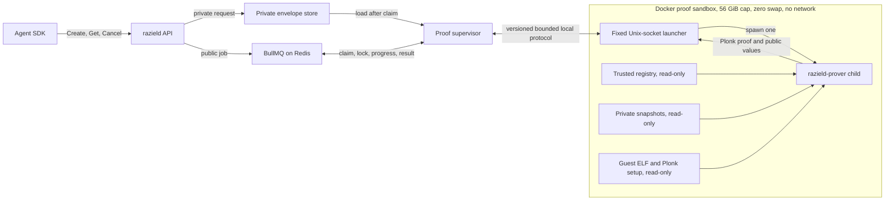

# ADR-0015: Private Snapshot and One-Shot Prover Boundary

- Status: accepted
- Date: 2026-08-22
- Accepted: 2026-08-23
- Eight-CPU resource amendment accepted: 2026-08-24
- Milestone: M4
- Related decisions: ADR-0009, ADR-0010, ADR-0012, ADR-0013
- Related baton: B-0024
- Security review triggers: snapshot storage, private witness handling, process
  isolation, logs containing authorization context

## Context

ADR-0009 defines the blinded relationship tree. Its public signed descriptor exposes
the relationship root, snapshot identity, policy binding, validity window, and
authority signature. It does not expose the shared 32-byte salt, relationship tuples,
stored caveat values, or Merkle openings.

B-0022 can build the minimum positive witness from those private values. B-0023 can
combine that witness with trusted policy and snapshot registry records. The one-shot
prover still needs a trusted source for the exact private snapshot used by the signed
descriptor.

An asynchronous capability job can wait through process restarts. The direct Plonk
fixture took about 29 minutes with four CPUs and 15 minutes 30 seconds with eight.
Both runs used about 43 GiB. The private snapshot cannot exist only in the API
process or BullMQ job payload. Querying SpiceDB again at proof time can return state
from a different revision and cannot reproduce the committed salt.

ADR-0013 requires a separate one-shot prover in a 60,129,542,144-byte cgroup with no
swap or network. This is 56 GiB, or about 60.13 GB. It does not define the private
snapshot file format. It does not grant the proof supervisor access to the Docker
socket or host cgroup administration. Either privilege reaches beyond the narrow
proof-job contract.

Two decisions are required before B-0024 feature code starts:

1. Define the private snapshot record and its trusted lookup rules.
2. Define the child protocol and Docker resource boundary without a privileged
   supervisor.

### ZedToken and private snapshot

A ZedToken is an opaque SpiceDB consistency token. It identifies a datastore
point-in-time. It does not contain the relationship tuples, stored caveat values,
Raziel's private salt, Merkle tree, or Merkle openings.

Raziel uses a ZedToken once during administrative snapshot publication. It reads the
relationships at that exact SpiceDB revision, canonicalizes them, creates a fresh
private salt, builds the blinded relationship root, and signs the public snapshot
descriptor.

The private snapshot record preserves the exact relationship data and salt behind
that public root. Proof generation can then continue after SpiceDB changes or the
ZedToken's exact revision expires from SpiceDB's garbage-collection window.

## Proposed Decision

### Private snapshot record

Raziel stores each private relationship snapshot as one immutable, versioned,
Rust-only Protobuf file inside an owner-configured directory.

The logical version 1 record is:

```text
PrivateRelationshipSnapshotV1 {
  format_version
  snapshot_id
  relationship_root
  snapshot_secret_salt
  relationships[]
}
```

Each relationship uses typed fields for the full relationship identity, optional
subject relation, caveat name, and stored caveat context. Context values use the
existing bounded PolicyIR scalar types. Raw Protobuf bytes never enter a commitment.
The loader reconstructs each canonical ADR-0009 relationship before rebuilding the
tree.

The file does not duplicate the signed snapshot descriptor, authority signature,
PolicyIR, proof input, witness openings, or capability request. The trusted local
registry remains authoritative for those public records.

### Lookup and registry binding

The fixed owner configuration supplies the private snapshot directory. Request data
cannot supply a directory, file path, suffix, or alternate store.

The one-shot prover first resolves the requested snapshot ID through the trusted local
registry. It validates the descriptor, authority signature, policy binding, status,
revocation state, and trusted time. It then derives this file name from the approved
relationship root:

```text
<64 lowercase relationship-root hex>.snapshot.pb
```

The loader rejects any file whose embedded snapshot ID or relationship root differs
from the resolved registry record. It rebuilds the blinded tree with the embedded
salt and ordered relationships, then requires exact root equality.

This order prevents a request-controlled path. It also prevents a private file from
substituting data for another signed snapshot.

### Encoding and limits

The version 1 loader applies these fixed ceilings before witness construction:

```text
private snapshot file bytes        <= 2 MiB
relationship count                 <= 256
one canonical relationship         <= 4 KiB
all canonical relationship bytes   <= 1 MiB
snapshot secret salt               = 32 bytes
```

Relationships use strict ADR-0009 structural identity order. Duplicate or unordered
relationships fail. Stored caveat context uses strict parameter-name order and the
approved PolicyIR type for each value.

Decoding rejects a missing version, an unknown version, unknown enum values, duplicate
logical fields, malformed values, trailing bytes, and non-canonical transport bytes.
Checked arithmetic applies to every byte and count total.

### Filesystem rules

The private snapshot directory uses mode `0700`. Snapshot files use mode `0600`.
The loader accepts only owner-controlled regular files. It rejects symbolic links,
unexpected owners, group or public permissions, and files above the transport cap.

Publication writes a new temporary file in the same directory, syncs it, then renames
it to its immutable root-derived name. An existing different file is an error. The
snapshot store is distinct from the per-job private envelope store and proof scratch.

Per-job cleanup does not delete a shared private snapshot. Administrative cleanup can
remove it only after the matching registry record is no longer accepted and no active
job references it.

The PoC trusts the data-owner filesystem boundary. This decision does not add
at-rest encryption, a database, a remote secret store, or a key-management service.

The storage contract is an owner-configured directory, not a Docker-specific data
format. The Docker deployment mounts that directory from a persistent named volume.
A bind mount can supply the same contract. Moving the record into Redis, Postgres, or
SQLite still needs persistent storage and adds a database access boundary.

### One-shot child protocol

B-0024 implements the real `razield-prover` child and its strict local protocol. The
child uses B-0023 input assembly and the approved ADR-0012 local Plonk prover. It has
no mock or Core production mode.

The supervisor sends one versioned, length-prefixed request through a private local
process channel. The request contains only:

- the validated private capability envelope bytes
- the trusted proof-worker start time in whole UTC seconds
- protocol version and bounded cancellation metadata

The request cannot contain registry paths, snapshot paths, guest ELF paths, Plonk
setup paths, proof mode, resource limits, network endpoints, output paths, or program
key selections.

Owner configuration fixes:

- the registry generation
- the private snapshot directory
- the authorization guest ELF
- the Plonk setup directory and manifest
- Plonk as the proof mode
- the approved program-key record
- the proof resource profile

The child returns one versioned, length-prefixed result. A successful result contains
only:

- the bounded Plonk proof artifact
- the exact ADR-0011 public values
- the approved verification-key identifier
- aggregate execution, proving, size, and resource metrics

The request limit is 32 KiB. The result limit is 2 MiB, with the existing 1 MiB proof
artifact cap applied inside it. Failure results contain a generic typed class and an
opaque correlation identifier. Standard output and standard error cannot contain
private request fields, relationships, caveat values, salts, paths, openings, guest
input, proof bytes, or registry contents.

The child handles one request and exits. EOF, cancellation, timeout, malformed input,
host denial, witness failure, proof failure, journal mismatch, or result encoding
failure produces no capability.

### Docker proof sandbox

Docker Compose starts one dedicated `razield-proof-sandbox` service at stack startup.
The service has no network and exposes one owner-only Unix socket through a shared
local volume. A small launcher inside that sandbox accepts the fixed child protocol
and starts one `razield-prover` child at a time.

The entire sandbox container uses these required Compose settings:

```yaml
cpuset: "0-7"
mem_limit: "60129542144"
memswap_limit: "60129542144"
network_mode: none
read_only: true
```

The maintainer approved the eight-CPU amendment on 2026-08-24 after the measured run
recorded in ADR-0012. The sandbox sets `GOMAXPROCS=8` and `RAYON_NUM_THREADS=8` and
rejects any other visible CPU or worker count. Memory, swap, network, filesystem,
mount, scratch, protocol, and deadline controls remain unchanged.

Docker treats equal positive memory and memory-swap limits as zero container swap.
The sandbox uses a bounded private `tmpfs`. It receives read-only mounts for the
registry generation, private snapshot store, guest ELF, and Plonk setup. Only its
Unix socket and private scratch are writable.

The sandbox preflight rejects a host with less than 66,571,993,088 bytes of memory.
It rejects a rendered Compose service that does not carry the exact memory, swap,
CPU, network, root-filesystem, mount, and scratch settings. The child checks cgroup v2
at startup and exits before private input if `memory.max` is not `60129542144` or
`memory.swap.max` is not `0`.

The cap is a maximum, not a reservation. The current eight-CPU validation peaked at
45,592,842,240 bytes. Docker can kill the sandbox at its hard limit without killing
the API or proof supervisor.

The proof supervisor does not receive the Docker socket. Compose owns container
creation and restart. The supervisor connects only to the owner-only Unix socket. An
OOM, launcher exit, socket close, malformed result, or deadline becomes one failed
job with no retry.



The supervisor is the existing `razield-proof-worker` component. It consumes one
BullMQ job, renews its lock, loads the private request envelope, checks the proof
window, sends one bounded execution request, forwards cancellation, applies the
one-hour deadline, deletes the per-job envelope, and records the terminal public
result. It does not build the witness or generate the proof.

### Deployment staging and authority

B-0024 builds the child, strict protocol, trusted private snapshot loader, and bounded
public result. It does not activate the BullMQ production supervisor.

This decision grants the supervisor neither Docker-socket access nor delegated host
cgroup administration. The existing activation token remains closed. B-0025 will
connect the supervisor to the fixed Compose sandbox and prove the ADR-0013 cgroup,
no-network, read-only-root, scratch, deadline, and cancellation rules.

This staging produces working feature code without silently giving a network-facing
service broad host control. It also lets B-0024 test the process contract without
claiming that the production resource boundary exists.

No new package version, CLI, runtime, system tool, proof mode, Docker privilege, or
SP1 run is approved by this decision.

## Why These Decisions Are Needed

### Proof correctness

The proof must use the exact private data behind the signed relationship root. A live
SpiceDB read can drift from the committed revision. It cannot recover the original
private salt. Exact registry binding and root reconstruction close that gap.

### Witness privacy

BullMQ, Redis, public RPC responses, standard logs, and the agent must never receive
relationship tuples or witness material. An owner-only local record gives the
networkless child the required data without crossing those boundaries.

### Process containment

The native Plonk prover can exhaust memory or abort. A separate child keeps this
failure outside the API and queue supervisor. The protocol must stay narrow so the
child cannot select trusted files or external services.

### Host authority

The Docker socket commonly grants control over host containers and mounts. Delegated
cgroup administration grants control over resource groups. Neither privilege follows
from permission to process one BullMQ job. The fixed Compose sandbox creates the
resource boundary before the supervisor accepts work.

## Security and Privacy Effects

- The private snapshot becomes persistent sensitive state inside the data-owner trust
  boundary.
- A root-derived name reveals only the public relationship root already present in
  the signed descriptor.
- The file carries no authority signature and cannot authorize itself.
- Registry validation happens before private-file lookup.
- Exact root reconstruction detects file substitution, record mutation, wrong salts,
  wrong ordering, and stale private data.
- Process requests and results exclude request-selected paths and proof settings.
- Docker must apply the exact 60,129,542,144-byte hard limit and zero-swap setting.
- Production proving stays disabled until process isolation and result validation
  pass their own gate.

## Compatibility and Migration Cost

This decision changes no public Protobuf contract, canonical commitment, PolicyIR
semantics, snapshot root, guest input, public value, proof artifact, verification key,
or capability format.

It adds one internal file codec, one local process codec, one child binary, and fixed
owner configuration. No existing real snapshot requires migration. Test snapshot
fixtures need the new private record only where they exercise the B-0024 boundary.

A later encrypted store can preserve the logical record but needs a new key and
failure model. A non-Docker launcher can preserve the child protocol if it supplies
the same fixed trusted mounts and ADR-0013 controls.

## Test Requirements

B-0024 must cover:

- exact private record encode, decode, and registry binding
- wrong snapshot ID, wrong root, wrong salt, mutation, duplicate, ordering, type, and
  size rejection
- owner, mode, regular-file, link, immutable publication, and path-selection checks
- one valid child request and bounded public result without running SP1
- malformed, oversized, truncated, and trailing child protocol behavior
- typed host, witness, proof, journal, trusted-state, and resource failure mapping
- no private values in errors, debug output, standard output, or standard error
- dependency-tree exclusion of hosted and SP1 network proving paths
- sandbox startup rejection for incorrect cgroup v2 memory or swap values
- affected service, witness, prover, verifier, authorization-core, formatting, Clippy,
  and workspace checks

B-0025 must cover:

- live Unix-socket launcher exchange and exact one-child behavior
- canceled, timed-out, and crashed child handling with confirmed process exit
- host denial, witness failure, proof failure, and public-journal mismatch across the
  launched process boundary
- rendered Compose equality for the exact byte cap, zero swap, eight CPUs, no network,
  read-only root, fixed mounts, owner-only socket, and bounded scratch
- strict terminal result validation before capability issuance or worker activation

A real Plonk execution remains a separate maintainer-approved run. Protocol tests can
exercise the real child boundary with a controlled internal prover result, but the
production child has no mock proof mode.

## Options Not Selected

### Store private snapshots in Redis or BullMQ

Redis owns queue state. Giving it relationships, salts, or caveat values expands the
networked private-data boundary and conflicts with ADR-0013.

### Add Postgres for private snapshots

Postgres can store the record, but the repository has no approved Postgres service for
Raziel state. It adds credentials, schema migrations, backup rules, a network path,
and another persistent volume. The proof sandbox cannot connect to it under the
no-network rule. A trusted process would still need to copy the private record into
the sandbox.

### Store private snapshots in SQLite

SQLite keeps the data local but still stores one database file on a volume. It adds a
database dependency and migration rules without supplying a needed query pattern.
Version 1 records are immutable, bounded, and fetched by one public root digest.

### Copy the whole private snapshot into each job envelope

This duplicates long-lived relationship state for every capability request. It raises
retention, deletion, queue-admission, and byte-limit costs. The signed root already
provides a stable trusted lookup key.

### Query SpiceDB during proof execution

The result can differ from the manually signed snapshot. A query cannot reproduce the
private salt or prove that returned tuples formed the accepted root.

### Keep snapshots only in API memory

An API restart loses proof inputs for queued jobs. It ties large private state to the
request-serving process and prevents a one-shot child from resolving trusted state
independently.

### Use JSON or an unversioned Rust binary codec

JSON adds alternate number and text spellings. An unversioned Rust codec gives weak
migration and size-control rules. A strict internal Protobuf record matches existing
repository transport patterns without making wire bytes commitment inputs.

### Give the proof supervisor the Docker socket

The worker could create privileged containers, mount host paths, and control unrelated
services. That authority is much broader than one fixed proof launch.

### Give the supervisor unrestricted cgroup administration

The worker could alter limits for unrelated services. A later launcher must expose
only fixed proof-profile operations.

### Run the prover inside the supervisor process

An OOM or native abort can terminate lock renewal and queue control. ADR-0013 already
requires a separate process.

### Activate the supervisor before the launcher exists

The process would lack the approved memory, swap, network, filesystem, and deadline
boundary. A passing child protocol alone does not satisfy the production gate.

## Approval Record

The maintainer approved this decision on 2026-08-23. The approval accepts:

1. The immutable, root-keyed, owner-only private snapshot Protobuf record, exact
   registry binding, and stated byte and relationship limits.
2. The child-first B-0024 scope and fixed Docker proof-sandbox design. B-0024 builds
   the real one-shot child and strict protocol. Production activation stays closed
   until B-0025 connects the Unix-socket launcher and proves every Docker resource
   control.

The approval does not grant a dependency change, Docker socket access, host cgroup
authority, production activation, or SP1 proof run.
