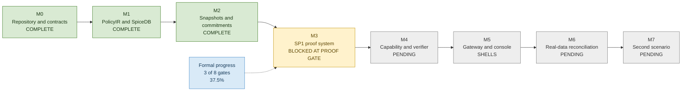
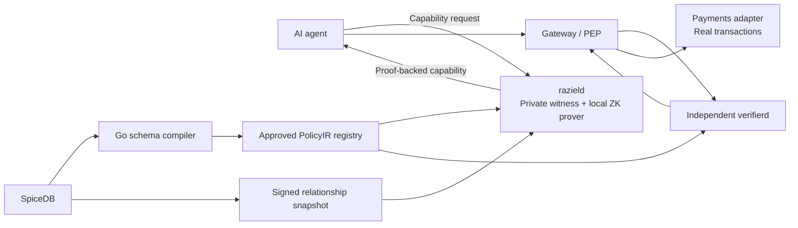
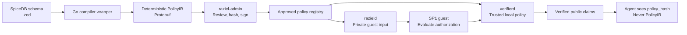

# Raziel PoC Progress Report

- Report date: 2026-07-28
- Audience: Academic progress review
- Repository snapshot: `main` at `10fbc88` with uncommitted B-0011 work
- Formal progress: 3 of 8 milestone exit gates passed, 37.5%
- Current milestone: M3, SP1 execution and proof
- Current state: Plonk implementation built, proof gate blocked by local memory

## Executive Summary

Raziel is a proof-carrying authorization layer for AI-agent data access. It proves
that an approved policy and committed relationship snapshot authorize one exact
capability scope. An independent verifier checks cryptographic evidence rather than
trusting an `ALLOW` response from the prover.

M0, M1, and M2 have passed their exit gates. M3 has delivered the bounded SP1 guest,
host input preparation, execute-mode equality, strict proof framing, trusted key
identity, local Plonk code, and fail-closed checks. Three network-isolated Plonk runs
reached the exact 7 GiB memory cap and exited without a proof. The next proof gate
needs a project-controlled machine with at least 48 GiB RAM and an approved 36 GiB
container cap.

The end-to-end payment-reconciliation PoC has not passed. M4 through M7 remain.

## Slide 1: Planned PoC

- Build proof-carrying authorization for AI-agent data access.
- Keep SpiceDB as the policy and relationship source.
- Prove that an approved policy and signed snapshot produce `ALLOW`.
- Let an independent verifier check the proof.
- Demonstrate payment reconciliation using real transaction data.
- Keep private relationships, paths, caveat values, salts, and Merkle openings hidden.

## Slide 2: Progress

| Milestone | Deliverable | Status |
| --- | --- | --- |
| M0 | Repository, toolchain, contracts, service shells | Complete |
| M1 | PolicyIR compiler, evaluator, and SpiceDB equivalence | Complete |
| M2 | Canonical commitments, snapshots, signatures, registries | Complete |
| M3 | SP1 execution and privacy-safe proof | Code built, exit gate blocked |
| M4 | Capability service and independent verifier | Pending |
| M5 | Gateway, SDK, and console | Shells only |
| M6 | Real-data payment reconciliation | Pending |
| M7 | Second-scenario extension test | Pending |

Formal completion is 37.5%. Practical progress is about 40 to 45% after counting
partial M3 work. This second figure is an engineering estimate, not an accepted gate.

## Slide 3: Milestone Progress

## Slide 4: Planned Architecture

The target design keeps proof creation and proof verification separate. `verifierd`
never calls `razield`. The agent receives public capability claims and `policy_hash`,
not PolicyIR or relationship witness data.

## Slide 5: Architecture Built So Far

```mermaid
flowchart LR
    S["SpiceDB compiler<br/>DONE"] --> P["PolicyIR equivalence<br/>DONE"]
    P --> M["Canonical commitments<br/>Salted snapshots and registries<br/>DONE"]
    M --> E["SP1 guest and execute equality<br/>DONE"]
    E --> C["Core proof path<br/>PRIVACY HOLD"]
    C --> Z["Local Plonk code and setup<br/>BUILT"]
    Z --> B["7 GiB proof benchmark<br/>MEMORY BLOCKED"]
    B -.-> V["razield and verifierd wiring<br/>PENDING"]
    V -.-> G["Gateway and console<br/>SHELLS"]
    G -.-> D["Real-data reconciliation<br/>PENDING"]
```

The direct authorization fixture executes in 422,138 instructions. The Plonk archive,
toolchain, native Gnark bridge, libclang package, proof framing, verification path,
and setup-file hashes are pinned. Three Plonk attempts reached exactly
7,516,192,768 bytes and ended with exit 137. No proof artifact was produced.

## Slide 6: PolicyIR Compiler Flow

The Go wrapper is a build-time compiler. Runtime services do not import it as a Go
package.

Current consumers include:

- `raziel-admin`, which strictly decodes, hashes, signs, and registers PolicyIR.
- The Rust PolicyIR evaluator and SpiceDB equivalence harness.
- The SP1 authorization guest through its private input.
- The planned `razield` and `verifierd` service wiring in M4.

## Slide 7: Changes in Direction

### Core proof to Plonk

SP1 Core is sound, but its proof contains witness-derived trace openings. Raziel
cannot place that artifact in an agent-facing capability. Plonk wraps the private
recursive proof and provides computational zero knowledge.

### Strict missing-input errors to CEL absorption

The first caveat rule propagated every missing-input error. SpiceDB follows CEL
Boolean semantics:

| Expression | Result |
| --- | --- |
| `false && missing` | `false` |
| `true && missing` | missing-input error |
| `true || missing` | `true` |
| `false || missing` | missing-input error |

Raziel adopted the same rule to pass live SpiceDB equivalence.

### Plain relationship commitments to salted leaves

Small relationship sets support offline guessing attacks against unsalted hashes.
Each snapshot now uses one private 32-byte salt. The public root reveals no tuple,
salt, count, or Merkle opening.

### Authorization separated from dataset relevance

Authorization answers whether an agent has permission. Relevance estimates whether a
dataset can help with a task. Combining them creates unclear trust claims and a
discovery oracle. Relevance and stateful leakage control remain separate later work.

### Local proving only

Hosted proving would expose the private witness outside Raziel's trust boundary.
Proof generation remains local and network-isolated.

## Slide 8: Remaining Work

- Approve a revised 36 GiB Plonk cap.
- Run the same proof gate on a project-controlled machine with at least 48 GiB RAM.
- Produce one real Plonk proof and verify it through `LightProver`.
- Run proof, key, journal, version, and trailing-byte mutation checks.
- Record proof time, proof size, verification time, memory, hardware, and tool versions.
- Build the M4 capability job API and independent `verifierd`.
- Connect the gateway, agent SDK, and console in M5.
- Run payment reconciliation against provenance-recorded real data in M6.
- Test second-scenario reuse without a new proof guest in M7.

## Speaker Notes

M0 through M2 establish trusted inputs to the proof system. They cover policy
compilation, canonical hashes, private relationship snapshots, authority signatures,
and local registries.

M3 separates guest execution from proof generation. Execute-mode equality has passed.
The privacy-safe proof has not passed its resource gate.

The main research finding is that soundness and zero knowledge are separate
properties. Core can prove correct execution without meeting Raziel's witness-privacy
requirement. This finding caused the Plonk pivot.

The failed Plonk runs still produced useful evidence. They established that the fixed
`2^25` Plonk domain has a source-derived live-memory floor near 15.75 GiB before
circuit, witness, FFT, MSM, runtime, and proof buffers. Reducing fixture complexity
does not remove that fixed outer-domain cost.

The first functional PoC needs M3 through M6. M7 then tests whether another scenario
can reuse the same proof system through policy, configuration, adapters, and UI work.

## Evidence Sources

- [`docs/agent/CURRENT-BATON.md`](../../agent/CURRENT-BATON.md)
- [`ARCHITECTURE.md`](../../../ARCHITECTURE.md)
- [`docs/spec/POC-TECHNICAL-SPEC.md`](../../spec/POC-TECHNICAL-SPEC.md)
- [`docs/decisions/0007-cel-boolean-error-absorption.md`](../../decisions/0007-cel-boolean-error-absorption.md)
- [`docs/decisions/0009-blinded-relationship-tree.md`](../../decisions/0009-blinded-relationship-tree.md)
- [`docs/decisions/0012-local-sp1-proof-key-and-artifact.md`](../../decisions/0012-local-sp1-proof-key-and-artifact.md)
- [`tools/spicedb-ir-compiler/README.md`](../../../tools/spicedb-ir-compiler/README.md)
