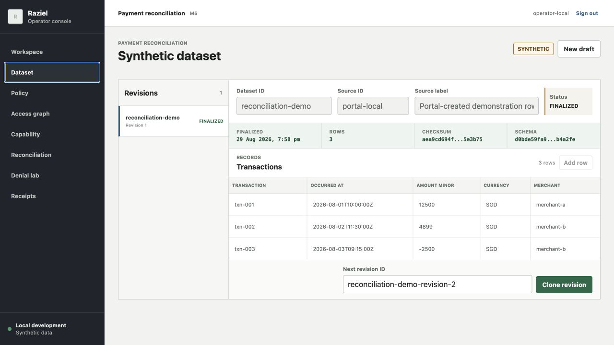
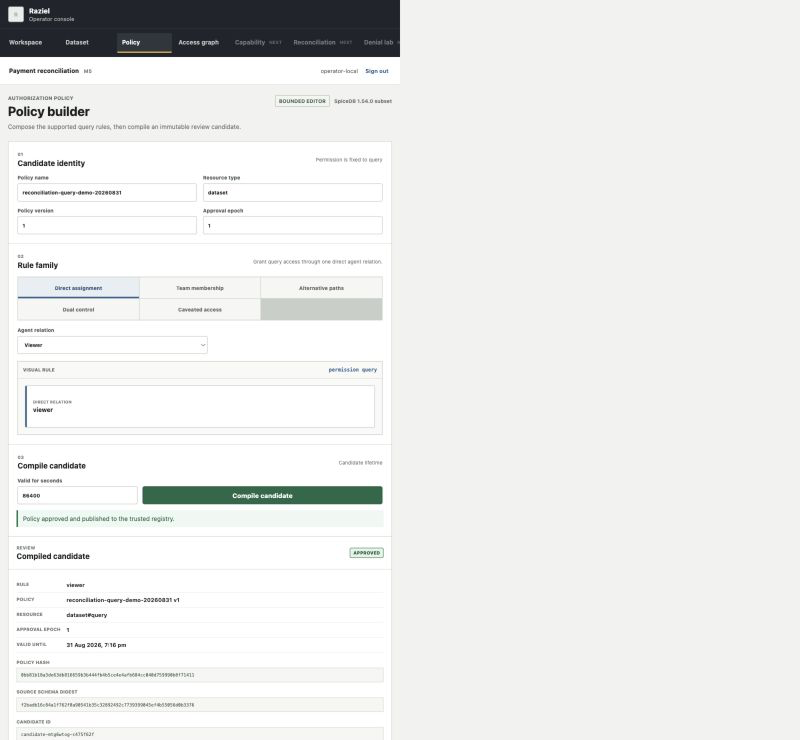
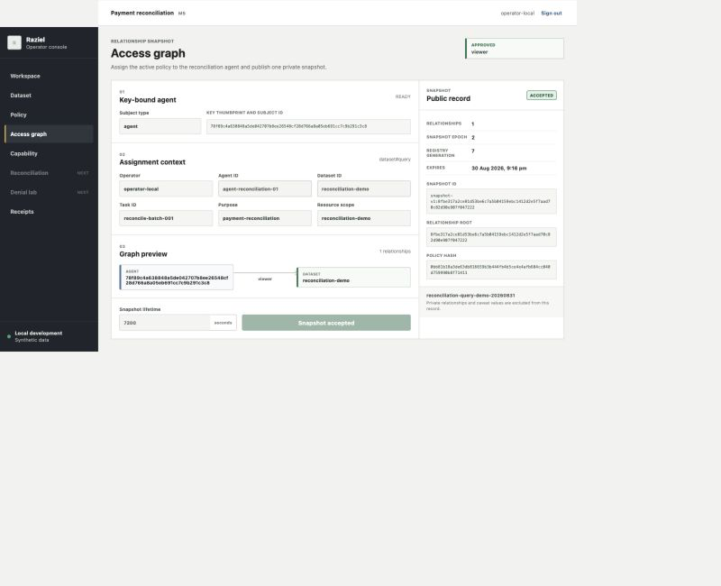
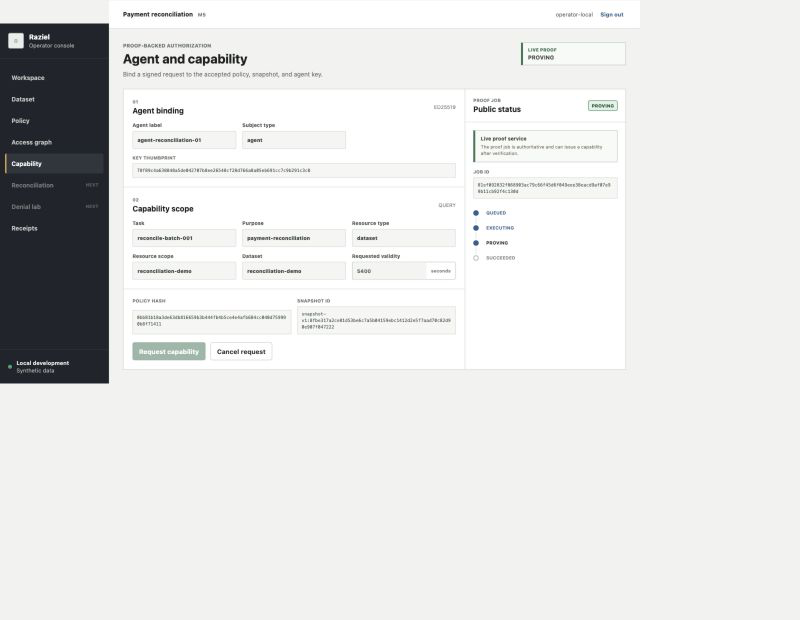
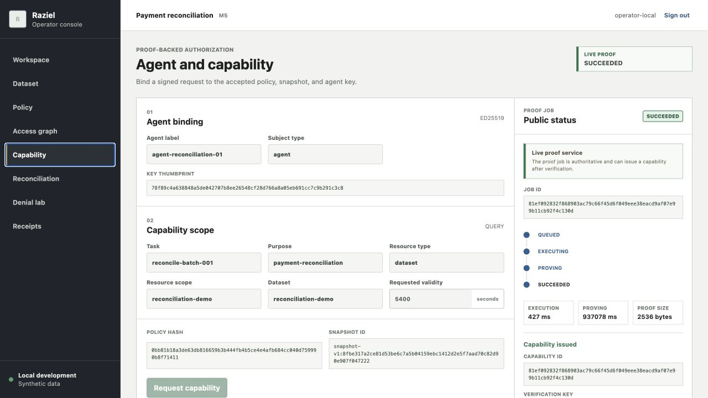
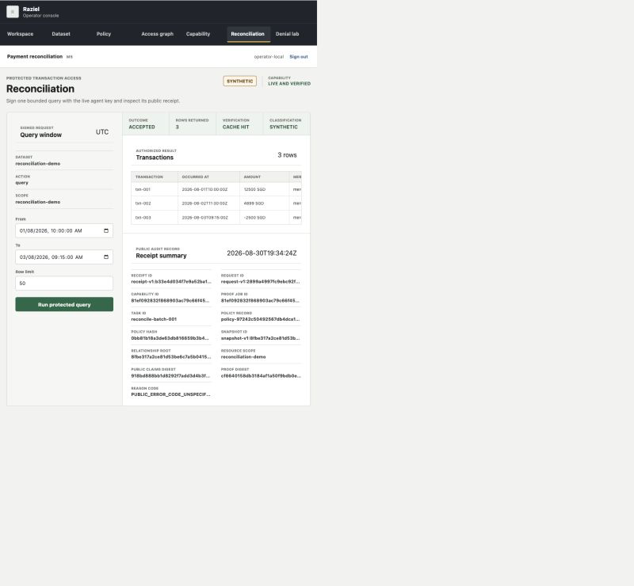
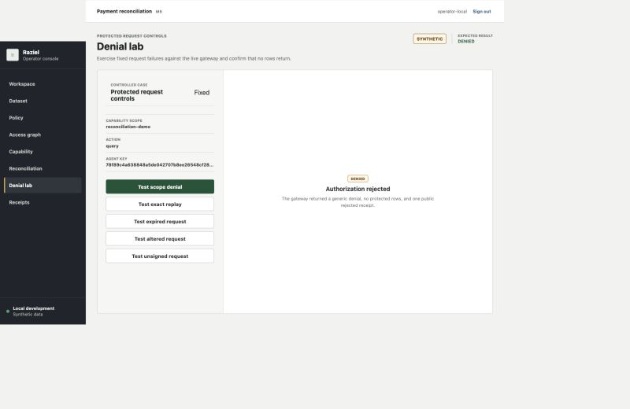
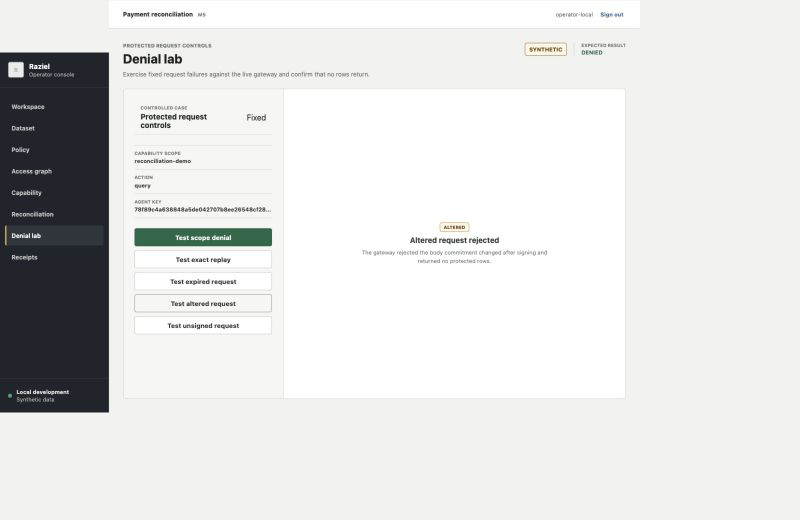
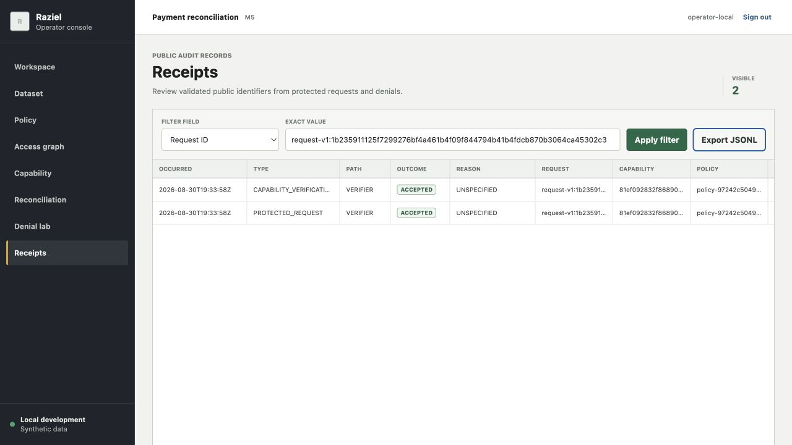

# M5 Local Portal

Status: complete. The synthetic UF-01 through UF-14 workflow passed on the NUS VM in
live Plonk mode on 2026-08-30 UTC. The walkthrough evidence and screenshots are
recorded below.

## Start

Docker is the only host prerequisite. The app profile uses the pinned repository
toolchain, creates an owner-only local operator verifier, and builds the policy
compiler, candidate inspector, policy activation service, Access Graph publisher, and
snapshot service from the pinned Go and Rust lockfiles.

```bash
export RAZIEL_M5_OPERATOR_PASSWORD='choose-a-local-password'
./scripts/start-m5-demo --recorded
```

Open `http://127.0.0.1:3000` and sign in with the exported password.

The default `recorded` capability mode plays the checked-in public M4 timeline. It
cannot issue a capability or unlock protected transaction data.

The mutation routes accept the request's actual same origin. Both
`http://127.0.0.1:3000` and `http://localhost:3000` work through an SSH tunnel.

For an ngrok development URL, add its hostname to the Next.js development-origin
list before startup. Set the expected origin only when a reverse proxy rewrites the
request host:

```bash
export RAZIEL_OPERATOR_EXPECTED_ORIGIN='https://demo.example.ngrok.app'
export RAZIEL_CONSOLE_ALLOWED_DEV_ORIGINS='demo.example.ngrok.app'
./scripts/start-m5-demo --recorded
```

The gateway stays on the private Compose network at `http://demo-gateway:3001`.
Browser requests remain same-origin and need no wildcard CORS policy.

The profile stores ignored runtime state under `.raziel/m5/`:

- `operator-secret.json` contains a salted scrypt verifier and session HMAC key.
- `transactions.json` contains portal-created synthetic transaction revisions.
- `policy-tools/` contains the local compiler and inspector executables.
- `policy-build/` caches their locked build outputs and Go modules.
- `policy-candidates/` contains owner-only candidate source and compiled artifacts.

Docker volumes hold the policy authority key, snapshot authority key, trusted
registry, private relationships, snapshots, retry state, and service sockets. The
console container mounts only the activation and Access Graph client sockets. It
cannot read either authority key, the trusted PolicyIR registry, SpiceDB token,
private relationships, or private snapshots.

The first startup downloads locked build dependencies inside the toolchain container.
Later starts reuse the local cache.

The initializer preserves an existing verifier. Set
`RAZIEL_M5_RESET_OPERATOR=1` for one startup to replace it with the current password.

## What Is Demoable

| Mode | Demoable | Not demoable |
| --- | --- | --- |
| Local recorded | Operator login, synthetic dataset revisions, visual policy compilation and activation, Access Graph publication, public proof-job playback, and receipt browsing | Capability issuance, protected queries, cache reuse, and Denial Lab controls |
| Live NUS VM | The complete UF-01 through UF-12 path, one fresh Plonk proof, verifier and cache query paths, five denial controls, and public receipt export | M6 real-transaction acceptance and any second scenario |

The complete desktop feature path passed through the live NUS VM deployment. Every
screen keeps the `SYNTHETIC` classification visible. M5 does not claim real payment
reconciliation.

## Panel Map

| Panel | Main areas and controls | What it does | Evidence to show | Available |
| --- | --- | --- | --- | --- |
| Workspace | Scenario header and Workflow status | Orients the operator to the payment-reconciliation scenario and current service state | M5 label, synthetic classification, and workflow state | Recorded and live |
| Dataset | Revisions list, Transactions editor, `New draft`, `Save`, `Finalize`, and `Clone` | Creates bounded synthetic transactions and freezes an immutable dataset revision | Rows, validation, checksum, schema fingerprint, row count, and finalization time | Recorded and live |
| Policy | Candidate identity, Rule family blocks, `Compile candidate`, Compiled candidate review, and `Approve and activate` | Renders one supported visual rule shape, runs the real compiler path, and publishes an approved policy record | Visual rule summary, compiler status, policy record ID, version, epoch, and `policy_hash` | Recorded and live |
| Access graph | Key-bound agent, Assignment context, optional caveat values, Graph preview, `Publish access graph`, and Public record | Creates the server-owned agent identity, writes the selected relationships, and publishes a signed snapshot | Agent thumbprint, accepted relationship count, snapshot ID, relationship root, epoch, and expiry | After policy activation |
| Capability | Agent binding, Capability scope, Private request context, `Request capability`, cancel control, and Public status | Signs the exact capability request through the SDK and submits the asynchronous proof job | Stable job ID, queued and proving progress, public capability claims, proof size, and timings | Recorded playback locally, real proof on VM |
| Reconciliation | Query window, `Run protected query`, Transactions, and Receipt summary | Signs a protected request, checks the capability through the verifier or cache, and reads bounded matching rows | `VERIFIER` or `CACHE HIT`, synthetic rows, request ID, receipt ID, proof digest, and accepted outcome | Live capability only |
| Denial lab | Scope, replay, expired, altered, and unsigned controls with one result area | Sends fixed invalid or unauthorized envelopes to the real gateway | `DENIED`, `REPLAYED`, `EXPIRED`, `ALTERED`, or `UNSIGNED` and no transaction rows | Live capability only |
| Receipts | Filter field, exact filter value, receipt table, refresh, and `Export JSONL` | Reads and reserializes the bounded public audit ledger | Verification, cache, accepted, scope-denied, and replay records with public identifiers | Recorded and live, populated by completed actions |

The sidebar communicates prerequisites. Access graph unlocks after policy activation.
Capability unlocks after snapshot publication. Reconciliation and Denial Lab unlock
only after a live succeeded capability authorizes the finalized dataset.

## User Flow Map

| Flow | Panels | Operator action | Demo output | Status |
| --- | --- | --- | --- | --- |
| UF-01 Create Synthetic Transactions | Dataset | Add and save bounded payment records | Editable rows and field validation | Implemented, recorded and live |
| UF-02 Finalize A Synthetic Dataset | Dataset | Review, finalize, and optionally clone a revision | Immutable checksum, schema fingerprint, count, and timestamp | Implemented, recorded and live |
| UF-03 Build A Policy Candidate | Policy | Select one of five visual rule families and compile it | Normalized visual summary, compiler status, and candidate hash | Implemented, recorded and live |
| UF-04 Review And Activate A Policy | Policy | Review the candidate and approve activation | Active policy record ID, version, epoch, generation, and `policy_hash` | Implemented, recorded and live |
| UF-05 Publish Relationships And Snapshot | Access graph | Create the agent, review relationships, and publish | Snapshot ID, root, policy binding, count, and expiry | Implemented, recorded and live |
| UF-06 Request A Capability | Capability | Review the bound request and submit it once | Stable proof-job ID and asynchronous state | Implemented, recorded and live |
| UF-07 Monitor A Real Proof | Capability | Keep the status panel open through proving | Public progress, succeeded capability claims, proof size, and timings | Live VM passed |
| UF-08 Run The First Protected Query | Reconciliation | Submit one signed bounded query | `VERIFIER`, synthetic rows, and an accepted receipt | Implemented, live VM only |
| UF-09 Reuse A Verified Capability | Reconciliation | Run another query with a fresh nonce | `CACHE HIT`, same capability and proof digest, new request and receipt IDs | Implemented, live VM only |
| UF-10 Demonstrate Scope Denial | Denial lab | Submit the fixed out-of-scope request | Generic `DENIED`, no rows, and an owner public rejection receipt | Implemented, live VM only |
| UF-11 Demonstrate Replay Rejection | Denial lab | Replay the exact envelope and run the fixed expired, altered, and unsigned controls | `REPLAYED`, `EXPIRED`, `ALTERED`, and `UNSIGNED`, each with no rows | Implemented, live VM only |
| UF-12 Inspect And Export Receipts | Receipts | Filter public records and export JSONL | Validated public audit history | Implemented, meaningful after completed actions |
| UF-13 Use Local Recorded Mode | All available recorded panels | Start with `--recorded` and inspect the public timeline | Fast UI walkthrough with protected success visibly locked | Implemented locally |
| UF-14 Run The Live VM Demo | All panels | Start live Compose on the VM and open it through the SSH tunnel | One connected draft-to-proof-to-query walkthrough | Passed on 2026-08-30 UTC |

## Screenshot Set

Screenshot files live under `docs/images/m5-live/`. Each image came from the live VM
portal through the Mac SSH tunnel. The Access Graph frame shows the operator-authored
synthetic relationship preview. The frames contain no passwords, private keys, raw
capability bytes, hidden snapshot records, salts, Merkle openings, private caveat
values, witness data, or private logs.

## Live VM Evidence

The passing walkthrough used these public records:

- Dataset `reconciliation-demo`, finalized with three synthetic rows.
- Policy `reconciliation-query-demo-20260831`, record
  `policy-97242c50492567db4dca1b64d6dd134d`, and policy hash
  `0bb81b18a3de63db816659b3b444fb4b5ce4e4afb684cc040d759990b8f71411`.
- Snapshot
  `snapshot-v1:8fbe317a2ce81d53be6c7a5b04159ebc1412d2e5f7aad70c82d90e907f047222`.
- Proof job `81ef092832f868903ac79c66f45d6f049eee38eacd9af07e99b11cb92f4c130d`.
- Guest execution took 427 ms. Plonk proving took 937,078 ms, about 15 minutes
  37 seconds. The proof artifact was 2,536 bytes.
- The first protected request used the independent verifier. The second request used
  the verified-capability cache with a fresh nonce and receipt.
- Scope, replay, expired, altered, and unsigned requests returned no transaction
  rows.
- The receipt ledger showed six public records. An exact request-ID filter returned
  the linked verification and protected-request rows. JSONL export downloaded.
- The browser console reported no warnings or errors during the final receipt check.

## Current Workflows

The Dataset workspace creates, edits, finalizes, and clones synthetic reconciliation
revisions. Finalized revisions show their checksum and schema fingerprint.

The Policy workspace supports five visual rule families:

- direct agent assignment
- team membership
- alternative paths through direct, team, or organization delegation
- dual control through two required direct relations
- one direct relation with a supported caveat template

`Compile candidate` runs the real SpiceDB compiler adapter and Rust candidate
inspector. The browser receives only the safe public candidate projection.

`Approve and activate` sends the symbolic candidate ID and authenticated operator ID
to an isolated Rust activation service. That service asks the policy authority to
sign the exact private candidate, then asks the registry writer to publish the next
trusted generation. The browser receives only the active record ID, policy identity,
policy hash, epoch, status, timestamps, and registry generation. Repeating the action
returns the same active record without another signature or generation.

The Access Graph workspace unlocks after policy activation. It derives the bounded
scenario relationships supported by the selected visual rule. The operator can
create one server-owned ephemeral Ed25519 agent identity, then review the key-bound
agent subject, dataset, team or organization, task, purpose, scope, snapshot lifetime,
and applicable caveat inputs before publishing. The default lifetime is 7,200 seconds.

`Publish access graph` sends the relationship batch through an authenticated console
route to the owner-only Rust publisher. The publisher writes the approved candidate
schema and relationships to SpiceDB, then asks the snapshot-only service to publish a
signed snapshot at that private revision. The browser receives only the policy record
ID, policy hash, snapshot ID, relationship root, epoch, validity, accepted count,
registry generation, and status. It never receives the relationships, caveat values,
ZedToken, salts, Merkle openings, PolicyIR, or authority signatures. An exact retry
returns the same snapshot.

The Agent and Capability workspace unlocks after an accepted snapshot. It shows the
public agent thumbprint and the exact task, purpose, action, resource scope, request
context, policy hash, snapshot ID, and requested validity. The server signs the exact
request with the existing TypeScript SDK. The private key remains in console process
memory.

`Request capability` returns one stable job ID. The screen polls queued, executing,
proving, succeeded, failed, and canceled states. Recorded success stays visibly
non-authorizing and returns no capability.

In live mode, a succeeded capability unlocks Reconciliation only for its exact
finalized dataset. `Run protected query` signs a bounded time-window query with a
fresh nonce. The private gateway claims the nonce, asks the independent verifier to
verify the capability and request signature, checks the exact dataset scope, reads
the bounded synthetic rows, and writes a public JSONL receipt before returning the
result. The browser receives no raw capability proof, private key, PolicyIR,
relationship data, caveat values, or witness material.

A second query reuses the verified public capability projection from Redis. The
gateway still checks the fresh nonce, request time, agent signature, key binding,
target, action, and dataset scope. The browser marks this path as `CACHE HIT` and
shows a new request receipt.

Denial Lab unlocks from the same live capability. `Test scope denial` signs a fresh
request for a fixed synthetic dataset outside the capability scope. The gateway
verifies the capability and request, rejects the scope before any dataset read, and
writes a public rejected receipt. The browser receives one generic denial and no
transaction rows or policy details.

`Test exact replay` sends one valid signed request and then sends the byte-identical
envelope again. The first result stays inside the server route. The gateway rejects
the second nonce before another verifier call or dataset read. The browser receives
only `REPLAYED`, and the owner receipt uses
`PUBLIC_ERROR_CODE_REQUEST_REPLAYED`.

The remaining Denial Lab controls send three fixed envelopes to the same live
gateway. `Test expired request` signs a request 301 seconds before submission. `Test
altered request` changes the signed body hash. `Test unsigned request` removes the
agent signature. Each control shows its selected operator label only after the
gateway returns the generic rejection. None returns transaction rows. These early
request failures do not create claim-derived receipts because the gateway has not
established trusted capability claims.

Receipts is an authenticated view over the owner public JSONL ledger. It validates
and reserializes every record before display or export. The operator can filter exact
task, capability, proof job, policy, snapshot, or request IDs. The table separates
capability-verification records from protected requests and shows accepted, denied,
and replayed outcomes.

The portal keeps each unlocked panel mounted for the authenticated page session.
Sidebar navigation retains the compiled policy, active policy record, accepted
snapshot, terminal capability, query results, denial results, and receipt filter.

A full page reload clears that browser orchestration state. It does not revoke or
delete the trusted server records. The receipt ledger remains available after reload.
Do not reload the page during the connected live walkthrough.

Policy version and approval epoch remain explicit operator inputs. A fresh trusted
registry starts at version 1 and epoch 1. A persistent registry requires the next
epoch for a new record under the same policy name. The current PoC does not expose a
registry-history read API to the browser, so it cannot derive that value after a
server restart or full browser reload. A conflicting activation returns the typed
version-or-epoch message rather than a false service-unavailable message.

## Deploy To The VM

Pull the current reviewed `main` branch before starting the live profile.

```bash
cd ~/hypha-backend
git pull --ff-only origin main
git rev-parse --short HEAD
```

Docker remains the only host runtime. The repository toolchain installs and builds
the pinned Node, Rust, Go, and SP1 dependencies inside containers.

## Live VM Proof And Protected Query

The live profile needs the prepared Plonk setup already used by the M4 VM run. From
the repository root on the VM:

```bash
export RAZIEL_M5_OPERATOR_PASSWORD='choose-a-local-password'
./scripts/start-m5-demo
```

`start-m5-demo` defaults to the live server profile. It derives the host user,
host group, retained verification-key ID, and retained SP1 verification-key hash
from the current machine and checked-in fixture. It fails before Compose startup
when the Plonk setup or either pinned verifier value is missing. Raw Compose and
`start-m5-demo --recorded` retain the lightweight mode for local and programmatic
testing.

The profile starts the UI, owner services, Redis queue, capability-only API, proof
worker, 60 GiB no-swap proof sandbox, independent verifier, and two-GiB networkless
verifier sandbox. The proof sandbox uses eight CPUs and has no network. The measured
M4 service proof took 955,516 ms, about 15 minutes and 56 seconds. Allow about 20
minutes for the live capability step.

Confirm the services started:

```bash
./scripts/compose \
  --profile apps \
  --profile m5-live \
  ps

curl --fail --silent --show-error http://127.0.0.1:3000 >/dev/null
```

On the Mac, forward only the console port:

```bash
ssh -N -L 3000:127.0.0.1:3000 sadm@gapaul-vm-i
```

Open `http://127.0.0.1:3000`. The console calls the gateway, capability API, and
verifier inside Compose. Do not forward ports `3001`, `50051`, `50052`, `50053`, or
`6379`.

For ngrok on the VM, keep the console bound to loopback and point ngrok at
`http://127.0.0.1:3000`. Set the exact public origin variables shown in the Start
section before starting Compose.

## Demo Walkthrough Available Now

Use the live VM profile for this walkthrough:

1. Sign in with `RAZIEL_M5_OPERATOR_PASSWORD`.
2. Open Dataset. Create or select the synthetic reconciliation revision, then save
   and finalize it. Show its row count, checksum, and schema fingerprint.

   

3. Open Policy. Pick one supported visual rule shape, review the visual blocks, then
   select `Compile candidate`.

   

4. Review the compiled public summary, then select `Approve and activate`. Show the
   active policy record and `policy_hash`.

   

5. Open Access Graph. Create the ephemeral agent, review the policy-bound access
   inputs, then select `Publish access graph`. Show the snapshot ID and relationship
   root. Private relationships remain hidden.

   

6. Open Agent and capability. Review the agent, task, purpose, action, dataset scope,
   policy hash, and snapshot. Select `Request capability` once.
7. Keep the page open during queued and proving states. The current VM profile should
   finish in about 16 minutes based on the accepted M4 run. Wait for `SUCCEEDED` and
   the public capability claims.

   

   

8. Open Reconciliation. Keep the default UTC window or choose a bounded window, set a
   row limit from 1 to 100, then select `Run protected query`.
9. Show the returned `SYNTHETIC` transaction rows and the public receipt. Point out
   the `VERIFIER` result, capability, proof job, policy, snapshot, request, proof
   digest, and accepted outcome fields.

   

10. Select `Run protected query` again without requesting another capability. The
    console signs a fresh nonce. Show `CACHE HIT`, the same capability and proof
    digest, and a different request and receipt ID. The gateway still checks the
    agent signature, freshness, replay nonce, key binding, target, and scope.

    

11. Open Denial lab and select `Test scope denial`. Show the generic `DENIED` result
    and the absence of transaction rows. The owner-side receipt records
    `AUDIT_OUTCOME_REJECTED` with `PUBLIC_ERROR_CODE_NOT_AUTHORIZED` but does not
    expose the denied dataset identifier or a policy path.

    

12. Select `Test exact replay`. Show `REPLAYED` and no transaction rows. This action
    sends one valid request, then resubmits the exact envelope and nonce. The second
    call does not rerun the verifier or read the dataset.

    

13. Select `Test expired request`. Show `EXPIRED` and no transaction rows. The
    console signs the request 301 seconds before submission, outside the five-minute
    freshness window.

    

14. Select `Test altered request`. Show `ALTERED` and no transaction rows. The
    console changes the signed body hash before gateway submission.

    

15. Select `Test unsigned request`. Show `UNSIGNED` and no transaction rows. The
    console removes the agent signature before gateway submission.

    

16. Open Receipts. Show the capability-verification record, accepted protected
    requests, scope denial, and replay rejection. Filter by the capability or request
    ID, then select `Export JSONL` to download the validated public projection.

    

After the walkthrough, inspect the owner-side receipt and bounded service logs on the
VM:

```bash
tail -n 3 .raziel/m5/receipts.jsonl

./scripts/compose \
  --profile apps \
  --profile m5-live \
  logs --tail 100 demo-gateway demo-verifierd demo-proof-worker
```

The M5 desktop feature path passed through receipt export on the live VM. Recorded
mode can demonstrate the portal and public proof timeline, but it cannot unlock
Reconciliation or Denial Lab.

## Stop

```bash
./scripts/compose --profile apps --profile m5-live down --remove-orphans
```

This workflow is labeled `SYNTHETIC`. It does not satisfy the M6 real-data gate.
