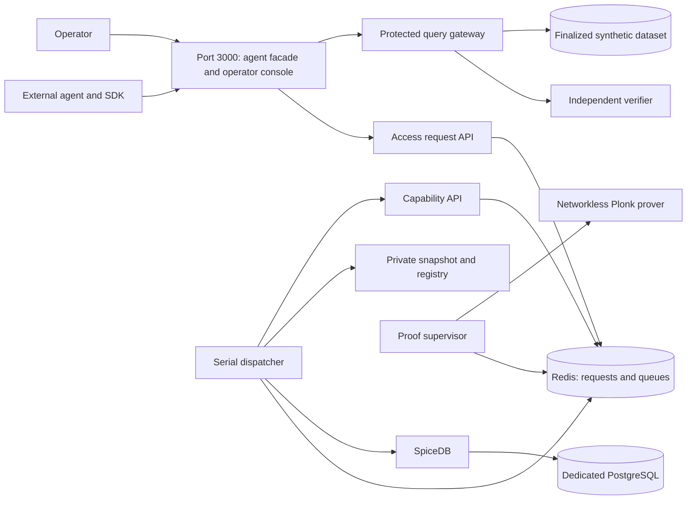

# M6 Live VM Checkpoint

This is the provisional SDK and operator deployment. Agent dashboards, the LLM
adapter, and the shared message channel are B-0067 work. The local SDK tests use
controlled proof responses. This runbook does not claim a completed live M6 proof.

## Runtime



Only port 3000 is published, on VM loopback by default. No database, Redis, gateway,
owner RPC, or prover port needs forwarding. The proof has eight CPUs, 56 GiB RAM,
and no swap. The verifier has 2 GiB RAM. Their child sandboxes have no network.
One proof runs at a time. There is no production mock-proof flag.

The Compose project is `raziel-m6-live`. Its named volumes and `.raziel/m6-live`
files are separate from M5 and the memory-backed `raziel-m6` preview. No state is
imported. Create new datasets, agents, and policy versions in this deployment.

## Prepare The VM

Use the same Linux x86_64, 64 GB VM and pinned Docker toolchain from M5.
Docker Compose must support `!override` and `!reset`. Host Node is needed only for
the render-check scripts. Rust, Go, pnpm, Buf, and SP1 run in the pinned container.
The existing verified Plonk setup remains at `.sp1/circuits/plonk/v6.1.0`.
Stop the old M5 proof workload before starting M6 on this one VM.

Pull the pushed backend commit on the VM. Do not run `git reset` or delete volumes.
Create the ignored repository-root `.env.m6` with these values:

```dotenv
RAZIEL_M5_OPERATOR_ID=operator-local
RAZIEL_M5_OPERATOR_PASSWORD=replace-with-at-least-12-characters
RAZIEL_M6_POSTGRES_PASSWORD=replace-with-a-long-alphanumeric-password
RAZIEL_M6_SPICEDB_TOKEN=replace-with-a-long-random-token
RAZIEL_M6_TRUST_DOMAIN_ID=raziel-m6-nus
RAZIEL_M6_CONSOLE_PORT=3000
RAZIEL_M6_OPERATOR_EXPECTED_ORIGIN=http://127.0.0.1:3000
```

Keep the PostgreSQL password alphanumeric. It is inserted into an internal database
URI. Keep these settings stable across restarts. The `M5` operator variable names
are retained for compatibility, but the operator record lives in M6 storage.

```bash
chmod 0600 .env.m6
docker pull postgres@sha256:9b18b78397054fce88a9552e9d5a3ad5bb7fd258c5b3cc1c5028e46373d6ea8f
./scripts/check-m6-live-compose
./scripts/prepare-m6-demo
./scripts/start-m6-demo
./scripts/compose-m6 --profile apps ps
```

Preparation downloads repository-locked dependencies, generates protocol code, and
builds current owner, proof, and verifier executables. It creates no proof or grant.
It can take longer on the first build. It never installs host language toolchains.
No automatic image pull occurs during startup. Existing pinned toolchain, Redis,
and SpiceDB images must already be present from the prior VM setup.

## View From The Mac

Reuse the SSH ControlMaster connection and forward the VM's port 3000:

```bash
ssh -N -L 3000:127.0.0.1:3000 gapaul-vm-i
```

Open `http://127.0.0.1:3000` on the Mac. This is local forwarding through SSH, not a
second application server. A public tunnel needs its actual browser origin in
`RAZIEL_M6_OPERATOR_EXPECTED_ORIGIN`. Do not expose internal service ports.

## Testable Flow

1. **Datasets**: create synthetic records, then finalize the dataset. Record its ID,
   revision, checksum, and query time range for the agent intent.
2. **Agents**: register the agent's public Ed25519 key and issue its API token. Keep
   the private key in the agent's own runtime. Configure the SDK with that signer,
   token, token ID, and the exact API audience from registration.
3. **Policy**: compile and publish a supported policy version. Publish another
   version without changing the first request's policy binding.
4. The SDK calls `createAccessRequest(intent)`. The operator opens **Access requests**,
   selects the installed policy version, sets its private grant options, and approves.
5. The SDK calls `waitForAccessRequest(id)`. At `AWAITING_SIGNATURE`, call
   `signIssuance(intent, request)`, retain the returned attempt, then call
   `submitIssuance(id, attempt)`. Continue polling until `READY` or a failure.
6. A signer absent for two minutes reaches `WAITING_FOR_AGENT`. It must explicitly
   call `resumeAccessRequest` with the current generation before signing a new proposal.
7. At `READY`, use the delivered public capability with `queryDataset`. Run another
   query with the same capability. The SDK creates fresh request signatures and
   nonces. Receipts distinguish independent verification from the cache.
8. Queue a second approved request during the first proof. It must wait without
   asking for its final signature until capacity is available.
9. Revoke the agent API token. A later query must fail even with a cached capability.

The SDK README contains the exact typed calls and response handling. The backend
vendors `gitaalekhyapaul-raziel-sdk-ts-0.1.0-b0066.tgz`. This is a local release
candidate. The authorized `0.1.0` publication completed on 2026-10-01. Public
registry metadata, `latest`, and archive integrity are verified. The backend shim
still uses its exact candidate pin. Demo-agent source now pins public `0.1.0`, with
its frozen install and production build verified. The migration is committed and
pushed, with obsolete archive cleanup at
`84f9eb135532cc52b89bbfbf20d77c1f85b12b7d`. Pull that checkpoint or a
later compatible commit before rebuilding the agents on the VM.
The [publication record](../agent/history/2026-10-01-sdk-publication-attempt.md)
separates upload acceptance from normal registry availability.

## Logs And Restart

```bash
./scripts/compose-m6 --profile apps logs --tail 80 m6-dispatcher m6-capability-api m6-proof-worker
./scripts/compose-m6 --profile apps logs --tail 80 m6-proof-sandbox m6-verifierd
./scripts/compose-m6 --profile apps stop
./scripts/start-m6-demo
```

Stop/start retains PostgreSQL, Redis, approvals, private snapshots, intents, and keys.
An uncertain proof submission is reconciled by deterministic job ID, not a new
nonce. Restart does not promise that an interrupted proof finishes successfully.
Never use `down --volumes` to repair an error. Do not share `.env.m6`, keys, intent
files, tuple data, or raw witness material in diagnostics.

## Evidence To Retain

Record the source commit, both request states, proof durations, public capability
sizes, verifier/cache receipt sources, and token-revocation rejection. Test the
query with dispatcher, capability API, and proof worker stopped. Verification must
remain available. Retain only redacted public outcomes, not private keys or grants.
