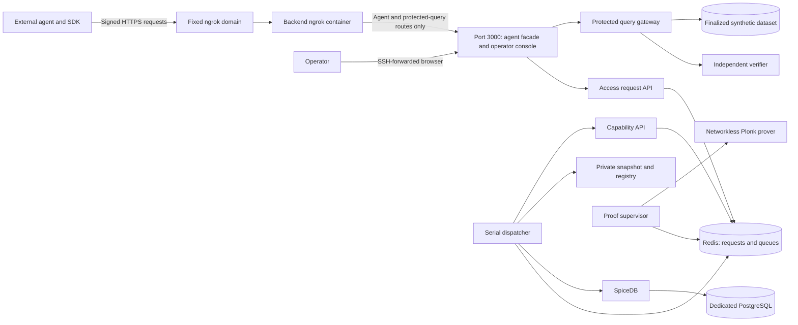

# M6 Live VM Checkpoint

This is the provisional SDK and operator deployment. Agent dashboards, the LLM
adapter, and the shared message channel are B-0067 work. The local SDK tests use
controlled proof responses. This runbook does not claim a completed live M6 proof.

## Scope And Locations

This runbook covers the backend only. All VM commands run in `~/hypha-backend`.
Its private settings file is `~/hypha-backend/.env.m6`. The agent repository uses
its own `.env.agents` and separate Docker Compose project. Do not run backend
scripts from the agent repository or use agent settings to start the backend.

For the full three-dashboard deployment, follow
[M7 Agent Demo](M7-AGENT-DEMO.md). It separates VM backend, VM agents, private LLM
files, and Mac forwarding. Its browser example uses Mac ports 13000-13002. The
standalone backend example below uses Mac port 3000. Pick one browser mapping and
match `RAZIEL_M6_OPERATOR_EXPECTED_ORIGIN` to it.

## Runtime



Only port 3000 is published, on VM loopback by default. No database, Redis, gateway,
owner RPC, or prover port needs forwarding. The proof has eight CPUs, 56 GiB RAM,
and no swap. The verifier has 2 GiB RAM. Their child sandboxes have no network.
One proof runs at a time. There is no production mock-proof flag.

The selected demo adds an opt-in fixed-domain ngrok container for agent API and
protected-query traffic. Operator browser access remains SSH-only. The tunnel
joins no owner network and mounts no private state. Ngrok's cloud can see permitted
API traffic. This route serves synthetic data, not private production records.

The Compose project is `raziel-m6-live`. Its named volumes and `.raziel/m6-live`
files are separate from M5 and the memory-backed `raziel-m6` preview. No state is
imported. Create new datasets, agents, and policy versions in this deployment.

## VM Backend: Prepare

Use the same Linux x86_64, 64 GB VM and pinned Docker toolchain from M5.
Docker Compose must support `!override` and `!reset`. Host Node is needed only for
the render-check scripts. Rust, Go, pnpm, Buf, and SP1 run in the pinned container.
The existing verified Plonk setup remains at `.sp1/circuits/plonk/v6.1.0`.
Stop the old M5 proof workload before starting M6 on this one VM.

Pull the pushed backend commit on the VM. Do not run `git reset` or delete volumes.
Run commands from `~/hypha-backend`. Create the ignored repository-root `.env.m6`
with these values. Keep an existing settings file and retained credentials on later starts:

```dotenv
RAZIEL_M5_OPERATOR_ID=operator-local
RAZIEL_M5_OPERATOR_PASSWORD=replace-with-at-least-12-characters
RAZIEL_M6_POSTGRES_PASSWORD=replace-with-a-long-alphanumeric-password
RAZIEL_M6_SPICEDB_TOKEN=replace-with-a-long-random-token
RAZIEL_M6_TRUST_DOMAIN_ID=raziel-m6-nus
RAZIEL_M6_CONSOLE_PORT=3000
RAZIEL_M6_OPERATOR_EXPECTED_ORIGIN=http://127.0.0.1:3000
RAZIEL_NGROK_URL=https://either-anymore-immunize.ngrok-free.dev
NGROK_AUTHTOKEN=replace-with-your-private-ngrok-authtoken
```

Keep the PostgreSQL password alphanumeric. It is inserted into an internal database
URI. Keep these settings stable across restarts. The `M5` operator variable names
are retained for compatibility, but the operator record lives in M6 storage.
The `compose-m6` wrapper passes this file to Docker Compose as `--env-file`.
Compose injects only the settings declared for each service. You do not need to
source the file or export every value manually.
Initializers generate policy/snapshot signing keys and the operator password
verifier in private runtime storage. Do not put those private keys in `.env.m6`.
Changing the configured password alone does not reset a retained operator record.
Edit the ngrok token in this private file. It reaches only the tunnel container.
No token belongs in chat or agent settings.

```bash
cd ~/hypha-backend
chmod 0600 .env.m6
docker pull postgres@sha256:9b18b78397054fce88a9552e9d5a3ad5bb7fd258c5b3cc1c5028e46373d6ea8f
docker pull ngrok/ngrok:3.39.11-alpine@sha256:187e588f6c4efe3b29cd3eea9fcd768a1afa7342319e3cee9aeb5af6a9cf64fd
./scripts/check-m6-live-compose
./scripts/check-ngrok-compose --m6
./scripts/prepare-m6-demo
./scripts/start-m6-demo --ngrok
./scripts/compose-m6 --ngrok --profile apps ps
```

Preparation downloads repository-locked dependencies, generates protocol code, and
builds current owner, proof, and verifier executables. It creates no proof or grant.
It can take longer on the first build. It never installs host language toolchains.
No automatic image pull occurs during startup. Existing pinned toolchain, Redis,
and SpiceDB images must already be present from the prior VM setup.

`--ngrok` starts the fixed endpoint inside the backend Compose stack and waits for
its health. No manual host tunnel is required. The plain command without this flag
retains backend-only startup for a separately supplied HTTPS ingress.

## Mac: View Backend

Reuse the SSH ControlMaster connection and forward the VM's port 3000:

```bash
ssh -N -L 3000:127.0.0.1:3000 gapaul-vm-i
```

Open `http://127.0.0.1:3000` on the Mac. This is local forwarding through SSH, not a
second application server. SSH alone is enough for this browser connection.
The operator's browser URL must match `RAZIEL_M6_OPERATOR_EXPECTED_ORIGIN`.
Agent containers use `https://either-anymore-immunize.ngrok-free.dev`. The full M7
runbook documents the Compose tunnel, agent settings, and public route checks.
Do not expose internal service ports.

## Testable Flow

1. **Datasets**: create synthetic records, then finalize the dataset. Record its ID,
   revision, checksum, and query time range for the agent intent.
2. **Agents**: register the agent's public Ed25519 key and issue its API token. Keep
   the private key in the agent's own runtime. Configure the SDK with that signer,
   token, token ID, and the exact API audience from registration.
3. **Policy**: compile and publish a supported policy version. Publish another
   version without changing the first request's policy binding.
4. The SDK calls `createAccessRequest(intent)`. The operator opens **Access requests**,
   selects the installed policy version, sets its private grant options, and approves.
5. The SDK calls `waitForAccessRequest(id)`. At `AWAITING_SIGNATURE`, call
   `signIssuance(intent, request)`, retain the returned attempt, then call
   `submitIssuance(id, attempt)`. Continue polling until `READY` or a failure.
6. A signer absent for two minutes reaches `WAITING_FOR_AGENT`. It must explicitly
   call `resumeAccessRequest` with the current generation before signing a new proposal.
7. At `READY`, use the delivered public capability with `queryDataset`. Run another
   query with the same capability. The SDK creates fresh request signatures and
   nonces. Receipts distinguish independent verification from the cache.
8. Queue a second approved request during the first proof. It must wait without
   asking for its final signature until capacity is available.
9. Revoke the agent API token. A later query must fail even with a cached capability.

The SDK README contains the exact typed calls and response handling. The backend
vendors `gitaalekhyapaul-raziel-sdk-ts-0.1.0-b0066.tgz`. This is a local release
candidate. The authorized `0.1.0` publication completed on 2026-10-01. Public
registry metadata, `latest`, and archive integrity are verified. The backend shim
still uses its exact candidate pin. Demo-agent source now pins public `0.1.0`, with
its frozen install and production build verified. The migration is committed and
pushed, with obsolete archive cleanup at
`84f9eb135532cc52b89bbfbf20d77c1f85b12b7d`. Pull that checkpoint or a
later compatible commit before rebuilding the agents on the VM.
The [publication record](../agent/history/2026-10-01-sdk-publication-attempt.md)
separates upload acceptance from normal registry availability.

## VM Backend: Restart

### Offline SP1 Build Cache

An older preparation run can leave `m6-proof-build` unable to resolve
`gecko_profile` during SP1's nested `cargo metadata` call. Fetching Raziel's
`Cargo.lock` alone does not prepare the two published SP1 runner lockfiles.
This is a build-cache failure, not an authorization proof failure.

Pull the repair, then run this targeted preparation in the VM backend checkout:

```bash
cd ~/hypha-backend
git pull --ff-only origin main
./scripts/prepare-m6-proof-runtime
./scripts/start-m6-demo --ngrok
./scripts/compose-m6 --ngrok --profile apps ps
```

The helper uses SP1 6.3.1's checksum-pinned published lockfiles, including optional
profiling packages. It does not turn profiling on or change Raziel's dependency
lockfile. The preparation command fetches the workspace Rust graph, both native
runner graphs, and the pinned Gnark Go modules before the offline proof build.
It starts no runtime service or proof job. The subsequent build checks dependency
resolution offline with a read-only cache. The prover keeps its network isolation.
Normal bootstrap and `./scripts/prepare-m6-demo` now perform this prefetch automatically.

### Recover The Existing Public Go Cache

On October 14, a fresh local fetch of SP1's pinned `gnark-ignition-verifier` module
returned HTTP 404 upstream. The VM's earlier successful proof runs left the public
cache `raziel_razield-proof-go-mod-cache`. Use this explicit recovery for that VM:

```bash
cd ~/hypha-backend
git pull --ff-only origin main
./scripts/prepare-m6-proof-runtime --reuse-go-cache raziel_razield-proof-go-mod-cache
./scripts/start-m6-demo --ngrok
./scripts/compose-m6 --ngrok --profile apps ps
```

Recovery mounts the legacy public cache read-only. It checks the exact SP1 module
manifest, the pinned source checksums, offline module completeness, and Go's module
integrity checks. It copies only public dependencies into the separate M6 cache.
Existing destination entries are not overwritten. A conflicting or incomplete
cache fails the checks. The source stays unchanged. No private volume or Docker
socket enters the recovery container. No dependency version or fork changes.

The proof build still has no network access. Recovery does not generate a proof,
delete a volume, or rebuild the toolchain image. A missing or invalid legacy cache
needs investigation. Do not clear it or upgrade cryptographic dependencies to pass.

The console now has a bounded HTTP readiness check on its internal port 3000.
Ngrok waits for this check. Preparation without the ngrok overlay can report the
existing tunnel as an orphan. This warning does not require removing the tunnel.
Do not add `--remove-orphans` for that warning.

### Permanent Zero-Swap Repair

Symptom: a job records `PROVING`, then fails almost immediately with
`SERVICE_UNAVAILABLE`. The sandbox reports `memory.swap.max=max`, but Docker
inspect still records equal memory and memory-swap limits. The prover rejects
that environment before receiving private input. This is not evidence of an OOM.

The M6 Compose definitions now set the per-container OCI annotation
`org.systemd.property.MemorySwapMax: "uint64 0"` on the proof and verifier
sandboxes. Systemd retains an explicit zero for their scopes. New containers
receive the same property without a manual `systemctl set-property` command.
Health checks reject an incorrect actual RAM limit, nonzero/unlimited swap,
or an invalid launcher socket. No additional privilege or host-wide swap change
is required. This preserves ADR-0015's existing resource contract.

The observed drift matches
[opencontainers/cgroups issue 74](https://github.com/opencontainers/cgroups/issues/74).
The annotation uses the documented
[runc systemd auxiliary properties](https://github.com/opencontainers/runc/blob/main/docs/systemd.md#auxiliary-properties).
With a cgroupfs driver, the systemd annotation is not applied. Docker's existing
equal memory/memory-swap limits and the same actual-cgroup health checks remain.

Apply this update only after every admitted proof has finished or cancellation
has reached a terminal state. Do not interrupt a working proof for this repair.
All commands below run in the VM backend checkout:

```bash
cd ~/hypha-backend
git pull --ff-only origin main
./scripts/check-m6-live-compose

./scripts/compose-m6 --ngrok --profile apps up \
  --detach --no-deps --force-recreate --wait --wait-timeout 120 \
  m6-proof-sandbox m6-verifier-sandbox

./scripts/compose-m6 --ngrok --profile apps exec -T \
  m6-proof-sandbox cat /sys/fs/cgroup/memory.swap.max
./scripts/compose-m6 --ngrok --profile apps exec -T \
  m6-verifier-sandbox cat /sys/fs/cgroup/memory.swap.max
```

Both outputs must be `0`, and both sandbox health checks must pass. This recreates
only the two sandboxes. It preserves volumes, identities, policies, datasets, and
the rest of the stack. No binary build, image download, sudo command, or proof
submission belongs to this update. A previously failed request remains failed.
Use a new access request for the next proof test after confirming health.

If a later health check fails, inspect its fixed diagnostic message:

```bash
docker inspect --format '{{json .State.Health}}' raziel-m6-live-m6-proof-sandbox-1
docker inspect --format '{{json .State.Health}}' raziel-m6-live-m6-verifier-sandbox-1
```

Do not remove the child's no-swap check or replace it with a Docker-inspect-only
check. Readiness does not establish proof success or the full M7 acceptance gate.

### Guest Identity And Grant Form Repair

A separate 16-minute attempt failed without an OOM. Public-only inspection found
that its freshly rebuilt guest had a different program key from the verifier's
approved c809 identity. The old comparison ran after the expensive proof call.
The discarded child error does not establish the exact last internal failure.

Preparation now installs the pinned approved public guest and checks its checksum
and both key identifiers. The child repeats the key check before private input.
The approved verifier key stays unchanged. `--check-program-key` checks only public
program material. It does not generate a proof, load a snapshot, or contact Redis.

The approval form now derives required input names from the exact approved policy.
Direct and dual-direct policies show no private grant controls. Team policies show
Team ID. Organization policies show Organization ID. Caveats show their referenced
stored inputs. ANY/ALL show the union. Hidden fields retain valid internal defaults
for the existing complete grant payload. Changing selection resets edited values.
The catalogue remains operator-only. No policy or grant recipe reaches an agent.

Apply both fixes after every admitted proof finishes or reaches terminal cancellation.
This offline rebuild uses the VM's existing caches and preserves every volume:

```bash
cd ~/hypha-backend
git pull --ff-only origin main
./scripts/check-m6-live-compose
./scripts/compose-m6 --ngrok --profile apps stop
./scripts/compose-m6 run --rm --no-deps \
  -e CARGO_NET_OFFLINE=true -e GOPROXY=off \
  m6-toolchain ./scripts/prepare-m6-tools
./scripts/compose-m6 --profile apps run --rm --no-deps m6-proof-build
./scripts/compose-m6 --ngrok --profile apps up \
  --detach --force-recreate --wait --wait-timeout 900
./scripts/compose-m6 --ngrok --profile apps exec -T \
  m6-proof-sandbox /opt/raziel-runtime/razield-prover --check-program-key
```

Both preparation and the last command must report `approved_program_key=pass`.
Reload the operator browser. Request a new capability from the agent. A failed
request remains failed. Do not replace the expected key with a newly derived key,
clear Redis, delete volumes, or recreate agent identities for this repair.
Deployment readiness is not a completed real-proof acceptance result.

### Normal Restart

```bash
cd ~/hypha-backend
./scripts/compose-m6 --ngrok --profile apps logs --tail 80 m6-dispatcher m6-capability-api m6-proof-worker
./scripts/compose-m6 --ngrok --profile apps logs --tail 80 m6-proof-sandbox m6-verifierd
./scripts/compose-m6 --ngrok --profile apps stop
./scripts/start-m6-demo --ngrok
```

Stop/start retains PostgreSQL, Redis, approvals, private snapshots, intents, and keys.
An uncertain proof submission is reconciled by deterministic job ID, not a new
nonce. Restart does not promise that an interrupted proof finishes successfully.
Never use `down --volumes` to repair an error. Do not share `.env.m6`, keys, intent
files, tuple data, or raw witness material in diagnostics.

## Evidence To Retain

Record the source commit, both request states, proof durations, public capability
sizes, verifier/cache receipt sources, and token-revocation rejection. Test the
query with dispatcher, capability API, and proof worker stopped. Verification must
remain available. Retain only redacted public outcomes, not private keys or grants.
