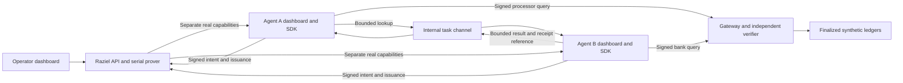

# Three-Dashboard Agent Demo

Status: B-0067 local feature checkpoint. The connected VM proof and complete recording
remain pending. This runbook describes the deployment to validate, not a passed M7 gate.

Agent source checkpoint: `54aa8090d1b2ff20d4bb545a71b7745fc9025efd`.
SDK source: `e7f1cd6b354f236f0323d9d19aa4a431c5dfa470`. Packaged candidate SHA-256:
`556abe87978429a1542bfbbe8d81edd48a8be92ceeb07b1731eb18e8233ce572`.

## Components

| Dashboard | Role | VM loopback port |
| --- | --- | --- |
| Operator | Seed/edit/finalize ledgers, publish policies, register keys, review requests | `3000` |
| Agent A | Request processor access, query payments, send lookup, inspect reply | `3001` |
| Agent B | Select lookup, request bank access, query settlements, send evidence | `3002` |

The agent repository owns two separate processes and private volumes. Its shared
channel has no host port and grants no protected-data access. Agent reads use the
packaged SDK, a real capability, and the protected gateway. Proofs remain serial.



## Deployment Prerequisites

Use sibling checkouts `hypha-backend` and `raziel-demo-agents`. The separate
`raziel-sdk-ts` checkout holds SDK source but is not needed to start the containers.
The agent repository includes its exact SDK candidate tarball and lockfile. No
public npm release is required for this run. Pull the pushed feature checkpoint:

```bash
cd ~/hypha-backend
git pull --ff-only origin main
cd ~/raziel-demo-agents
git pull --ff-only origin main
```

If the agent checkout does not exist on the VM, create it first from the separate
repository. This does not change backend source or copy secrets:

```bash
cd ~
git clone https://github.com/gitaalekhyapaul/raziel-demo-agents.git
```

Do not deploy unpushed local files or pull directly through an unresolved PAT prompt.

Prepare and start the backend using [M6 Live VM](M6-LIVE-VM.md). It uses fresh
`raziel-m6-live` state, not the old M5 or partial preview state. Retain the pinned
Docker toolchain and verified local Plonk setup. No host language-toolchain install
is required for the agent containers.

For the Mac-ngrok route below, set the backend's ignored `.env.m6` browser origin
to `http://127.0.0.1:13000` before backend startup. Keep its VM console port `3000`.
Stop the old M5 proof stack before starting this fresh deployment on the same VM.
Then run from `~/hypha-backend`:

```bash
./scripts/check-m6-live-compose
./scripts/prepare-m6-demo
./scripts/start-m6-demo
./scripts/compose-m6 --profile apps ps
```

The linked M6 runbook specifies `.env.m6`, the pinned PostgreSQL image, existing
Redis/SpiceDB/toolchain images, and Plonk setup prerequisites. Preparation builds
dependencies and binaries. It does not generate a proof. Startup waits for health.

In the agent checkout, create the ignored settings file:

```bash
cp .env.example .env.agents
chmod 0600 .env.agents
```

Set `AGENT_DASHBOARD_PASSWORD` to at least 12 characters. Set distinct
`CHANNEL_TOKEN_A` and `CHANNEL_TOKEN_B`, each at least 32 characters. Set
`SOCLAAS_ENV_PATH` to the private SoC file on the VM. The file uses
`SOCLAAS_BASE_URL`, `SOCLAAS_MODEL`, and `SOCLAAS_API_KEY`. It stays outside Git and
the image build context. No LLM credentials are entered in a dashboard. Keep that
file at mode `0600`. A Mac path is not a VM path. Transfer the private file to the
VM through the existing SSH connection and set its VM path in `.env.agents`.

For the Mac browser ports below, set these two values before agent startup:

```dotenv
AGENT_A_ORIGINS=http://127.0.0.1:13001
AGENT_B_ORIGINS=http://127.0.0.1:13002
```

Run from the agent checkout:

```bash
docker compose --env-file .env.agents build --pull=false agent-a
docker compose --env-file .env.agents up -d --wait
docker compose --env-file .env.agents ps
```

Default private volume ownership is UID/GID `1000`. Set `AGENT_UID` and `AGENT_GID`
before the first build for a different runtime user. Do not change existing volume
ownership or delete volumes as a startup repair.

## API Reachability

The SDK requires HTTPS outside loopback. A Docker service name and
`host.docker.internal` are not loopback. Agents must not join backend owner networks.
SSH browser forwarding does not create an API endpoint inside each container.

One free ngrok assigned HTTPS domain can serve the operator/API for both agents.
No custom domain or Premium subscription is required. The Mac already has ngrok
`3.39.11`; the VM SSH session currently has no ngrok command on its path. The tunnel
can run on the Mac through an SSH-forwarded VM port, with no new VM installation.

For that option, use a free Mac port, such as `13000`, and set the backend's
`RAZIEL_M6_OPERATOR_EXPECTED_ORIGIN=http://127.0.0.1:13000` in `.env.m6` before startup.
The VM console port remains `3000`. Run on the Mac and retain the SSH session:

```bash
ssh -N -L 13000:127.0.0.1:3000 -L 13001:127.0.0.1:3001 -L 13002:127.0.0.1:3002 gapaul-vm-i
```

For these browser ports, set `AGENT_A_ORIGINS=http://127.0.0.1:13001` and
`AGENT_B_ORIGINS=http://127.0.0.1:13002` in the VM agent settings before startup.
Open the three dashboards at local ports `13000`, `13001`, and `13002`. In another
Mac terminal, with its ngrok account configured, run:

```bash
ngrok http 13000
```

Only the console/API port is exposed through ngrok. The agent containers use its
HTTPS URL. The SSH session and Mac tunnel must remain running for their API calls.
This route passes through the Mac; it is not an autonomous VM ingress deployment.
Do not start public exposure without the maintainer's deployment approval.

An already configured VM ngrok client can instead expose the VM console directly:

```bash
ngrok http 3000
```

Use its reported HTTPS URL as both agents' **API base URL**. Keep their **Audience**
equal to the exact value supplied during agent registration, not a guessed URL.
Follow the [ngrok free-plan limits](https://ngrok.com/docs/pricing-limits/free-plan-limits/).
Free HTML browsing has an interstitial. The dashboards can remain SSH-forwarded.
Check SDK API reachability during deployment. Do not claim this path passed locally.
An absent ngrok client requires a pinned installation approval before installation.
A deployment-provided trusted HTTPS endpoint can replace the tunnel.

For the default browser ports rather than the Mac-ngrok example above, forward:

```bash
ssh -N -L 3000:127.0.0.1:3000 -L 3001:127.0.0.1:3001 -L 3002:127.0.0.1:3002 gapaul-vm-i
```

Open `http://127.0.0.1:3000`, `http://127.0.0.1:3001`, and
`http://127.0.0.1:3002`. Nondefault browser ports need matching agent origins.
The operator's expected browser origin remains the SSH URL for this flow. The agent
API uses token/key authentication, not the operator's browser session.

## Recording Flow

1. Operator **Datasets**: select **Seed reconciliation ledgers**. Select and finalize
   `processor-demo-v1` and `bank-demo-v1`. Each starts with three editable synthetic rows.
2. Operator **Policy**: compile and publish a supported version. Publication creates
   no capability. Use an installed policy version during request review.
3. Each agent **Identity**: copy its public key. Operator **Agents**: register that
   key and issue a separate token. Return to each agent and save its API URL, audience,
   and token. The token is write-only in the browser and private in server storage.
4. Agent A **Tasks / New task**: request `processor-demo-v1`, revision `1`, with UTC
   range `2026-10-01T00:00:00Z` through `2026-10-01T23:59:59Z`.
5. Operator **Access requests**: select and approve A's exact request and policy.
   A polls and signs the prepared proposal. Record waiting/proving/ready states.
   Keep the real proof running. Use a video time cut, not a replacement response.
6. Agent A **Authorized rows**: query the dataset. Record its verifier receipt.
   **Settlement lookup**: send `processor-001`. The shared reference is `recon-exact-001`.
7. Agent B **New task**: select that incoming task and lookup. Request `bank-demo-v1`,
   revision `1`, with the same UTC range. Approve B's separate request in the operator.
   Wait for its separate real serial proof.
8. Agent B **Authorized rows**: query the bank ledger. **Settlement evidence**: send
   the result. Agent A **Messages** and **Reconciliation result** show the bounded reply.
9. Repeat queries with the existing capabilities. Edit the UTC window to narrow rows.
   Record a `CACHE` receipt and no additional proof job. Dataset and task bindings stay fixed.
10. Repeat A's lookup with `processor-002` and `processor-003` to show missing and
    ambiguous settlements. These messages reuse the same shared task and capabilities.
    Agent B selects the relevant lookup before returning evidence.
11. **Run agent** invokes the configured model's bounded tools for the selected task.
    Manual query/message controls remain available after a model failure.

**Pause** stops new automatic task actions, not an in-flight API call or an already
admitted proof. A completed signature stays private for exact reuse. Paused
cancellations keep status polling until the terminal result. **Resume**
handles a paused task or `WAITING_FOR_AGENT`. **Retry** retains the exact intent,
signing attempt, or pending message ID. **Cancel task** requests SDK cancellation.
Changing connection identity or installation with existing tasks is rejected.

Amounts use integer minor units. Results describe the authorized query window.
A full 100-row page requires a narrower query before evidence publication. A model
summary and settlement result are business output, not ZK proof of transaction truth.

## Remaining Acceptance

This checkpoint is ready for provisional deployment, not a completed demo claim.
First validate Agent A's registration, inbox approval, real proof, and protected
query. Then run B's separate capability and the full shared reconciliation flow.
Keep npm publication deferred. No dummy capability or recorded verifier response
is used by these containers.

Retain source commits, image/SDK versions, dataset revisions/checksums, both real
proof durations, public capability sizes, verifier/cache receipt sources, and bounded
messages. Validate wrong key/scope, replay, expiry, and token revocation without
returning protected rows. Verify with issuer/dispatcher/prover roles stopped.
Capture the three-dashboard VM walkthrough after these connected checks pass.
Never retain private keys, API tokens, issuance signatures, witness data, or raw
provider error bodies in the evidence bundle. Stop/start preserves all private state.
