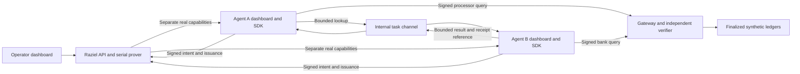
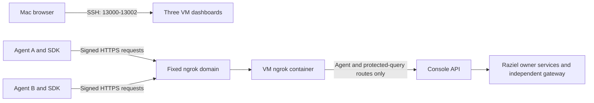

# Three-Dashboard Agent Demo

Status: B-0067 local feature checkpoint. The connected VM proof and complete recording
remain pending. This runbook describes the deployment to validate, not a passed M7 gate.

Agent feature checkpoint: `54aa8090d1b2ff20d4bb545a71b7745fc9025efd`.
Public-SDK agent checkpoint with archive cleanup, committed and pushed:
`84f9eb135532cc52b89bbfbf20d77c1f85b12b7d`.
SDK release documentation checkpoint, committed and pushed:
`6239fad9d02b1047806b3c449eb593ea7cd9f119`.
Agent fixed-origin deployment checkpoint:
`71d238ecca44fe5a98c50193fc028c1b2208da6e`.
SDK runtime source: `e7f1cd6b354f236f0323d9d19aa4a431c5dfa470`. Agent source now
pins public npm package `@gitaalekhyapaul/raziel-sdk-ts@0.1.0`. The lockfile records
the verified registry integrity. See the
[migration evidence](../agent/history/2026-10-01-agent-public-sdk-consumption.md).

## Components

| Dashboard | Role | VM loopback port |
| --- | --- | --- |
| Operator | Seed/edit/finalize ledgers, publish policies, register keys, review requests | `3000` |
| Agent A | Request processor access, query payments, send lookup, inspect reply | `3001` |
| Agent B | Select lookup, request bank access, query settlements, send evidence | `3002` |

The agent repository owns two separate processes and private volumes. Its shared
channel has no host port and grants no protected-data access. Agent reads use the
packaged SDK, a real capability, and the protected gateway. Proofs remain serial.



## Where To Work

Every command below names its machine and working directory.

| Location | Working directory | Responsibility | Private settings |
| --- | --- | --- | --- |
| VM backend | `~/hypha-backend` | Operator, API, database, queue, prover, verifier | `.env.m6` |
| VM agents | `~/raziel-demo-agents` | Agent A, Agent B, shared channel | `.env.agents` |
| VM private files | `~/raziel-secrets` | Supplied SoC credentials, outside both repos | `soclaas.env` |
| Mac browser | Any directory | SSH dashboard forwarding | Existing SSH ControlMaster |
| Mac backend development | Local `hypha-backend` checkout | Optional Docker ingress to an existing local backend | `.env.ngrok` |

The SDK source checkout is not needed on the VM. Agent builds install exact public
SDK `0.1.0` from the lockfile. Installation needs registry access on a cold cache,
not an npm publishing token. Keep Git/PAT authentication under maintainer control.

## VM Backend: Configure

Working directory: `~/hypha-backend`.

```bash
cd ~/hypha-backend
git pull --ff-only origin main
git status --short
```

Create `~/hypha-backend/.env.m6` with private values. Edit the existing file on
later starts rather than replacing retained credentials.

```dotenv
RAZIEL_M5_OPERATOR_ID=operator-local
RAZIEL_M5_OPERATOR_PASSWORD=replace-with-at-least-12-characters
RAZIEL_M6_POSTGRES_PASSWORD=replace-with-a-long-alphanumeric-password
RAZIEL_M6_SPICEDB_TOKEN=replace-with-a-long-random-token
RAZIEL_M6_TRUST_DOMAIN_ID=raziel-m6-nus
RAZIEL_M6_CONSOLE_PORT=3000
RAZIEL_M6_OPERATOR_EXPECTED_ORIGIN=http://127.0.0.1:13000
RAZIEL_NGROK_URL=https://either-anymore-immunize.ngrok-free.dev
NGROK_AUTHTOKEN=replace-with-your-private-ngrok-authtoken
```

```bash
cd ~/hypha-backend
chmod 0600 .env.m6
```

The `M5` operator variable names are compatibility names. This deployment stores
its operator record in separate M6 runtime storage. The PostgreSQL password must
be alphanumeric for its database URI. Keep the database password and SpiceDB token
stable across restarts. The retained token initializer rejects a changed token.
Changing the operator password in this file does not reset an existing operator
record. An explicit operator reset is separate from normal startup.

`./scripts/compose-m6` reads this repo's `.env.m6` through Compose `--env-file`.
Compose passes declared settings to their service environments. The operator
initializer stores a salted password verifier, not a plain-text login password.
The policy and snapshot signing keys are generated on first initialization and
retained in owner-only runtime volumes. Do not create those keys in an env file.

The ngrok token belongs only in backend settings. Get it from your account and edit
the private file directly. Do not send it through chat or put it in agent settings.
The domain is public and stable. It is not the registration audience or an agent ID.

## VM Backend: Prepare And Start

Working directory: `~/hypha-backend`.

Use the existing pinned Docker toolchain and approved Plonk setup. Host Node is
needed for the render check. Rust, Go, pnpm, Buf, and SP1 stay in the toolchain.
The [M6 backend runbook](M6-LIVE-VM.md) lists image and setup prerequisites.

Finish or cancel an active M5 proof through its existing controls first. Stop the
old stack before starting M6 on the same VM. Stopping preserves its volumes.

```bash
cd ~/hypha-backend
./scripts/compose --profile apps --profile m5-live stop
docker pull postgres@sha256:9b18b78397054fce88a9552e9d5a3ad5bb7fd258c5b3cc1c5028e46373d6ea8f
docker pull ngrok/ngrok:3.39.11-alpine@sha256:187e588f6c4efe3b29cd3eea9fcd768a1afa7342319e3cee9aeb5af6a9cf64fd
./scripts/check-m6-live-compose
./scripts/check-ngrok-compose --m6
./scripts/prepare-m6-demo
./scripts/start-m6-demo --ngrok
./scripts/compose-m6 --ngrok --profile apps ps
```

Preparation builds dependencies and binaries. It generates no authorization proof.
Startup waits for service health. The project is `raziel-m6-live`, with separate
volumes and runtime files. It imports no M5 or preview state. Never use
`down --volumes` as a startup repair.

The startup command starts ngrok inside Compose and waits for its fixed endpoint.
It forwards directly to the console container. A host ngrok process and a Mac API
tunnel are not needed. The image is pinned for native Mac arm64 and VM amd64.
Cold setup needs the explicit image pull above. Startup never downloads images.

If an older checkout reports `invalid mount path: 'mode=0700'` or
`invalid mount path: 'size=268435456'`, pull the dispatcher tmpfs repair before
retrying. Its YAML mount must be one quoted entry, not six separate list items.
No image rebuild, proof rerun, or volume deletion is needed for this repair:

```bash
cd ~/hypha-backend
git pull --ff-only origin main
./scripts/check-m6-live-compose
./scripts/start-m6-demo --ngrok
```

If startup reports `error mounting` at `/workspace/.raziel/m6` followed by
`read-only file system`, pull the runtime bind-mount repair and use the same retry
commands above. The old target was nested inside the initializers' read-only source
mount. A fresh workspace did not contain that mountpoint.

The repaired containers mount the existing host `.raziel/m6-live` directory at
`/var/lib/raziel/m6`. Operator records, policy drafts, versions, transactions, and
receipts keep their host locations. All four runtime consumers use the new container
path. Initializers retain their read-only source mounts. No data migration,
permission change, dependency preparation, image rebuild, or proof rerun is needed.
Let normal startup recreate the affected containers. Do not create the old nested
mountpoint manually or delete runtime files and volumes.

If `m6-proof-build` reports missing `gecko_profile` during offline Cargo metadata,
follow the [targeted SP1 build-cache repair](M6-LIVE-VM.md#offline-sp1-build-cache).
The fix prefetches both published SP1 runner lockfiles, then rebuilds the failed
runtime. It changes no proof features, package versions, private data, or images.

For a missing finalized Go modfile or the pinned Go module's upstream 404, use the
[public Go cache recovery](M6-LIVE-VM.md#recover-the-existing-public-go-cache).
The recovery uses the legacy VM dependency cache, not private M5 state. The console
HTTP health check now supplies the readiness prerequisite used by ngrok.

An access-API health check can recover after a failed startup. Check its current
health rather than treating an earlier unhealthy summary as a persistent fault.

### Ngrok Auth-File Startup Repair

The pinned image creates `/var/lib/ngrok/auth-config.yml` from `NGROK_AUTHTOKEN`
at startup. An older Compose configuration has a read-only root without a writable
auth directory. Its logs report `can't create ... auth-config.yml: Read-only file system`,
then `Error reading configuration file`. This prevents the public endpoint from starting.

The repaired role keeps the root read-only and adds a private 1 MiB RAM-backed
directory at `/var/lib/ngrok`, owned by UID/GID 1000 with mode `0700`. The image's
`NGROK_CONFIG` setting points to our existing read-only base config. No auth file
is persisted on the host or in a named volume. Keep your existing private token.

With the rest of the backend running, pull and recreate only the console and
tunnel in the VM backend repo:

```bash
cd ~/hypha-backend
git pull --ff-only origin main
./scripts/check-ngrok-compose --m6
./scripts/compose-m6 --ngrok --profile apps up \
  --detach --no-deps --force-recreate --wait --wait-timeout 300 demo-console
./scripts/compose-m6 --ngrok --profile apps up \
  --detach --no-deps --force-recreate --wait --wait-timeout 120 raziel-ngrok
./scripts/compose-m6 --ngrok --profile apps ps demo-console raziel-ngrok
./scripts/compose-m6 --ngrok --profile apps logs --no-color --tail 50 raziel-ngrok
```

No image rebuild, dependency preparation, proof rerun, agent restart, or volume
deletion is needed. A running proof worker stays untouched. For a stopped full
backend, use `./scripts/start-m6-demo --ngrok` after the existing preparation gates pass.

Check the outgoing path from the VM agent repo without a token:

```bash
cd ~/raziel-demo-agents
docker compose --env-file .env.agents exec -T agent-a node -e \
"fetch('https://either-anymore-immunize.ngrok-free.dev/api/agent/v1/me',{signal:AbortSignal.timeout(10000)}).then(async r=>console.log(r.status,(await r.text()).slice(0,400))).catch(e=>{console.error(e.cause?.code??e.message);process.exitCode=1})"
```

Expected: HTTP `401` with Raziel JSON containing `NOT_AUTHORIZED`. This unsigned
probe confirms network routing and the authentication guard, not token validity
or proof acceptance. Then retry **Save connection** with the exact audience and
agent-specific token. Inspect the response error code for a continuing failure.
Agent logs do not currently print caught request errors. Startup-only logs do not
show whether a request arrived.

### Public Ingress Health

From the Mac or VM, run this GET request without credentials:

```bash
curl -i --max-time 15 https://either-anymore-immunize.ngrok-free.dev/api/health
```

Expected: HTTP `200`, `Cache-Control: no-store`, and `{"status":"ok"}`. This checks
the public endpoint, tunnel forwarding, and console liveness. It does not check
Redis, SpiceDB, the proof worker, capability validity, or private data. Use GET,
not `curl -I`: HEAD and other methods are not public on this route. The root and
operator paths remain blocked by the ingress policy.

## VM Private Files: Prepare SoC Credentials

Working directory: any directory on the VM.

```bash
install -d -m 0700 ~/raziel-secrets
```

Transfer the previously supplied file from the Mac through the existing SSH alias.
The following command runs on the Mac, not the VM:

```bash
scp /Users/gitaalekhyapaul/Downloads/soclaas.env gapaul-vm-i:raziel-secrets/soclaas.env
```

Return to the VM:

```bash
chmod 0600 ~/raziel-secrets/soclaas.env
```

The file contains `SOCLAAS_BASE_URL`, `SOCLAAS_MODEL`, and `SOCLAAS_API_KEY`.
Do not paste its contents into chat, Git, terminal diagnostics, or a dashboard.
Do not transfer it over an unresolved or untrusted SSH connection.

## VM Agents: Clone Or Update

Working directory: the VM home directory, then `~/raziel-demo-agents`.

First setup only:

```bash
cd ~
git clone https://github.com/gitaalekhyapaul/raziel-demo-agents.git
```

For an existing checkout:

```bash
cd ~/raziel-demo-agents
git pull --ff-only origin main
```

For either path, inspect the checkout:

```bash
cd ~/raziel-demo-agents
git log -1 --oneline
git status --short
```

Use the public-package checkpoint listed at the top or a later compatible commit.
The obsolete SDK archive is not a dependency.
The fixed API-origin default needs the newer deployment checkpoint listed above.

## VM Agents: Configure

Working directory: `~/raziel-demo-agents`.

First setup only, with no existing `.env.agents`:

```bash
cd ~/raziel-demo-agents
cp .env.example .env.agents
chmod 0600 .env.agents
```

Edit this file with private values and the absolute VM path to the SoC file:

```dotenv
AGENT_DASHBOARD_PASSWORD=replace-with-at-least-12-characters
CHANNEL_TOKEN_A=replace-with-a-random-token-at-least-32-characters
CHANNEL_TOKEN_B=replace-with-a-different-token-at-least-32-characters
RAZIEL_API_BASE_URL=https://either-anymore-immunize.ngrok-free.dev
SOCLAAS_ENV_PATH=/home/sadm/raziel-secrets/soclaas.env
AGENT_A_ORIGINS=http://127.0.0.1:13001
AGENT_B_ORIGINS=http://127.0.0.1:13002
```

Use two distinct channel tokens. They authenticate the internal agent message
service, not Raziel data access. The dashboard password is an agent-console login,
not the backend operator password.

`docker compose --env-file .env.agents` loads startup values for interpolation.
The agent services then load the separate SoC file through Compose `env_file`.
Its credentials reach only Agent A and Agent B's runtime environments, not the
shared channel or backend. They are not copied into the Docker image.
`src/config.ts` reads those environment values for the OpenAI-compatible client.
`LLM_BASE_URL`, `LLM_MODEL`, and `LLM_API_KEY` override the matching SoC values.
Do not set `LLM_ENV_FILE` for this Compose route. That setting is for a native
process reading a file directly. Without LLM configuration, manual controls remain.

`RAZIEL_API_BASE_URL` prefills both Identity forms. It does not connect an agent or
replace its token. A saved connection keeps its stored URL across restarts and
overrides this default. Do not switch an agent with retained tasks to a different
installation. Its registrations, tokens, tasks, and capabilities belong to that backend.

Browser origins and API destinations have separate roles:

| Setting | Checked by | Purpose |
| --- | --- | --- |
| `RAZIEL_API_BASE_URL` | Agent configuration and SDK | Destination for server-side signed requests to Raziel |
| `AGENT_A_ORIGINS`, `AGENT_B_ORIGINS` | Each agent dashboard server | Protect its own cookie-authenticated browser actions |
| `RAZIEL_M6_OPERATOR_EXPECTED_ORIGIN` | Backend operator console | Protect operator browser actions, accepting its own request origin too |

The backend does not inspect the agent-dashboard origin lists. SDK calls run on
the agent server, not in the browser, so browser CORS does not apply to that hop.
No new backend origin allowlist belongs to this ngrok change. For another browser
port or hostname, edit that dashboard's comma-separated origin setting. Keep
unrelated websites outside cookie-authenticated mutation access.

An env file is private local configuration, not a production secret vault.
VM administrators and users with Docker access can inspect container environments.
Do not share `docker compose config`, `docker inspect`, or `printenv` output that
contains interpolated credentials.

## VM Agents: Build And Start

Working directory: `~/raziel-demo-agents`.

```bash
cd ~/raziel-demo-agents
docker compose --env-file .env.agents build --pull=false agent-a
docker compose --env-file .env.agents up -d --wait
docker compose --env-file .env.agents ps
```

Default volume ownership is UID/GID `1000`. Set `AGENT_UID` and `AGENT_GID`
before the first build for another runtime user. Keep existing volume ownership.
Each agent generates its separate Ed25519 key on first start and retains it in its
private volume. Private key and state files use owner-only permissions.
No agent private key belongs in `.env.agents`.

## Mac: Open The Dashboards

Working directory: any directory on the Mac. Keep this terminal running.

```bash
ssh -N -o ExitOnForwardFailure=yes \
  -L 127.0.0.1:13000:127.0.0.1:3000 \
  -L 127.0.0.1:13001:127.0.0.1:3001 \
  -L 127.0.0.1:13002:127.0.0.1:3002 \
  gapaul-vm-i
```

Open the operator at `http://127.0.0.1:13000`, Agent A at
`http://127.0.0.1:13001`, and Agent B at `http://127.0.0.1:13002`.
SSH alone supplies this browser access. No ngrok process is needed to open or
control the dashboards. Only these three ports need browser forwarding.

## Agent API Route

This is separate from browser forwarding. The SDK runs inside the agent
containers on the VM. Their `127.0.0.1` addresses belong to those containers,
not the VM host or Mac. SSH `-L` creates Mac listeners; it does not create a
backend listener inside either agent container.

The SDK keeps its non-loopback HTTPS requirement. The selected route is
`https://either-anymore-immunize.ngrok-free.dev`, managed inside backend Compose.
Do not put the Mac browser URL into an agent API field, join agents to owner
networks, or disable TLS checks.



The traffic policy returns 404 for operator pages, operator APIs, and unknown paths.
Permitted routes still require their existing token, signature, and capability
checks. A 401 from an unsigned `/api/agent/v1/me` probe is expected. A 502 indicates
an upstream problem, not a rejected capability. Use these public, credential-free
checks after startup:

```bash
curl --silent --output /dev/null --write-out '%{http_code}\n' https://either-anymore-immunize.ngrok-free.dev/
curl --silent --output /dev/null --write-out '%{http_code}\n' https://either-anymore-immunize.ngrok-free.dev/api/agent/v1/me
```

Expect 404 for the root and 401 for the unsigned identity request. Then connect
each agent through its Identity form to test the signed route. Do not use an
unsigned probe as proof of authenticated access or protected-query readiness.

Ngrok terminates HTTPS at its cloud edge. It can see permitted API traffic,
including bearer tokens and authorized synthetic rows. Local traffic inspection
is disabled, but this does not establish provider-side confidentiality or retention.
Use synthetic demo data only. No private graph, witness, database, or authority key
passes through the public API. See [ADR-0022](../decisions/0022-fixed-domain-ngrok-demo-ingress.md).

## Mac Backend: Optional Ingress

This option serves an existing Mac backend, not the VM backend. It does not start
the proof stack or replace VM proving. Stop the VM tunnel first, on the VM:

```bash
cd ~/hypha-backend
./scripts/compose-m6 --ngrok stop raziel-ngrok
```

In the local Mac backend checkout, create ignored `.env.ngrok` from
`.env.ngrok.example` on first setup. Edit its private `NGROK_AUTHTOKEN`, retain the
fixed domain, and leave `RAZIEL_NGROK_UPSTREAM=http://host.docker.internal:3000`
for a backend on Mac port 3000. Change that port for a different local listener.

```bash
cp .env.ngrok.example .env.ngrok
chmod 0600 .env.ngrok
./scripts/start-ngrok
./scripts/compose-ngrok ps
```

The approved pinned image is already downloaded on this Mac. Another machine
needs the explicit image pull from the VM preparation section. No host ngrok CLI
is needed. To release the domain from the Mac:

```bash
./scripts/compose-ngrok stop
```

Only one host uses this fixed domain at a time. Pooling is disabled. Do not start
both tunnels and expect shared state. Changing the active host transfers no
registrations, tasks, datasets, keys, or capability state. Restart the VM route
with `./scripts/start-m6-demo --ngrok` after releasing the Mac tunnel.

## Dashboards: Register Agent Credentials

This step happens in the browser, not in either env file.

1. Each agent's **Identity** panel displays its public key. Keep its private key
   in the agent volume.
2. In the operator's **Agents** page, register that public key and issue a separate
   API token for that agent.
3. In that agent's **Identity** panel, retain the prefilled fixed HTTPS API origin,
   exact registration audience, and issued token, then connect.
4. Repeat for the second agent with its own key and token.

The runtime stores the connection token in its owner-only `state.json` volume
record and supplies it through the SDK token provider. It is not returned in the
public connection view or passed to the model. The supplied SoC API key is an LLM
credential. It cannot replace a Raziel-issued agent API token.

## Recording Flow

1. Operator **Datasets**: select **Seed reconciliation ledgers**. Select and finalize
   `processor-demo-v1` and `bank-demo-v1`. Each starts with three editable synthetic rows.
2. Operator **Policy**: compile and publish a supported version. Publication creates
   no capability. Use an installed policy version during request review.
3. Each agent **Identity**: copy its public key. Operator **Agents**: register that
   key and issue a separate token. Return to each agent and save its API URL, audience,
   and token. The token is write-only in the browser and private in server storage.
4. Agent A **Tasks / New task**: request `processor-demo-v1`, revision `1`, with UTC
   range `2026-10-01T00:00:00Z` through `2026-10-01T23:59:59Z`.
5. Operator **Access requests**: select and approve A's exact request and policy.
   A polls and signs the prepared proposal. Record waiting/proving/ready states.
   Keep the real proof running. Use a video time cut, not a replacement response.
6. Agent A **Authorized rows**: query the dataset. Record its verifier receipt.
   **Settlement lookup**: send `processor-001`. The shared reference is `recon-exact-001`.
7. Agent B **New task**: select that incoming task and lookup. Request `bank-demo-v1`,
   revision `1`, with the same UTC range. Approve B's separate request in the operator.
   Wait for its separate real serial proof.
8. Agent B **Authorized rows**: query the bank ledger. **Settlement evidence**: send
   the result. Agent A **Messages** and **Reconciliation result** show the bounded reply.
9. Repeat queries with the existing capabilities. Edit the UTC window to narrow rows.
   Record a `CACHE` receipt and no additional proof job. Dataset and task bindings stay fixed.
10. Repeat A's lookup with `processor-002` and `processor-003` to show missing and
    ambiguous settlements. These messages reuse the same shared task and capabilities.
    Agent B selects the relevant lookup before returning evidence.
11. **Run agent** invokes the configured model's bounded tools for the selected task.
    Manual query/message controls remain available after a model failure.

**Pause** stops new automatic task actions, not an in-flight API call or an already
admitted proof. A completed signature stays private for exact reuse. Paused
cancellations keep status polling until the terminal result. **Resume**
handles a paused task or `WAITING_FOR_AGENT`. **Retry** retains the exact intent,
signing attempt, or pending message ID. **Cancel task** requests SDK cancellation.
Changing connection identity or installation with existing tasks is rejected.

Amounts use integer minor units. Results describe the authorized query window.
A full 100-row page requires a narrower query before evidence publication. A model
summary and settlement result are business output, not ZK proof of transaction truth.

## Remaining Acceptance

This checkpoint is ready for provisional deployment, not a completed demo claim.
First validate Agent A's registration, inbox approval, real proof, and protected
query. Then run B's separate capability and the full shared reconciliation flow.
Keep the exact public SDK dependency and lockfile for this deployment. `0.1.0` was publicly published
on 2026-10-01, with registry metadata and archive integrity verified. No dummy capability
or recorded verifier response is used by these containers.

Retain source commits, image/SDK versions, dataset revisions/checksums, both real
proof durations, public capability sizes, verifier/cache receipt sources, and bounded
messages. Validate wrong key/scope, replay, expiry, and token revocation without
returning protected rows. Verify with issuer/dispatcher/prover roles stopped.
Capture the three-dashboard VM walkthrough after these connected checks pass.
Never retain private keys, API tokens, issuance signatures, witness data, or raw
provider error bodies in the evidence bundle. Stop/start preserves all private state.
