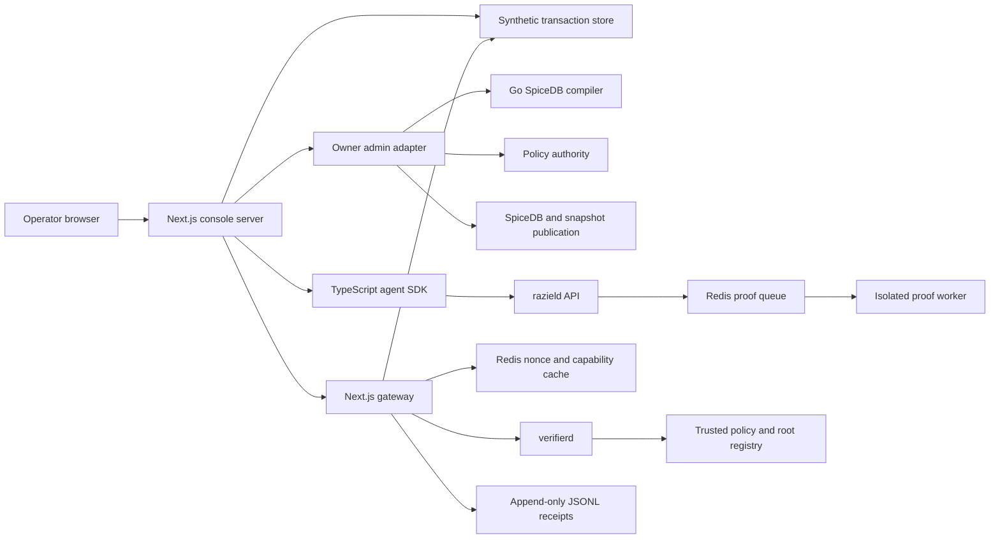

# M5 Implementation Plan And User Flows

- Status: Approved for implementation
- Date: 2026-08-26
- Milestone: M5
- Data classification: Synthetic development data only
- Proof-system changes: None
- Review gate: Approved by the maintainer on 2026-08-27 local time

## Outcome

M5 will produce one connected payment-reconciliation portal. An operator will create
and finalize synthetic transaction records, build a supported authorization policy,
publish relationships and a snapshot, request a real proof-backed capability, query
protected records, and inspect public receipts.

The portal will demonstrate several policy shapes through a bounded visual rule
builder. One selected policy will run through proof generation at a time. Each policy
change creates a new `policy_hash` and needs a fresh capability proof. It does not
rebuild the SP1 guest, circuit, verification key, or trusted setup.

M5 does not satisfy the real-data acceptance gate. M6 owns that gate.

## Product Roles

| Role | Responsibility |
| --- | --- |
| Operator | Creates synthetic data, drafts policy rules, approves operator actions, requests capabilities, and reviews receipts |
| Agent simulator | Holds one ephemeral Ed25519 key and uses the TypeScript SDK to request and exercise a capability |
| Policy authority | Reviews and signs compiled policy candidates through an owner-only boundary |
| Snapshot authority | Publishes signed relationship snapshots at an exact SpiceDB revision |
| Gateway | Enforces capability scope, request signatures, freshness, replay protection, and verification |
| `razield` | Builds the private witness, submits the proof job, and returns public capability state |
| `verifierd` | Resolves trusted records locally and verifies the proof without calling `razield` |

## Connected System



The browser sends operator-authored rule blocks to the console server. It never
receives canonical PolicyIR, authority keys, private snapshot records, witness data,
or a policy evaluator. The agent SDK receives only public capability fields.

The owner admin adapter is not a public policy API. It coordinates the existing Go
compiler and Rust administration commands from the owner network. `razield` remains
unable to approve its own policy.

## Visual Policy Builder

### Form model

The editor will use typed visual blocks. It will not accept free-form `.zed` text.
The first version exposes these controls:

| Control | Choices |
| --- | --- |
| Policy identity | Name and integer version |
| Protected target | Resource type, resource identifier, and `query` action |
| Grant source | Direct relation, team membership subject set, or one-hop delegation |
| Grant combination | Any selected grant or all selected grants |
| Caveat value type | String, integer, or Boolean |
| Caveat comparison | Equality, inequality, integer range comparison, Boolean `and`, `or`, and `not` |
| Claim input | Approved capability claims such as task, purpose, scope, resource, action, key thumbprint, or expiry |
| Request input | Named request context accepted by the selected rule template |
| Relationship input | Named stored context accepted by the selected rule template |

The interface will show rule blocks, nesting, typed values, and validation errors. It
will prevent unsupported combinations before submission. The server remains the
authoritative validator.

### Supported policy examples

The same form can create these distinct demo rules without proof-system changes:

| Example | Rule shape | Demo use |
| --- | --- | --- |
| Direct access | `viewer` | Grant one agent direct query access |
| Team access | `viewer_team->member` | Grant every current team member access |
| Alternative authority | `viewer + auditor` | Accept a direct viewer or an auditor |
| Dual control | `viewer & approver` | Require both viewing and approval relations |
| Scoped caveat | `viewer with task, purpose, scope, or amount checks` | Bind access to public claims and typed context |

The initial M5 demo will generate one fresh proof at a time. Other forms can still
compile, show validation, and reach the approval review step without claiming a live
capability.

### Fixed compiler profile

One owner-side compiler profile will hold the proof limits. These limits cover node
counts, path depth, witness count, Merkle depth, string size, context count, and total
private input size. Operators cannot change them in M5.

The form selects caveat inputs from a fixed catalog. Each input already carries its
provenance class: request context, relationship context, or capability claim. The
browser cannot relabel provenance.

### Activation workflow

1. The operator builds typed rule blocks.
2. The console server validates the draft shape.
3. The owner adapter renders a SpiceDB schema candidate and compiler configuration.
4. The Go compiler produces canonical PolicyIR and a `policy_hash` candidate.
5. The portal shows a public review summary, compiler status, version, and hash.
6. The operator submits an explicit approval action.
7. The separate policy authority signs and publishes the approved record.
8. The owner adapter writes the schema and submitted relationships to SpiceDB.
9. The snapshot authority publishes one signed snapshot at the exact ZedToken.
10. The portal marks the policy and snapshot ready for a capability request.

The browser does not receive canonical PolicyIR or read back the private relationship
graph. Relationship entry is write-only. The portal returns identifiers, counts,
hashes, revisions, and status.

This workflow introduces a client-visible policy drafting surface. Implementation
must open the repository security review trigger for client-visible policy artifacts.

## Feature Slices

M5 work will proceed as connected product slices. Each slice ends with visible
behavior and focused checks.

| Order | Slice | Product result | Main implementation |
| --- | --- | --- | --- |
| 1 | Agent and capability client | Create an agent session, submit a signed capability request, poll job state, and cancel a queued request | Complete `packages/sdk-ts`, generated Connect clients, and server-side agent orchestration |
| 2 | Policy and access setup | Build visual rules, compile a candidate, approve it through the owner boundary, write relationships, and publish a snapshot | Add the rule draft contract, compiler adapter, authority action, SpiceDB write path, and snapshot action |
| 3 | Synthetic reconciliation data | Create, edit, review, finalize, and query a bounded synthetic transaction dataset | Add the local transaction store, validation, immutable finalization record, checksum, schema fingerprint, and row count |
| 4 | Protected gateway | Accept signed requests, verify capabilities, reject replay, cache valid verification, filter scope, and write receipts | Complete gateway middleware, verifier client, Redis nonce logic, capability cache, protected routes, and JSONL writer |
| 5 | Operator console | Run the full workflow from one work-focused interface | Build the screen inventory below with loading, empty, success, denied, expired, replayed, and failed states |
| 6 | Live VM demonstration | Run the complete stack with real local Plonk proof generation | Add the M5 Compose profile, loopback bindings, VM runbook, SSH access, and one final walkthrough |

Tests will follow implemented behavior. M5 will not add broad queue-state work or a
new proof harness. Each slice gets narrow unit checks, one connected service check,
and security checks for its exposed boundary. The final gate adds one browser flow
and one real VM proof run.

## Screen Inventory

| Screen | Operator actions | Public output |
| --- | --- | --- |
| Workspace | Select the payment-reconciliation scenario and inspect service health | Scenario ID, synthetic label, service status, and active IDs |
| Dataset | Add, edit, remove, review, and finalize synthetic transaction rows | Rows, validation state, checksum, schema fingerprint, row count, and finalization time |
| Policy | Arrange visual rule blocks, validate, compile, review, and request approval | Draft summary, compiler status, policy record ID, version, `policy_hash`, and approval status |
| Access graph | Submit direct, team, delegation, and caveated relationships | Submission status, accepted count, snapshot ID, root, policy hash, epoch, and expiry |
| Agent and capability | Create an agent session, define task and purpose, request or cancel a capability | Agent thumbprint, request scope, job ID, state, expiry, proof size, and public proof timings |
| Reconciliation | Submit a signed protected query and repeat it through the cache | Authorized transaction rows, applied scope, verification result, and cache state |
| Denial lab | Change scope, signature, nonce, or expiry in bounded controls | Generic denied, replayed, expired, or unavailable result |
| Receipts | Filter and export public audit and benchmark records | Stable IDs, outcome, timestamps, cache result, public hashes, and resource metrics |

No screen shows canonical PolicyIR, private graph reads, caveat values, satisfying
paths, Merkle openings, salts, witness traces, authority private keys, or raw proofs
with private debug data.

## User Flows

### UF-01 Create Synthetic Transactions

1. Open the Dataset screen.
2. Add bounded payment, invoice, merchant, amount, currency, and status fields.
3. Fix field-level validation errors.
4. Save the editable draft.

### UF-02 Finalize A Synthetic Dataset

1. Review the draft and its `SYNTHETIC` source label.
2. Select Finalize.
3. Record an immutable checksum, schema fingerprint, row count, and timestamp.
4. Clone the revision to make later edits.

### UF-03 Build A Policy Candidate

1. Open the Policy screen.
2. Choose direct, team, delegated, alternative, or dual-control grants.
3. Combine the rule blocks with Any or All.
4. Add optional typed caveat blocks.
5. Submit the candidate for server validation and compilation.

### UF-04 Review And Activate A Policy

1. Review the normalized rule summary, compiler status, version, and candidate hash.
2. Submit the explicit approval action.
3. Wait for the policy authority to sign and publish the record.
4. Confirm the active policy record ID and `policy_hash`.

### UF-05 Publish Relationships And Snapshot

1. Enter direct grants, team membership, delegation, or caveated relationships.
2. Submit them through the owner adapter.
3. Publish a snapshot at the returned ZedToken.
4. Confirm the snapshot ID, relationship root, policy binding, and expiry.

### UF-06 Request A Capability

1. Create an ephemeral agent session.
2. Enter the task, purpose, action, resource scope, and requested expiry.
3. Sign the exact request commitment through the TypeScript SDK.
4. Submit it and receive the stable proof-job ID.

### UF-07 Monitor A Real Proof

1. Watch queued and proving states without blocking one HTTP request.
2. Inspect periodic elapsed-time updates.
3. Receive succeeded, failed, canceled, or unavailable state.
4. On success, inspect public capability claims and proof metrics.

### UF-08 Run The First Protected Query

1. Select a finalized dataset and an authorized query scope.
2. Sign the protected request with a fresh nonce.
3. Let the gateway call `verifierd` and validate the scope.
4. View the matching transaction rows and public verification receipt.

### UF-09 Reuse A Verified Capability

1. Submit another in-scope query with a fresh nonce.
2. Reuse the same unexpired capability.
3. Observe a valid cache hit and a new protected-request receipt.

### UF-10 Demonstrate Scope Denial

1. Select a resource or action outside the capability scope.
2. Submit a correctly signed request.
3. Receive a generic denial with no policy-path explanation.
4. Inspect the access-controlled public failure category in Receipts.

### UF-11 Demonstrate Replay Rejection

1. Submit one valid protected request.
2. Resubmit the exact signed envelope and nonce.
3. Receive the replay result.
4. Confirm that no protected data was returned.

### UF-12 Inspect And Export Receipts

1. Filter by task, capability, proof job, policy, snapshot, or request ID.
2. Inspect verification, query, denial, replay, and cache events.
3. Export the public JSONL records and benchmark summary.

### UF-13 Use Local Recorded Mode

1. Run the console and gateway on a smaller development machine.
2. Load a checked-in public M4 result and recorded job timeline.
3. Build datasets and policy drafts against local development services.
4. Show proof history, validation, and denied states.
5. Keep protected success disabled and labeled `RECORDED`.

### UF-14 Run The Live VM Demo

1. Start the full M5 Compose profile on the NUS VM.
2. Connect from the Mac with SSH local port forwarding.
3. Open the console through the forwarded loopback port.
4. Run one selected policy from draft to a fresh Plonk capability.
5. Complete first-use, cached-use, scope-denial, replay, and receipt flows.

## Local And VM Modes

### Local development

The Mac will run the UI against recorded public proof state or a remote VM service
endpoint reached through SSH. Recorded mode cannot mint a capability, report live
proof success, or unlock protected records. It exists for fast UI work and public
state rendering.

### NUS VM

The VM will run SpiceDB, Redis, the console, gateway, `razield`, proof worker,
`verifierd`, verifier worker, and owner administration components through Docker
Compose. Service ports will bind to VM loopback.

The Mac will use local forwarding:

```bash
ssh -N \
  -L 3000:127.0.0.1:3000 \
  sadm@gapaul-vm-i
```

Only the console port crosses the tunnel. The console reaches the gateway and owner
services over private Compose networks.

The proof worker retains the approved 60 GiB memory limit, no swap, no network during
execution, and the approved eight-CPU profile. The UI tunnel will not expose private
proof channels, witness files, or owner authority keys.

## State And Retention

| State | M5 owner |
| --- | --- |
| Editable and finalized synthetic transactions | Bounded local transaction store |
| Policy draft | Console server until compile or discard |
| Approved policy and key records | Owner registry publication path |
| Private relationships and snapshot records | SpiceDB and owner-only snapshot storage |
| Proof queue and cancellation state | BullMQ on Redis |
| Capability verification cache and request nonces | Gateway-owned Redis keys |
| Public audit records | Append-only JSONL files |
| Agent private key | Ephemeral server-side agent session storage |

The implementation plan does not select a new database package. The first slice that
needs transaction persistence will present the exact pinned dependency and fallback
for approval.

## Dependency Gates

M5 will request approval only for missing packages that the selected implementation
needs. Likely gates include a generated Connect transport, a Redis client for the
gateway, an icon set for the visual builder, and a bounded transaction-store driver.
Each request will state the exact pin, install command, purpose, and no-install
fallback.

## M5 Completion Gates

M5 is complete after all of these claims pass:

- The portal creates and finalizes a labeled synthetic transaction dataset.
- The visual builder produces at least four accepted policy shapes from the current
  compiler subset and rejects unsupported combinations.
- An owner can compile, review, approve, register, and activate one selected policy.
- The portal publishes relationships and one signed snapshot without graph readback.
- The TypeScript SDK signs capability and protected-request commitments.
- A real local Plonk proof reaches the portal through the asynchronous job path.
- The gateway returns an in-scope protected query after independent verification.
- A second query records a valid cache hit with a fresh nonce.
- Out-of-scope, replayed, expired, altered, and unsigned requests fail closed.
- Public JSONL receipts link policy, snapshot, job, capability, and request IDs.
- Recorded mode stays labeled and cannot unlock protected data.
- The browser walkthrough passes on the Mac through an SSH tunnel to the VM.

## Review Decisions

The maintainer should review these choices before implementation:

1. Use typed visual rule blocks backed by the existing compiler subset.
2. Keep one shared proof-limit profile and lock caveat provenance labels.
3. Let the portal stage and request approval, but keep signing keys in a separate
   owner-only authority component.
4. Make relationship submission write-only and return public status, counts, and
   commitments.
5. Generate one fresh proof at a time during the recorded presentation.
6. Keep local recorded mode unable to unlock protected data.
7. Select the transaction-store dependency only at its implementation gate.

Approval of this plan opens the first M5 implementation baton. It does not approve a
new package, public proof field, proof semantic, or client-visible PolicyIR.
