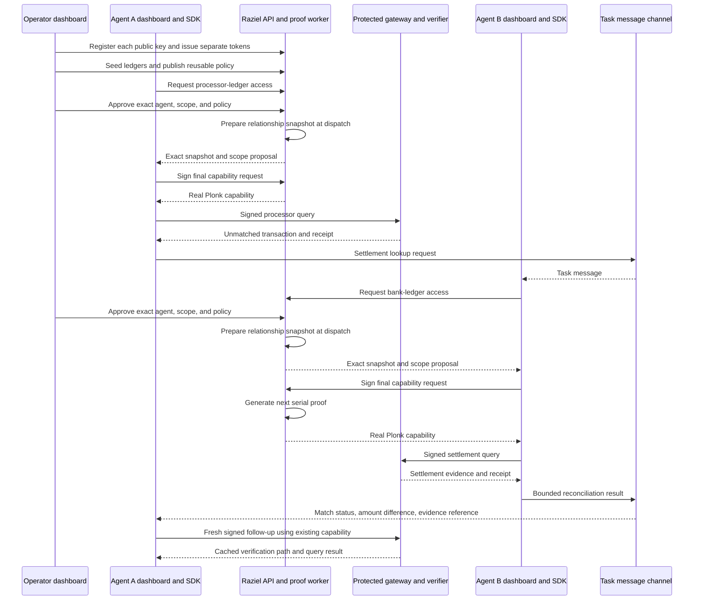

# M6-M7 Agent Reconciliation Demo Plan

Status: scope agreed, implementation pending

Date: 2026-09-25

Decision: [ADR-0019](../decisions/0019-public-sdk-and-two-agent-reconciliation.md)

B-0063 has drafted [Agent API v1](AGENT-API-V1.md) and
[ADR-0020](../decisions/0020-agent-api-and-request-provisioning.md). The new request
signature and policy-version provisioning decisions await approval. This does not
change the accepted product scope in ADR-0019.

## Outcome

Three desktop dashboards show an operator and two external agents completing payment
reconciliation. Each agent consumes the public Raziel SDK, obtains its own proof
capability, and reuses it for protected queries. The demo uses stored synthetic rows,
real local Plonk proofs, and a configurable OpenAI-compatible LLM API.

M0-M5 stay complete. M6 becomes external agent access and SDK delivery. M7 becomes the
three-dashboard reconciliation demonstration. Real-data acceptance and a second
domain scenario move to the deferred backlog. No claim of real-data validation is made.

## Current Gaps

- `packages/sdk-ts` is a private signing-helper package with a private workspace
  dependency. It lacks an external transport client and persistent caller integration.
- The current portal holds agent sessions inside the operator workflow.
- The capability API starts from an already-selected snapshot. It has no access-intent
  inbox or operator approval lifecycle.
- M5 admits one distinct nonterminal proof job and reports busy for another request.
- Policy candidate cleanup and shared SpiceDB schema writes assume one selected
  policy flow. Reusable policy packages need durable owner storage and version binding.
- There is no external-agent token registry, agent dashboard, or message channel.

## Repository Ownership

| Repository | Deliverables |
| --- | --- |
| `hypha-backend` | Protobuf contracts, agent API, registration, review inbox, policy/snapshot orchestration, protected ledger queries, operator UI, deployment integration |
| `raziel-sdk-ts` | `@gitaalekhyapaul/raziel-sdk-ts`, signer contract, typed client, polling, retries, capability reuse, package examples and release metadata |
| `raziel-demo-agents` | Two agent applications and dashboards, persistent keys, bounded LLM tools, shared task channel, agent Compose services |

Backend contracts and canonical vectors are the source of truth. Generated protocol
code ships inside the public SDK or through public pinned dependencies. No consumer
may need `workspace:*` packages from a private checkout. Agent A and B pin the same
released SDK version and keep separate state, keys, tokens, and server processes.

One coordinating baton lives in the backend. Each active repository records its local
objective and exact backend/SDK compatibility versions. Parallel edits use disjoint
file ownership. Dependencies and protocol decisions are grouped per feature. Routine
implementation choices do not require repeated product approval.

## Demonstration



Agent B must sign its own final request in the same way as Agent A. Two requests may
be approved at once. The dispatcher runs their proof work sequentially. The demo
recording can cut the waiting time without replacing the proofs with playback.

## User Flows

| ID | Dashboard | User action and visible result |
| --- | --- | --- |
| AF-01 | A and B | Initialize each persistent identity and copy its public key |
| AF-02 | Operator | Register each public key and create a one-time visible API token |
| AF-03 | Operator | Seed, create, edit, and finalize processor and bank ledger revisions |
| AF-04 | Operator | Build and publish policy versions independently of requests or proofs |
| AF-05 | A | Start a reconciliation task and submit a signed access intent |
| AF-06 | Operator | Review identity, task, dataset, and scope, then approve or reject |
| AF-07 | All | Observe waiting, snapshot preparation, signing, proof progress, and result |
| AF-08 | A and B | Receive and inspect only the caller's own capability and public claims |
| AF-09 | A | Query processor data and send an unmatched transaction reference to B |
| AF-10 | B | Read the task message, request its own access, and query bank settlements |
| AF-11 | B then A | Send bounded evidence and display the reconciliation conclusion |
| AF-12 | A and B | Repeat scoped queries using fresh signatures and the same capability |
| AF-13 | All | Show rejected access, wrong-key/scope denial, canceled work, and expiry |
| AF-14 | Operator | Inspect request, job, query, and message references in safe audit views |
| AF-15 | A and B | Restart or reconnect with the same identity and recover request status |

Prioritize complete desktop flows. One shared component library can serve the two
agent dashboards, but each application uses its own authenticated server and storage.
The operator portal never receives agent private keys or signs for an external agent.

## Domain And Policy Mapping

- Scenario: `payment-reconciliation`, two-ledger extension of the existing domain.
- Data: generated sample records and operator-created rows, labeled `SYNTHETIC`.
- Provenance: generator/version or operator origin, revision, checksum, schema, count.
- Principals: distinct key-derived Agent A and Agent B subjects.
- Resources: finalized processor and bank dataset revisions using existing scope rules.
- Action: `query`. Purpose: `reconciliation`. Each agent request retains its exact task.
- Permission: the existing dataset query permission, compiled through SpiceDB and
  PolicyIR. Prefer one reusable supported schema across the initial two-ledger seed.
- Relationships: operator-authorized direct or team grants to the registered keys.
- Caveats: existing supported task, purpose, scope, amount, and time parameters only.
- Outputs: bounded query rows to the authorized agent and a small business reply
  between task participants. No new guest node, leaf format, or public proof value.

Seed an exact match, a missing settlement, and an ambiguous settlement. Use integer
minor units and currency checks for amount calculations. Read results from finalized
stored rows. Do not hard-code the expected answer into the gateway or LLM response.
The operator can add records that change the reconciliation outcome.

## Agent And Message Design

Use `LLM_BASE_URL`, `LLM_MODEL`, and a server-side `LLM_API_KEY` secret. Treat the API
as OpenAI-compatible per maintainer direction. A small tool loop supports starting a
task, requesting access, checking status, querying authorized data, reading messages,
and posting a bounded result. The dashboard can pause and resume task execution.

Application code owns state transitions and validates every tool argument. Do not
send keys, tokens, capability proof bytes, PolicyIR, or private graph data to the model.
Authorized synthetic query results can enter its context. Exact matching and amount
arithmetic use ordinary code. Model summaries remain labeled task output, not proof
evidence. Provider failure preserves the current task and allows an explicit retry.

The message channel belongs to the demo applications. It authenticates each sender
and limits reads/writes to assigned task participants. It grants no dataset access.
Each data query still uses the SDK and gateway. Message storage contains bounded
business payloads and references, never a transferable capability or raw bank export.

Example reply for presentation, not a frozen protocol schema:

```json
{
  "status": "matched",
  "transactionReference": "processor-1042",
  "settlementReference": "bank-2091",
  "currency": "SGD",
  "settlementAmountMinor": 12500,
  "amountDifferenceMinor": 0,
  "evidenceReceiptId": "receipt-example"
}
```

The dashboard can render: "Bank settlement found. SGD 125.00. Difference SGD 0.00."
The displayed amount comes from the permitted result fields, not model arithmetic.
Use explicit `not_found` and `ambiguous` outcomes. A receipt supports traceability of
the authorized query. It does not cryptographically attest that the match is correct.

## Request And Policy Lifecycle

Keep an access request separate from the existing proof-job state machine:

```text
requested -> pending_review -> approved_waiting -> preparing
          -> awaiting_agent_signature -> submitted -> proving -> ready
pending_review -> rejected
nonterminal -> canceled, expired, or failed as applicable
```

Names above are planning labels. The proposed [API contract](AGENT-API-V1.md) specifies
wire states, transitions, and error types, including an explicit offline-agent state.
One stable intent ID deduplicates client retries. One persisted signed issuance
attempt maps to the existing deterministic proof job ID. A transport timeout triggers
status reconciliation. It does not create a new intent, nonce, or proof automatically.

Publishing a policy writes a new approved immutable version independently. Retain
the approved policy package needed for later requests. An approval selects one exact
version. At dispatch, provision the grant, capture the exact SpiceDB revision, build
the snapshot, and get the agent's final capability signature. Recheck validity before
admission. Let another ready request proceed if its predecessor's agent is offline.

Use existing BullMQ/Redis for durable coordination. Do not build a replacement queue.
Retain single proof concurrency and current memory limits. Specify bounded signature
waiting, queue capacity, cancellation, and retention in B-0063. Do not widen proof TTLs
to compensate for an unbounded waiting queue.

A policy publish cannot swap an admitted job's policy, delete its snapshot, or imply
revocation. The proposed migration uses durable per-version source packages and a
cumulative namespaced SpiceDB schema. It retains the existing registry epoch semantics
through version-specific signed policy names. The new workflow must keep per-policy
provisioning correct without a proof-long lock. This is a backend feature, not only
a UI change. ADR-0020 records its trust checks and approval gate.

## Feature Order

| Baton | Deliverable | Repositories | Completion evidence |
| --- | --- | --- | --- |
| B-0063 | Concrete agent-auth and access-request contracts, policy provisioning migration, dependency inventory | Backend, sibling setup | Reviewable wire fields, state transitions, signature binding, compatibility and versioning plan |
| B-0064 | Agent registration, Create Agent Token, signed caller authentication, SDK signer/transport foundation | Backend + SDK | Two registered identities access only their own API records through a packaged client |
| B-0065 | Operator inbox, approve/reject, independent policy publication, request-triggered snapshots | Backend + SDK | Dashboard request reaches a pinned policy/snapshot proposal without holding publication through a proof |
| B-0066 | Durable serial dispatch, final agent signatures, polling/cancel/reuse SDK and public release | Backend + SDK | Two waiting requests dispatch one at a time, retries deduplicate, external install completes protected query flow |
| B-0067 | Seeded ledgers, editable domain records, both agent dashboards, LLM tools and messages | Backend + agents | All three dashboards complete reconciliation with stored data and packaged SDK tools |
| B-0068 | VM integration, both live proofs, fresh/cached queries, screenshots and demo runbook | All three | Documented three-dashboard recording flow with real proof evidence and controlled denials |

B-0064 through B-0066 close M6. B-0067 and B-0068 close M7. Build shared visual
components against agreed contracts in parallel with backend work once B-0063 settles
those contracts. Do not spend a separate milestone building test infrastructure.

## Deployment And Validation

The NUS VM runs the owner services, data gateway, proof worker, and demo application
containers. Preserve the approved proof memory and CPU profile. Run the LLM on the
Mac or SoC endpoint by configuration so it does not compete for proof memory.
The runbook must state each dashboard port, API base URL, origin setting, and tunnel
mapping after they exist. Support the VM-to-Mac demonstration arrangement and optional
external HTTPS publishing. Do not bake one hostname into protocol identity.

Agent containers use their own key/state volumes and API tokens. They have no owner
registry, SpiceDB, witness, authority-key, or backend database mounts. Agent dashboards
talk to their own servers, which use the SDK. The operator stays separately authenticated.

Local work can use controlled test doubles at the proof execution boundary to exercise
UI states. These runs are labeled simulated and cannot authorize real protected data.
Existing retained public-proof tests cover verifier wiring. The VM completes the new
two-agent live-proof gate. Request Docker or an SSH control master from the maintainer
only if a required check lacks it. Remote pulls may need the maintainer's PAT unlock.

Focused acceptance cases: registration/key mismatch, token revocation, caller record
isolation, approval binding, publication during a proof, expiry before dispatch,
duplicate submission, canceled/offline requests, package install, restart persistence,
both live capabilities, fresh versus cached queries, wrong scope/key, replay, and
bounded message output. Reuse existing suites and vectors. Broaden tests only for
changed behavior or an observed fault.

Keep proof, gateway, and task-completion metrics distinct. Show per-capability proving
cost and first versus cached query latency. Record image tags, commits, SDK version,
synthetic data revision, and redacted public receipts in the final evidence bundle.

## Remaining Inputs And Risks

- No further product clarification is needed for this plan.
- This task needs sibling filesystem write access before cross-repository edits.
- Live inference needs a configured endpoint, model, and secret at deployment time.
- Public npm release needs package ownership, authentication, and license metadata.
- ADR-0020 proposes compatible shared-schema provisioning and exact agent-request
  signatures. Approval and runtime validation remain pending. Neither proposal changes
  the existing SP1 authorization statement.
- LLM behavior is variable. Dashboard controls and bounded tools must make the demo
  resumable without claiming deterministic model reasoning.
- Authorization proof does not establish transaction truth, reconciliation accuracy,
  downstream information-flow control, or real-data acceptance.

## Exact Next Action

Review ADR-0020's two security decisions, then implement B-0064 registration, signed
authentication, and the standalone SDK foundation. No repository or package is
published by the contract task.
